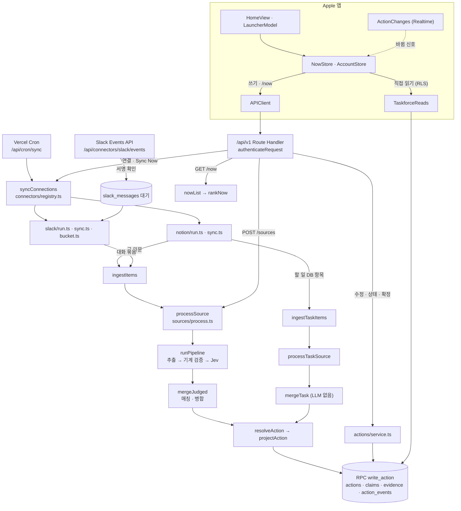

# 피처맵: 기능 → 코드

관련 문서: [PRD](PRD.md) · [아키텍처](ARCHITECTURE.md) · [진실 판정](TRUTH_RULES.md) · [연동](INTEGRATIONS.md) · [Slack 연동](go-live/slack-integration.md) · [플랫폼](PLATFORMS.md) · [go live](GO_LIVE.md) · [Apple 앱](../apple/README.md)

기능마다 실제 코드 위치, 거쳐야 하는 정식 구현, 호출자, 테스트를 적는다. 왜 그렇게 만들었는지는 위 문서에 있고, 이 문서는 **어디에 있고 무엇을 거쳐야 하는지**만 다룬다.

- 마지막 확인: 2026-09-29, `main`(`c11ee26`)에 이 문서의 PR들(#12 · #14 · #16 · #17 · 결함 정리)을 더한 코드.
- 확인 범위: 서버(`src/` · `scripts/` · `supabase/` · `tests/`)와 Apple 앱(`apple/`)을 진입점 → 핵심 구현 → 저장까지 코드로 따라갔다. 적은 파일과 심볼은 모두 실제로 있다. 테스트는 이름만 적었고 이번에 돌리지 않았다.
- 줄 번호는 적지 않는다(금방 낡는다). 파일과 심볼 이름으로 찾는다.
- 줄임: `v1/` = `src/app/api/v1/`, `lib/` = `src/lib/`, `App/` = `apple/Taskforce/`, `Kit/` = `apple/Packages/TaskforceKit/Sources/TaskforceKit/`.

## 1. 한눈에 보는 흐름

## 2. 우회하면 안 되는 경로 (SSOT)

새 코드는 아래 정식 구현을 거친다. 같은 책임을 두 번째로 만들지 않는다.

| 책임 | 정식 구현 | 지킬 것 |
|---|---|---|
| API 인증 | `lib/api/auth.ts` `authenticateRequest` (Bearer 또는 쿠키, 쿠키 쓰기는 `lib/api/csrf.ts` `isCrossSiteWrite` 확인) | `/api/v1`은 모두 이것을 쓴다. `lib/auth.ts` `requireUser`는 화면(`src/app/page.tsx` · `lab` · `admin/metrics`) 전용이다 (쿠키만, `/login`으로 보냄) |
| Slack 요청 확인 | `lib/connectors/slack/verify.ts` `verifySlackSignature` + `lib/env.ts` `slackSigningSecret` | Slack events route는 로그인 없이 이 서명만 믿는다 |
| 요청 · 응답 모양 | `lib/api/contract.ts` (zod) | Swift `Kit/Models.swift` · `AccountModels.swift` · `Connections.swift`가 이 파일을 따른다 |
| AI 호출 | `lib/ai/llm.ts` `completeJson` · `lib/ai/jev.ts` `decide` · `lib/ai/embed.ts` `embed`, 공급자 고정 `lib/ai/providers.ts` `providerRouting` | OpenRouter 주소는 이 세 파일에만 있다. LLM은 형식이 깨지거나 한도를 넘기면 한 번 다시 묻고, 출력 한도(`finish_reason: length`) · 90초를 넘긴 호출을 다시 물을 때만 추론량을 제한한다(`OVERRUN_RETRY_REASONING`). 사용자가 기다리는 빠진 할 일 신고 · 물어보기는 마감(`lib/ai/deadline.ts` `interactiveDeadline`: 요청 시작 + 실행 한도 60초(`INTERACTIVE_MAX_DURATION_S`, route의 `maxDuration`과 같은지 route 테스트가 본다) − 8초)을 준다: LLM은 첫 호출부터 추론량을 제한하고(그래도 한도를 넘기면 `low`로 다시 묻는다, 추론 옵션을 받는 공급자가 없다는 404면 한 번 옵션 없이 다시 묻는다) 시도마다 남은 시간으로 시간 한도를 정하며(`attemptTimeoutMs`, 5초가 안 남으면 다시 묻지 않는다), Jev(첫 요청은 남은 시간의 절반 · 10초 중 짧은 쪽, `jevTimeoutMs`) · 임베딩도 마감을 넘기지 않고 1초가 안 남으면 부르지 않는다. 마감 안에 끝내지 못하면 `DeadlineExceededError` → 500과 로그 한 줄 `deadline_exceeded`(route · 단계 · 걸린 시간, `logDeadlineExceeded`. 단계는 `llm` · `jev` · `embed`(응답 본문을 읽다 넘긴 것 포함) · `lock`(같은 사용자의 앞선 병합을 기다림) · `merge`(기다리지 않았는데 앞 단계가 시간을 다 씀)). 모델을 부르기 전 동의 확인은 원문 처리 · 빠진 할 일 · 물어보기가 `lib/consent/gate.ts` `withConsentGate`, 직접 추가의 임베딩은 `handleCreateAction`이 한 번 확인한다 |
| 원문 → 후보 | `lib/pipeline/run.ts` `runPipeline` (추출 → 기계 검증 → Jev) | API · eval · 재처리 스크립트가 같은 함수를 쓴다 |
| 메일에 인용된 옛 메일 | `lib/pipeline/text.ts` `quotedHistoryStart` → `lib/pipeline/verify.ts` `verifyCandidates` (`kind: "email"` + `fromConnector: true`) | 인용이 이 위치 뒤에만 있는 **연결로 가져온** 메일 후보는 버린다(`QUOTED_HISTORY`). 인용 구간을 찾는 곳을 새로 만들지 않는다: 기계 검증 · eval · 이후 Gmail 어댑터가 모두 이 함수 하나를 쓴다. 출처 표시 `ExtractInput.fromConnector`는 연결이 넘기고(`lib/connectors/store.ts` `ingestDeps.process`), 재처리 스크립트는 `sources.external_id` 유무로 정한다. 직접 넣은 원문(`v1/sources` · 런처)과 사용자가 고른 구절(누락 신고)에는 표시가 없어 쓰지 않는다. 골든셋은 `sources[].from_connector`로 같은 길을 탄다. 버린 후보는 처리 요약 `droppedByReason`과 `judge_logs`(`jev_answers.dropped`, `process.ts`)에 이유만 남고, 누락 신고 `classifyMiss`가 `quoted_history` 단계로 가른다(앱 응답은 `not_extracted`, 이벤트 · 지표에는 그대로) |
| 원문 속 화자 · 언급 | `lib/pipeline/identity.ts` `quoteSpeaker` · `speakerRole` · `addressedToUser` | 인용 줄 이름표를 확실히 읽고 역할을 가를 수 있으면 화자 역할은 코드가 정한다 (제품 원칙 5). 아니면 Jev 답을 쓴다. 새 연동은 원문을 머리줄 `[…]` + `이름: 글` 형식으로 만든다 (`evals/golden/README.md` "Slack 케이스") |
| 원문 처리 (DB) | `lib/sources/process.ts` `processSource` · `processTaskSource` · `reportMissing` | 연동 · API · 스크립트 모두 여기로 들어온다. 판정 기록(`judge_logs`)은 처리할 때마다 `replaceJudgeLogs`로 바꾼다(쌓지 않는다). 실패했거나 처리 중에 멈춘 글 원문은 `lib/sources/retry.ts`가 다시 처리한다 (첫 처리를 포함해 3번까지, 시도 번호 · 시각은 `processing_summary`). 하루가 지나서도 멈춘 원문은 다시 처리하지 않고 실패로 닫는다 (`processing_summary.closed: "expired"`). 실패하면 까닭 코드를 `sources.processing_error_code`에 남기고(`sourceFailureCode`: AI 402 · 403 `ai_quota`, 시간 초과 `ai_timeout`, 응답 형식 `ai_output`, 동의 철회 `consent`, 창 지남 `expired`, 그 밖 `internal`), 더 다시 하지 않기로 닫으면 지표 이벤트 `source_failed`(+ 연결의 `provider`, `recordSourceFailed`)를 한 줄 남긴다 (20261020000000). cron이 다시 처리할 때는 이 원문에서 이미 근거로 쓰인 구절과 겹치는 후보를 빼고 병합한다 (`lib/pipeline/missing.ts` `unappliedCandidates`, 뺀 수는 `merge.already_applied`). 병합 단계(임베딩 채우기 + 매칭 · 병합)만 사용자마다 `withUserLock`으로 한 번에 하나씩 돈다 (한 서버 인스턴스 안에서만 보장). 추출 · 판정은 잠금 밖이다. 사용자가 기다리는 누락 신고는 앞선 병합을 마감 전 5초(`MERGE_MIN_MS`)까지만 기다리고(넘기거나 차례가 와도 그만큼 남지 않았으면 병합하지 않고 `DeadlineExceededError`), 임베딩 채우기를 하지 않는다 |
| Action 필드 값 | `lib/pipeline/resolve.ts` `resolveAction` → `lib/actions/project.ts` `projectAction` | 필드 값은 이 둘로만 계산한다 (제품 원칙 5). 예외는 임베딩만 쓰는 `lib/actions/db-store.ts` `saveEmbedding` |
| Action 쓰기 | `lib/actions/service.ts` → `lib/actions/db-store.ts` `writeAction` · `writeProgress` → RPC `write_action` · `set_action_progress` · `start_action`; 사용자 메모는 `saveActionNotes` → `save_action_notes` | 앱 역할의 직접 쓰기는 DB가 막는다 (`20260929000000_actions_server_writes.sql`). `v1/actions/[id]/**`는 `lib/api/action-routes.ts` `actionWriteRoute`를 거친다. 메모는 별도 revision으로 비교 저장하고 `user_notes_updated` 이벤트에는 revision만 남긴다. Claim · 근거 · 판정 필드는 바꾸지 않는다. 예외: Slack 연결 끊기 · 앱 제거는 SQL `purge_slack_sources`가 인용을 자리 표시로 바꾸고 Claim의 글자(`quote` · `value_text` · `speaker`)만 비운다. 판정 칸은 남아 필드 값은 그대로다 |
| 이슈 번호 `#139` (0.2.0 OA D4c-3a, 서버 저장만) | DB 트리거 `actions_assign_number`(`20261120000000_action_numbers.sql`)가 insert 때 `actions.number`를 사용자별 카운터 `action_counters`에서 준다 (코드 경로 없음) | 번호는 DB만 정한다: 들어온 값은 무시하고, 한 번 받으면 바뀌지 않고(`actions_number_immutable`), 삭제 · dropped 뒤에도 다시 쓰지 않는다. `action_counters`는 앱 권한 0(`context_version_bumps`와 같은 처리). 앱은 RLS로 `actions.number`를 읽는다. v1 응답 스키마는 동결이라 `number`가 없다. 새 쓰기 경로 · 측정 이벤트 없음. 시험 `tests/db/action-numbers.*`, `tests/pg/action-numbers.test.ts` |
| 지운 원문 · 인용 | `lib/retention.ts` `purgedSourceMessage` · `SLACK_DISCONNECTED_QUOTE` | 같은 자리 표시 글자가 SQL `purge_slack_sources` · 대화 답 인용 가드 `conversation_messages_citation_guard`(B2, `20261106000000`)와 Swift `Kit/EvidenceDigest.swift` `RemovedQuote`에도 있어 모두 같아야 한다(대화 쪽은 `tests/db/conversations-v2.scenarios.ts`가 이 상수와 견준다). 인용을 모델 · 클립보드로 보내는 곳은 자리 표시를 뺀다 (`handoffAction` · `retrieveAskContext` · 매칭의 `SupabaseActionStore` `shortlist` · `unembedded`) |
| 지금 할 일 순서 | `lib/actions/rank.ts` `rankNow` (`GET /api/v1/now`) | 앱은 받은 순서를 그대로 보여 준다 |
| 속도 제한 | `lib/api/rate-limit-store.ts` `takeRateLimit` → RPC `take_rate_limit`. 한도 값은 `lib/api/rate-limit.ts` | 직접 추가 10분 30번 · 물어보기 20번 · 빠진 할 일 10번 · 연결 시작 10번 |
| cron 요청 확인 | `lib/api/cron.ts` `cronAuthorized` · `cronUnauthorized` | `/api/cron/*`는 모두 이것으로 `Authorization: Bearer $CRON_SECRET`만 받는다 |
| 연동 틀 · 동기화 | `lib/connectors/registry.ts` `syncConnections` · `connectorFor` · `tokenRevokerFor` · `revokeConnectorTokens` | cron · Sync Now · 첫 동기화가 모두 `syncConnections`를 쓴다. 연동은 `CONNECTORS`에 등록한다. 새 연결(앱 시작 · 완료)은 `connectorFor`가 연다 (Slack은 `SLACK_CONNECT_ENABLED`, Gmail은 `GMAIL_CONNECT_ENABLED`, Google은 `GOOGLE_CONNECT_ENABLED`, 웹은 `webConnector`). 동기화 · 토큰 폐기는 열지 않은 연동도 이미 있는 연결이면 한다 (#15). 동기화 결과는 `lib/connectors/store.ts` `recordSync`로 남긴다: 권한이 끊기면 `revoked`, 갱신 토큰이 만료 · 거절되면 `reauth` (둘 다 다시 연결할 때까지 동기화하지 않는다). 잠금을 잡은 시각(`claimedAt`)을 넘겨, 동기화 도중 다시 연결한 연결은 덮지 않는다. `recordSync`는 이 호출이 연결을 `reauth`로 **바꿨는지**(이미 `reauth`였거나 · 끊겼거나(`revoked`) · 그 사이 다시 연결했으면 false)를 돌려주고, 바꿨으면 지표 이벤트 `connection_reauth`(+ `provider`)를 남긴다(알림과 상관없이 만료를 센다). 커넥터는 true일 때만 `lib/notify/service.ts` `notifyReconnect`로 재연결 알림을 한 번 보낸다 (Notion · Gmail · Google). `reauth`가 아닌 기록이 `reauth` 연결을 덮지 않는 것은 `syncable_connections`가 `reauth`를 고르지 않고 동기화가 겹치지 않아서다 (`recordSync` 주석) |
| 연결 끊기 | `lib/api/connections.ts` `handleConnectionDelete` → RPC `disconnect_connection` | 앱 역할은 `connections`를 지울 수 없다 (`20261014000000_connections_server_delete.sql`). 서비스 쪽 토큰 폐기 → (Slack이면) 글자 지우기 → 행 삭제 순서다. 글자 지우기는 행을 지우기 전에 한다 (지우면 `sources.connection_id`가 null이 된다) |
| 연결 설정 쓰기 | `lib/connectors/store.ts` `mergeConnectionSettings` → RPC `merge_connection_settings` · `addConnectionStats` → RPC `add_connection_stats` (`20261017000000_connection_settings_atomic.sql`) | `connections.settings`를 읽어 통째로 다시 쓰지 않는다: 바꿀 키(`set` · `remove`)나 바꿀 Notion DB의 설정(`dataSources`)만 넘기면 DB가 지금 값에 합친다. 동기화 통계(`settings.stats`)는 `addConnectionStats`로만 더한다(연결 행을 잠근 채 더해 동시에 센 개수가 모두 남는다) |
| OAuth state · 토큰 | `lib/connectors/oauth-state.ts` (HMAC, 10분) · `lib/connectors/crypto.ts` (AES-256-GCM) | 토큰은 `connection_secrets`에 암호화해서만 저장한다. 웹(lab) 시작은 provider마다 쿠키 state(`oauthCookie`), callback은 provider별 route가 `handleOAuthCallback` 하나를 부른다 |
| 코디네이터 1 (0.2.0 C2, gate `COORDINATOR_ENABLED`) | 적재: DB 트리거(`20261110000000_coordinator_core.sql`)가 원문 처리 done · 사용자 메시지 · 사용자 결정 · 범위 version 상승을 같은 트랜잭션에서 `inbox_events`에 쌓는다(`lib/coordinator/inbox.ts`는 키 규칙 · 어댑터). 처리: `lib/coordinator/coordinate.ts` `runCoordinator` → `store.ts`(RPC `coordinator_claim` · `finish` · `fail` · `reserve_*`) · `reads.ts`(user_id로 좁힌 읽기) · `impact.ts` · `routing.ts` · `judgments.ts`. 결정 대기: `pending.ts` | 사건은 **`processSource` 등 기존 쓰기 경로 밖**(트리거)에서만 만든다: 실패한 처리는 사건이 아니고, 적재 실패는 성공 쓰기를 깨지 않는다. 사건 큐를 TS에서 직접 고치지 않는다(RPC만, `processed_at`은 처리 RPC로만). 모델은 포트 주입 + DB 선예약(사건당 관리 모델 ≤ 1)이고 운영 배선은 포트가 없다. 코디네이터는 정책 · 승인 · 도구를 가져오지 않고 Action · Claim · run을 쓰지 않는다 ([coordinator.md](coordinator.md)) |
| 앱의 쓰기 · 읽기 | `Kit/APIClient.swift` (모든 쓰기) · `Kit/TaskforceReads.swift` (직접 읽기) | 앱 코드의 `supabase.from(...)`은 `TaskforceReads`에만 있고 읽기뿐이다 |
| 실행 (U2) | `lib/execution/executor.ts` `advance`(함수 호출 한 번 = 단계 하나) → RPC `prepare_step` · `begin_call` · `complete_internal_step` (`lib/execution/store.ts`, 교착이면 다시 부름 `deadlock.ts`) | route · 자기 호출 · sweep 모두 `advance`를 지나고, 부르기 전 판단(스위치 · 허용 목록 · 크레딧)은 `begin_call` 하나가 한다. 외부 단계는 부르지 않는다 ([EXECUTION.md](EXECUTION.md) 13장) |
| 앱 목록 구역 · 상태 | `Kit/TaskSections.swift` `TaskBoard` · `WorkState` · `TaskUndo` · `UndoOffer` | 내 변경을 먼저 보여 줄 뿐 순서를 다시 매기지 않는다 |
| 맥락층 (0.2.0 B1 · S3b · D4c-1s, gate 꺼짐) | 프로젝트 만들기 `POST /api/v2/contexts` · 이름 · 아이콘 · 보관 `PATCH /api/v2/contexts/{id}` → RPC `create_work_context` · `update_work_context`; 멤버십은 S3b route · 기억 `remember_memory_item` · 조각 `replace_source_chunks` · 사람 `observe_person_handle` | 프로젝트 편집은 `expected_version` 조건부 쓰기, archive의 `context_version`은 기존 bump 큐 사용. 앱은 `work_contexts`를 읽기만 하고 모든 쓰기는 서버 함수에서 이벤트와 함께 처리한다. 자동 프로젝트 생성은 없다. 맥락층은 실행 정책 · 도구 · 승인을 가져오지 않는다 ([context-layer.md](context-layer.md)) |
| 대화 v2 (0.2.0 B2, gate 꺼짐) | route `src/app/api/v2/conversations/route.ts`(만들기) · `[id]/messages/route.ts`(보내기) → `lib/api/conversations.ts` `handlePostConversationMessage` → 답 `lib/conversation/respond.ts` `respondToMessage`(J1 의도 `intent.ts` → J2 상담 + J7 기억 후보 한 호출) → 쓰기 `lib/conversation/store.ts` `finishTurn` → RPC `conversation_finish_turn` (사용자 메시지는 `conversation_post_message`) | 메시지 · 답 · 기억 · 채택은 이 두 RPC로만 쓴다(한 트랜잭션: 늦은 응답 stale · 같은 제출 answered · 경합 conflict). 기억은 그 안의 `remember_memory_item`(B1 정정 규칙), 채택 Action은 그 안의 `write_action`(note 원문 + 사용자 Claim). 인용 확인은 물어보기의 `verifyCitations`, 기억 묶음은 B1 `buildContextBundle`. 실행을 부르지 않는다(eslint · `conversation/boundary.test.ts`) |
| 기억 쓰기 · 대화 범위 바꾸기 (0.2.0 B3 PR1, gate `MEMORY_ENABLED` · 범위는 `CONVERSATIONS_V2_ENABLED`) | route `src/app/api/v2/memory/[id]/confirm|forget|scope/route.ts` (POST) · `[id]/route.ts` (PATCH) → `lib/api/memory.ts` `handleConfirmMemory` · `handleEditMemory` · `handleForgetMemory` · `handleMoveMemory` → `lib/context/memory-writes.ts`(DB) · 규칙 `lib/context/memory-edit.ts`. 대화: `v2/conversations/[id]/route.ts` (PATCH) → `lib/api/conversations.ts` `handleUpdateConversation` → `lib/conversation/store.ts` `setConversationContext` | 확인 · 정정은 B1 `remember_memory_item`(`p_corrects` + `p_expected_version`), 잊기 · 옮기기는 RPC `forget_memory_item` · `move_memory_item`(`20261107000000`). 읽기는 앱이 RLS로 한다(새 읽기 route 없음). AI를 부르지 않고 run · Action · 정책을 만들지 않는다. Slack 원문 · 접근을 잃은 원문에서 온 후보의 확인 등 정책 보류는 409 이유 코드로 거절한다 ([context-layer.md](context-layer.md) 8장) |

## 3. 피처맵

### 3-1. 원문 처리 · 추출 (서버)

| 기능 | 진입점 | 정식 구현 → 저장 | 호출자 | 테스트 |
|---|---|---|---|---|
| 원문 넣기 → 할 일 | `v1/sources/route.ts` POST → `lib/api/sources.ts` `handleCreateSource` | 동의 없으면 409 → `sources` 저장 → 202 → `after()`에서 `processSource`(route 실행 한도 300초, 끊기면 재처리 cron이 이어 한다) → `runPipeline` → `replaceJudgeLogs`(`judge_logs`를 이번 결과로 바꿈, `jev_answers`에 `rule` · `quote_speaker`) → `backfillEmbeddings` → `mergeJudged` → `write_action` → 확인 요청 알림 `notifyConfirmations` | Mac 런처 "원문 보내기", lab 시험대, 연동 동기화(Notion, Slack `lib/connectors/slack/sync.ts` `syncSlack`. Slack은 처리 뒤 RPC `slack_repurge_if_disconnected`), `scripts/reprocess-sources.ts`, `scripts/create-review-account.ts`, 재처리 cron(3-4) | `lib/api/sources.test.ts`, `lib/sources/{process,retry}.test.ts`, `lib/pipeline/{run,extract,verify,judge,dates,text,identity}.test.ts`, `tests/db/source-processing.test.ts` |
| 인용 줄 화자 · @언급 읽기 | `lib/pipeline/identity.ts` `quoteSpeaker` · `addressedToUser` · `speakerRole` (줄 찾기 `lib/pipeline/text.ts` `quoteLineIndexes`) | `judgeCandidate`가 이름표를 Jev 입력(`quote_speaker`)으로 넣고 판정 결과의 `speaker`로 넘긴다. 사용자를 `@이름`으로 부른 요청이면 `decideOutcome` 규칙 `addressed_request` → `mergeJudged` `withSpeakerFromLabel`이 화자 역할을 정한다 → `judge_logs.jev_answers` | `processSource`, `reportMissing`, eval | `lib/pipeline/{identity,judge,merge,text}.test.ts`, 골든셋 `slack-namesake-other-person` · `seq-slack-relayed-extension` |
| Notion 할 일 DB 항목 반영 (LLM 없음) | `lib/sources/process.ts` `processTaskSource` | `lib/pipeline/merge-task.ts` `mergeTask`. 이미 연결된 항목은 `lib/pipeline/structured.ts` `snapshotChanges` · `taskClaims`로 바뀐 필드만 Claim으로 만든다 (사용자가 고쳤으면 origin `tracker`, 다른 사람이 고쳤으면 `source` · counterpart) → `action_links` | Notion 동기화 `ingestTaskItems` | `lib/pipeline/{merge-task,structured}.test.ts`, `lib/connectors/tasks-ingest.test.ts`, `tests/db/structured-tasks.test.ts` |
| 빠진 할 일 신고 | `v1/sources/[id]/missing/route.ts` POST → `reportMissing` | 요청을 받자마자 마감(`interactiveDeadline`) → 지운 원문이면 400(`purgedSourceMessage`: 90일 · Slack 끊기) → 인용이 원문에 있는지 확인 → 이미 근거면 `trackedActionSummary`로 바로 답함(모델 안 부름) → 속도 제한 → `lib/pipeline/missing.ts` `classifyMiss`(놓친 단계: `processing_failed` · `not_extracted` · `quoted_history`(연결 메일의 인용된 옛 메일 속이라 기계 검증이 버림, API 응답에는 `not_extracted`: `RESPONSE_MISS_STAGES` · `responseMissStage`, 응답 계약 `missStageSchema`에는 없다) · `judge_rejected` · `merge_absorbed`) → 추출 · 판정 → `mergeJudged`(임베딩 채우기 없이, 같은 사용자의 병합은 마감 전 5초까지만 기다림 `withUserLock`) → `user_reported_missing`(`after.reasoning_limited`). `reportMissing(…, deadline, processDepsFromEnv(deadline))`은 마감과 deps를 반드시 받는다: 추출(LLM)은 첫 호출부터 추론량을 제한하고 뒤의 판정 · 병합에 15초(`AFTER_EXTRACT_MS`)를 남기며, Jev · 임베딩은 마감까지 | Mac 런처 "빠진 할 일 신고", lab | `lib/pipeline/missing.test.ts`, `lib/sources/process.test.ts`(`processDepsFromEnv` · `withUserLock` · `reportMissing`), `v1/sources/[id]/missing/route.test.ts`, `lib/ai/{deadline,llm,jev,embed}.test.ts`, `tests/db/missing-weekly.test.ts`, `tests/db/rate-limits.test.ts` |
| 물어보기 | `v1/ask/route.ts` POST → `lib/api/ask.ts` `handleAsk` | 요청을 받자마자 마감(`interactiveDeadline`) → 동의 → 속도 제한 → `lib/pipeline/ask.ts` `answerQuestion`: 임베딩 → `lib/api/ask-store.ts` `retrieveAskContext`(RPC `match_actions_for_ask`, Slack 끊기 자리 표시 인용은 뺀다) → LLM → 인용을 원문에서 기계로 확인. 남는 인용이 없으면 "모른다". 임베딩 · LLM은 `askDepsFromEnv(…, deadline)`로 마감 안에 부르고, LLM은 첫 호출부터 추론량을 제한한다(`summary.reasoningLimited`: 운영에서는 저장하지 않고 eval 결과에만 남는다) | Mac 런처 Ask, eval | `lib/pipeline/ask.test.ts`, `lib/api/{ask,ask-store}.test.ts`, `v1/ask/route.test.ts`, `lib/eval/ask-golden.test.ts`, `tests/db/ask.test.ts` |
| 매칭 · 병합 | `lib/pipeline/merge.ts` `mergeJudged` · `lib/pipeline/match.ts` `matchCandidate` | 임베딩 → RPC `match_open_actions`(열린 Action 최대 5개) → Jev 관계 판정 → 인용 줄 이름표로 화자 역할을 정한다(`withSpeakerFromLabel`) → 새로 만들기 또는 Claim 붙이기. 사용자의 확정 약속(나 · 확정 · 직접)이 확실한 병합으로 기존 Action에 붙으면(`settlingCommitment`) `candidateClaims`가 기한뿐 아니라 내용(지금 제목) · 담당 · 상태 Claim도 더하고, 저장소 `append`가 판정 단계의 "판정 확인" 이유를 푼다(`clearJudgeReasons`. `InMemoryActionStore`와 `SupabaseActionStore`가 같은 `withoutJudgeReasons`를 쓴다. 병합 확신 `MATCH_THRESHOLDS.settleAtLeast` 0.8 이상 · 그 발언이 판정 자동 반영일 때만. 푼 확인은 그 쓰기의 이벤트 before · after에 전후를 싣는다(값이 바뀐 이벤트가 있으면 그 이벤트, 없으면 `merged`): `project.ts` `withClearedConfirmation`, 지표 1은 자동 반영으로 센다). 임계값 `MATCH_THRESHOLDS` | `processSource`, `reportMissing`, `mergeTask`, eval | `lib/pipeline/merge.test.ts`, `lib/actions/{db-store,project}.test.ts`, `lib/metrics/compute.test.ts`, `tests/db/{actions-server-writes,write-action}.test.ts` |
| 진실 판정 | `lib/pipeline/resolve.ts` `resolveField` · `resolveAction` | 규칙 0~6 ([TRUTH_RULES.md](TRUTH_RULES.md) 2장) → `projectAction` → `write_action` | 병합, eval | `lib/pipeline/resolve.test.ts`, `lib/actions/project.test.ts` |
| Jev 판정 임계값 | `lib/pipeline/judge.config.ts` `JUDGE_THRESHOLDS` (자동 반영 0.8 · 기각 0.4) | `lib/pipeline/judge.ts` `judgeCandidate` → `decideOutcome`. 코드 규칙 `addressed_request`(`@이름`으로 부른 요청) · `sole_recipient_request`(사용자가 유일한 받는 사람인 메일의 요청, `is_my_commitment ≥ SOLE_RECIPIENT_MIN_MINE` 0.2): '내 약속 아님' 하나로 기각하지 않고 확인 요청으로 보낸다 | 원문 처리, eval | `lib/pipeline/judge.test.ts`, `lib/eval/judge-metrics.test.ts` |
| 임베딩 채우기 | `lib/pipeline/backfill-embeddings.ts` `backfillEmbeddings` (20개씩) | `SupabaseActionStore` → `embed` → 임베딩만 저장 | 병합 직전마다 (`withUserLock` 안). 사용자가 기다리는 누락 신고는 빼고 배경 처리가 채운다 | `lib/pipeline/backfill-embeddings.test.ts`, `tests/db/user-created-actions.test.ts` |
| 추출 품질 eval | `scripts/eval.ts` (`npm run eval`, `--tag slack`) | `evals/golden`(케이스 `tags`) → 운영과 같은 함수(`runPipeline` · `judgeCandidate` · `mergeJudged`) → `lib/eval/score.ts` · `sequence-score.ts` · `judge-metrics.ts`. 태그마다 채점 줄이 따로 나온다. `evals/ask` → `lib/eval/ask-golden.ts` (앱과 같은 마감 · 첫 호출부터 추론량 제한, `--tag`를 주면 건너뜀). 결과는 `evals/results/`(커밋 안 함) | 운영자, CI(라벨 검사만) | `lib/eval/*.test.ts` (케이스 파일 형식은 `npm run test`에서도 검사) |
| 원문 다시 처리 (수동) | `scripts/reprocess-sources.ts` | 근거가 없는 원문을 오래된 것부터 `processSource`로 다시 돌린다 (원문 속 "나"는 `lib/connectors/store.ts` `loadIdentity`) | 운영자 | 없음 |

### 3-2. 할 일 쓰기 · 지금 할 일 (서버)

| 기능 | 진입점 | 정식 구현 → 저장 (이벤트 · 지표) | 호출자 | 테스트 |
|---|---|---|---|---|
| 직접 추가 | `v1/actions/route.ts` POST → `lib/api/create-action.ts` `handleCreateAction` | 원문 확인(지운 원문이면 400 `purgedSourceMessage`) → 이미 근거면 `already_tracked` → 속도 제한 → `lib/actions/service.ts` `createUserAction` → `lib/actions/user-claims.ts` → `write_action`. `user_created`. 동의했으면 임베딩 | iPhone +, Mac 런처 Add | `lib/api/create-action.test.ts`, `lib/actions/user-claims.test.ts`, `tests/db/user-created-actions.test.ts` |
| 수정 · 삭제 | `v1/actions/[id]/route.ts` PATCH · DELETE → `actionWriteRoute` | `service.ts` `editAction` · `deleteAction` → 동시 수정이 겹치면 3번 다시 시도한 뒤 409. `user_edited` · `user_deleted`(status `dropped`) | 앱(기한 수정, Review 넘기기, 지우기 · 되돌리기), lab | `lib/actions/{user-claims,project}.test.ts`, `tests/db/write-action.test.ts` |
| 확인 요청 확정 | `v1/actions/[id]/confirm/route.ts` | `service.ts` `confirmAction` → `user_confirmed` | 앱 Review 카드, lab | 위와 같음 |
| 착수 | `v1/actions/[id]/start/route.ts` | RPC `start_action` → `user_started` + 지표 `action_started` | lab (앱은 작업 상태 API를 쓴다) | `tests/db/write-action.test.ts` |
| 작업 상태 | `v1/actions/[id]/progress/route.ts` | `service.ts` `setActionProgress` → `lib/actions/progress.ts` `progressPlan` → RPC `set_action_progress` | 앱 상태 바꾸기 | `lib/actions/progress.test.ts`, `v1/actions/[id]/progress/route.test.ts`, `tests/db/action-progress.test.ts` |
| AI에게 넘기기 | `v1/actions/[id]/handoff/route.ts` | `service.ts` `handoffAction` → `lib/actions/handoff.ts` `buildHandoff`(원문이 지워졌으면 인용만. Slack 끊기 자리 표시 인용은 `handoffAction`이 뺀다. 저장 메모는 별도 인용 섹션) → Jev · 계획 프롬프트에 전달 → 지표 `handoff_used` | Mac 런처 Hand off, lab | `lib/actions/{handoff,service.handoff}.test.ts`, `lib/ai/handoff.test.ts` |
| 지금 할 일 | `v1/now/route.ts` GET | `service.ts` `nowList` → `rankNow` → 목록 할 일의 이벤트를 사용자 권한으로 읽어(100개씩, 1000행씩 끝까지, 2초 `CHANGED_READ_TIMEOUT_MS` 넘으면 끊음) `lib/actions/changed.ts` `changedActionIds`로 항목마다 `changed`(못 읽으면 모두 false, 순서는 그대로). 주간 질문 여부 `lib/metrics/weekly-check.ts` `weeklyCheckDue`. 실패 원문 수 · 마지막 실패 `failed_sources`(사용자 권한으로 실패한 지(`processed_at`) 하루 안의 글 원문 실패 행, 할 일 DB 항목 제외, 못 읽으면 0). 섹션마다 처음에 보일 개수 `section_limits`(`contract.ts` `NOW_SECTION_LIMITS`) | 앱 `APIClient.now`, lab(`nowList` 직접) | `lib/actions/rank.test.ts`, `lib/actions/service.test.ts`, `lib/metrics/weekly-check.test.ts`, `v1/now/route.test.ts`, `v1/now/golden.test.ts`(U1 전 응답 `now.golden.json`과 같음) |
| 바뀜 점 · 본 것 표시 (U1) | `v1/actions/[id]/seen/route.ts` POST → `actionWriteRoute` | 바뀜 = 사용자가 마지막으로 본 뒤(`user_seen` 또는 사용자가 직접 한 쓰기, actor user) actor가 user가 아닌 `due_changed` · `scope_changed` · `owner_changed` · `merged` · `completed` · `dropped` · `reopened` · `artifact_created`가 있음 (`lib/actions/changed.ts`, AI가 새로 만든 할 일 `created`는 아님). `service.ts` `markActionSeen`: 사용자 권한으로 Action(없으면 404) · 이벤트 읽기 → 열림 + 다른 사람 일이 아니고 지금 바뀜일 때만 service role로 `user_seen` 한 줄, 아니면 쓰지 않음 → 204. 누락 신고가 이미 있는 할 일에 붙으면(`already_tracked`) `v1/sources/[id]/missing/route.ts`도 같은 `markActionSeen`을 곁가지로 부른다(사용자가 신고해 붙은 병합은 바뀜이 아니다). 지표 3 활동에 넣지 않는다(`metrics/load.ts`) | 누락 신고 route, Mac 런처(바뀐 행을 골랐다가 떠날 때 · 런처를 닫을 때 한 번, `SeenTracker` · `LauncherModel.syncSeen`), iPhone(바뀐 행을 눌러 펼칠 때 · 바뀐 Review 카드가 보였다가 떠날 때 한 번, 오프라인이면 보내지 않음, `SeenTracker.open` · `HomeView.markSeen`) | `lib/actions/changed.test.ts`, `v1/actions/[id]/seen/route.test.ts`, `v1/sources/[id]/missing/route.test.ts`, `tests/db/action-seen.test.ts`, `lib/metrics/{load,compute}.test.ts` |
| 주간 질문 답 | `v1/weekly-check/route.ts` POST | route 안에서 `weekly_checks` upsert (지표 5) | iPhone | `lib/metrics/weekly-check.test.ts`, `tests/db/missing-weekly.test.ts` |
| app_opened | `v1/metric-events/route.ts` POST | 사용자 권한(RLS)으로 `metric_events`에 저장 (정책 `owner_insert_client_app_types`) | iPhone 앱 열기, Mac 런처 열기 | `tests/db/write-action.test.ts` |

### 3-3. 연동 (서버)

`v1/connections/[id]/start` · `complete`의 `[id]`는 **provider 이름**이고, `v1/connections/[id]` DELETE와 `data-sources`의 `[id]`는 **연결 UUID**다.

| 기능 | 진입점 | 정식 구현 → 저장 | 호출자 | 테스트 |
|---|---|---|---|---|
| 앱에서 연결 | `v1/connections/[id]/start/route.ts` → `lib/api/connections.ts` `handleConnectionStart` | 연결을 열지 않은 서비스면 400 → 동의 없으면 409 → 속도 제한 → `newOAuthState` + `oauth_nonces` → `{ url }` → 권한 화면 → `src/app/api/connectors/{notion,slack,gmail,google}/callback/route.ts` → `lib/connectors/callback.ts` `handleOAuthCallback`: 서명 확인 → code를 암호화해 `oauth_handoffs`(2분) → `taskforce://connections/{provider}?handoff=` → `v1/connections/[id]/complete/route.ts` `handleConnectionComplete` → `connector.connect` → `saveConnection` → `after()`에서 `afterConnected`(첫 동기화. Slack은 연결 뒤 메시지만 받아 첫 동기화에 넣을 것이 없다). 결과가 `missing_scope`(권한 화면에서 필요한 체크를 뺌, 연결 안 됨)면 `afterConnected`를 부르지 않는다(`isConnected`). `connected_partial`(google에서 Calendar · Meet 중 하나만 허용)은 연결된 것이라 부른다 | 앱 `AccountStore.connect` · `handleCallback` | `lib/connectors/{oauth-state,callback,registry}.test.ts`, `lib/api/connections.test.ts`, `tests/db/go-live-connections.test.ts`, `tests/db/rate-limits.test.ts` |
| 웹(lab) Notion 연결 | `src/app/api/connectors/notion/start/route.ts` · `callback/route.ts` GET | 쿠키 state → `handleOAuthCallback`의 웹 분기(연결 직전에 동의를 다시 본다, 없으면 `consent_required`) → `/lab?notion=` (첫 동기화 없음, 지표만) | `src/app/lab/connections-panel.tsx` | `lib/connectors/callback.test.ts` |
| Slack · Gmail · Google 연결 열기 | `lib/env.ts` `slackConnectEnabled` · `gmailConnectEnabled` · `googleConnectEnabled` (`SLACK_CONNECT_ENABLED` · `GMAIL_CONNECT_ENABLED` · `GOOGLE_CONNECT_ENABLED`, 비우면 개발 서버만) | 닫혀 있으면 `connectorFor`가 null → 앱 start · complete 400("아직 연결할 수 없어요"). 이미 있는 연결(운영자 시험)의 동기화 · 토큰 폐기 · 이벤트 받기는 닫혀 있어도 한다 | 앱 연결 · 동기화 · lab | `lib/connectors/registry.test.ts`, `lib/env.test.ts` |
| 웹(lab) Slack 연결 | `src/app/api/connectors/slack/start/route.ts` · `callback/route.ts` GET | `webConnector("slack", …)`(앱에 열었거나 `ADMIN_EMAILS` 운영자, 아니면 `/lab?slack=unavailable`) → 동의 → 쿠키 state → `handleOAuthCallback`(연결 직전에 동의를 다시 본다) → `slackConnector.connect`: `exchangeSlackCode`(사용자 토큰만) → `slackAuthTest` → `saveConnection` → `saveSlackSettings`(`mergeConnectionSettings`: Slack id · 팀 id · 주소만 합친다) | `src/app/lab/connections-panel.tsx` | `lib/connectors/{registry,slack/client}.test.ts` |
| Slack 이벤트 받기 (Events API) | `src/app/api/connectors/slack/events/route.ts` POST (로그인 없음) | 서명 헤더가 없으면 401, 1MB를 넘으면 413 → `verifySlackSignature`(5분) → `lib/connectors/slack/events.ts` `slackEnvelopeSchema`(challenge 응답) → `lib/connectors/slack/receive.ts` `receiveSlackEvent`: 앱 제거 · 토큰 회수 이벤트면 연결을 revoked로. 메시지는 같은 팀 연결 · 동의 확인 → `classifySlackMessage`(남김 · 고침 · 지움 · 버림) → `lib/connectors/slack/store.ts` `slackReceiveDeps` → `slack_messages` · `slack_threads`. 서명 키가 없거나 처리에 실패하면 500 | Slack | `src/app/api/connectors/slack/events/route.test.ts`, `lib/connectors/slack/{verify,events,receive}.test.ts`, `tests/db/slack.test.ts` |
| Slack 메시지 → 원문 | `lib/connectors/slack/run.ts` `syncSlackConnection` | `claimConnection` → `lib/connectors/slack/sync.ts` `syncSlack`: 대기 행 → 이름(`slack_people` 캐시) → `lib/connectors/slack/bucket.ts` `bucketSlackMessages`(대화 묶기) → `ingestItems`(30분 안정화 · 20건 · 1자 이상) → RPC `slack_ingest_source` → `processSource` → RPC `slack_repurge_if_disconnected` → `recordSync`. 토큰 오류면 `revokeSlackConnections`. 연결 전 메시지는 가져오지 않는다 | `syncConnections` | `lib/connectors/slack/{sync,bucket,client}.test.ts`, `tests/db/slack-sync.test.ts` |
| Slack 글자 지우기 | RPC `disconnect_connection`(연결 끊기) · `revoke_slack_connections`(앱 제거 이벤트 · 동기화 토큰 오류 · 매일 토큰 확인) | `purge_slack_data` → `purge_slack_sources`: 원문 본문 · 관련자를 비우고(`sources.raw_text_purge_reason` = `disconnected`), 인용은 자리 표시로, Claim은 글자만 비우고, `judge_logs`와 대기 표를 지운다 | 연결 끊기, Slack 이벤트, 동기화, retention cron | `tests/db/{slack,slack-sync}.test.ts` |
| Slack 토큰 매일 확인 | `src/app/api/cron/retention/route.ts` (정리가 끝난 뒤) | `lib/connectors/slack/run.ts` `checkSlackConnectionTokens` → `lib/connectors/slack/health.ts` `checkSlackTokens`: 연결마다 `slackAuthTest`. 토큰을 못 쓰면 `revokeSlackConnections`. 정리가 밀려도 cron이 20초(`SLACK_TOKEN_CHECK_MS`)를 떼어 둔다 | Vercel Cron 매일 03:30 KST | `lib/connectors/slack/health.test.ts`, `src/app/api/cron/retention/route.test.ts` |
| 웹(lab) Gmail 연결 | `src/app/api/connectors/gmail/start/route.ts` · `callback/route.ts` GET | `webConnector("gmail", …)`(앱에 열었거나 `ADMIN_EMAILS` 운영자, 아니면 `/lab?gmail=unavailable`) → 동의 → 쿠키 state → `handleOAuthCallback` → `gmailConnector.connect`: `lib/connectors/google/oauth.ts` `exchangeGoogleCode`(`id_token`의 `sub` · 확인된 `email`) → 받은 범위에 `gmail.readonly`가 없거나 `id_token`이 없으면 토큰을 바로 폐기하고 `missing_scope` → `saveConnection`(`external_account_id = sub`) → `mergeConnectionSettings`(`googleUserId` · `email` · `scopes`만 합친다, 통계는 그대로) → 같은 서비스의 다른 계정 연결은 토큰 폐기 + `disconnect_connection` | `src/app/lab/connections-panel.tsx` | `lib/connectors/{registry,google/oauth,gmail/run}.test.ts`, `tests/db/connection-settings.test.ts` |
| Gmail 메일 → 원문 | `lib/connectors/gmail/run.ts` `syncGmailConnection` | `claimConnection` → `lib/connectors/google/token.ts` `googleAccess`(만료 60초 전 갱신 · API 401이면 한 번 갱신, 갱신이 `invalid_grant`면 `GoogleReauthError` → `recordSync` `reauth` → 바꿨으면 `notifyReconnect` "Reconnect Gmail to keep syncing.") → `lib/connectors/gmail/sync.ts` `syncGmail`: 커서(`after` · `seen`) 뒤를 하루 창으로 `messages.list` → 이미 넣은 것(끊긴 연결 포함) · 이미 결정한 것 빼기 → `format=metadata` 머리글만 → `lib/connectors/gmail/filter.ts` `filterMessage`(규칙 ①~⑨) → 남긴 메일만 `format=full` → `lib/connectors/gmail/message.ts` `messageToItem`(메일 한 통 = 원문, 본문 2만 자) → `ingestItems`(안정화 없음 · 20건 · 1자 이상, 연결 전 시각의 메일은 확인 요청 알림 없음 `ingestDeps(admin, { notifyFrom })`) → `processSource` → `recordSync`(429면 결정한 곳까지 커서 + `error`) → 이유 코드별 개수를 `addConnectionStats`로 `settings.stats`에 더하기 | `syncConnections` | `lib/connectors/gmail/{sync,filter,message,mime,client,run}.test.ts`, `lib/connectors/google/{oauth,token,settings}.test.ts`, `tests/db/connection-settings.test.ts` |
| 웹(lab) Google 연결 | `src/app/api/connectors/google/start/route.ts` · `callback/route.ts` GET | Gmail과 같은 모양: `webConnector("google", …)`(앱에 열었거나 `ADMIN_EMAILS` 운영자, 아니면 `/lab?google=unavailable`) → 동의 → 쿠키 state → `handleOAuthCallback` → `googleConnector.connect`(`lib/connectors/google/run.ts`): `exchangeGoogleCode` → 받은 범위(G10): Calendar · Meet 둘 다면 `connected`, 하나면 `connected_partial`, 둘 다 없거나 `id_token`이 없으면 토큰을 바로 폐기하고 `missing_scope` → `saveConnection`(`external_account_id = sub`) → `mergeConnectionSettings`(`googleUserId` · `email` · `scopes`만 합친다, 통계는 그대로) → 같은 서비스의 다른 계정 연결은 토큰 폐기 + `disconnect_connection` | `src/app/lab/connections-panel.tsx` | `lib/connectors/{registry,callback}.test.ts`, `lib/connectors/google/run.test.ts`, `tests/db/connection-settings.test.ts` |
| Google Meet 전사 → 원문 | `lib/connectors/google/run.ts` `syncGoogleConnection` | `claimConnection` → `googleAccess` → 허용한 범위만(`grantedFeatures`): Meet이 없으면 전사 없음(Calendar만이면 토큰 확인 요청 1건으로 `reauth` 감지) → `lib/connectors/google/sync.ts` `syncGoogleMeet`: 끝난 회의 기록 ① 주최(`end_time`이 커서 이후) ② 참석(Calendar에서 커서 하루 앞부터 읽은 주최하지 않은 Meet 일정의 회의 코드 — 제목 · 이메일은 받지 않음 `CALENDAR_CODE_FIELDS`, `unverified.ts` `LIST_ATTENDED_MEETINGS`) → `meet.ts` 오래된 기록부터 전사 나열(전사를 모두 결정한 기록은 다시 나열하지 않음, 넣을 전사가 20건에 차거나 기록 150건이면 멈춤, 볼 수 없는 403 · 404 자료는 건너뛰고 셈) → 이미 넣은 전사는 한 회차에 한 번에 물어 빼기 → `FILE_GENERATED`만(ENDED는 2시간 기다림) → 전사 항목 · 참가자 · 회의 공간의 회의 코드 → `calendar.ts` `lookupMeetingEvent`(같은 회의 일정, 저장하지 않음) → `transcript.ts` `transcriptToItem`(발화자 이름표, 사용자 줄 = 프로필 이름, `unverified.ts` `isConnectedAccount`) → `ingestItems`(안정화 없음 · 20건, 연결 전 시각의 전사는 알림 없음) → `processSource` → `recordSync`(커서 `{ after, seen, fails }`: `after` = 결정 못 한 회의가 있으면 그 끝까지만, `seen` = 이미 센 결정 표시(기록 `r:` · 전사 `t:` · 참석 일정 `e:`)라 커서가 머물러도 다시 세지 않음, `fails` = 서버 오류로 미룬 전사의 실패 횟수. 오류는 갈래대로: 400번대(Calendar API 꺼짐 등)는 바로 결정하고 커서를 붙잡지 않음, 서버 오류 · 네트워크 오류 · 401은 처음 실패한 때부터 최대 6시간 붙잡고, 다른 읽기가 성공하는 동기화에서 반복되면 그보다 먼저 `meet_transcripts_failed`로 포기) → 개수를 `addConnectionStats`로 `settings.stats`에 더하기. 갱신 토큰이 거절되면(`GoogleReauthError`) `recordSync(…, { reauth: true })`가 `true`를 돌려준 동기화에서만 `notifyReconnect(admin, userId, "google")` 한 번 ("Reconnect Google Calendar & Meet to keep syncing.": 서버 `SERVICE_NAMES.google`이 앱 연결 화면의 이름과 같다, PR 4b) | `syncConnections` | `lib/connectors/google/{sync,run,calendar,meet,transcript,attendees,unverified}.test.ts` (전사 본문은 `evals/golden/*meet*.json`과 글자까지 비교), `tests/db/{sources-meeting,connection-settings}.test.ts` |
| Notion 회의록에 Calendar 일정 붙이기 | `lib/connectors/notion/run.ts` `syncNotionConnection` → `lib/connectors/google/lookup.ts` `googleCalendarLookup` | 사용자의 google 연결(active · error)이 Calendar를 허용했을 때만 조회 함수를 만든다(아니면 Google을 부르지 않는다) → `lib/connectors/notion/sync.ts` `syncNotion`: 본문을 받은 회의록(`kind = meeting`)마다 `meetingEvent`(5초 제한, 한 번 실패하면 남은 페이지는 붙이지 않음) → `calendar.ts` `pickMeetingEvent`(시각 + 제목, 애매하면 잇지 않음, 시각만 맞는 길은 페이지를 만든 사람이 연결한 Notion 계정일 때만 `createdByUser`) → `attendees.ts` `mergeAttendees`로 관련자 합치기 + `IngestItem.meeting` → `ingestDeps.insertSource`가 `sources.meeting`에 저장(일정이 붙은 원문만 열을 보내고, 열이 아직 없으면 일정 없이 다시 넣는다) → 잇기 결과를 `addConnectionStats`로 google 연결 `settings.stats`(`notion_link_*`)에 | `syncConnections` | `lib/connectors/notion/{sync,run}.test.ts`, `lib/connectors/google/{lookup,calendar}.test.ts`, `lib/connectors/store.test.ts`, `tests/db/{migrations,sources-meeting,connection-settings}.test.ts` |
| Sync Now | `v1/connections/sync/route.ts` POST | 동의 → `syncConnections`(240초, 연결마다 1분 간격) → 모든 연결이 동기화 중이거나 1분 안에 다시 요청했으면 429 | 앱, lab | `lib/connectors/sync-all.test.ts` |
| 자동 동기화 | `src/app/api/cron/sync/route.ts` (15분마다, `vercel.json`) | `CRON_SECRET` 확인 → 만료된 nonce · handoff 정리 → `syncConnections` → RPC `syncable_connections`(동의한 사용자, 오래 안 한 순) | Vercel Cron | `tests/db/go-live-connections.test.ts` |
| Notion 회의록 가져오기 | `lib/connectors/notion/run.ts` `syncNotionConnection` | `claimConnection`(10분 잠금, `sync_started_at` = 앱의 "Syncing…" 근거) → `lib/connectors/notion/sync.ts` `syncNotion`(최근 14일) → `lib/connectors/ingest.ts` `ingestItems`(30분 안정화 · 한 번에 20건 · 30자 미만 제외, 이미 넣은 페이지는 끊었다 다시 연결해도 다시 넣지 않는다: `ingestDeps.ingestedIds`) → `processSource` → `recordSync`. 토큰이 만료되면(401) `withNotionClient`가 한 번 갱신하고, 갱신 토큰이 거절되면(`invalid_grant`) 연결을 `reauth`로 남기고, 실제로 바꿨으면 `notifyReconnect`로 재연결 알림 한 번 (다른 요청이 먼저 갱신했으면 저장된 새 토큰으로 이어 간다). 토큰 발급 창구의 다른 거절(`NotionOAuthError`, 401 = 우리 쪽 client 설정)은 `error`로 남긴다. `revoked`는 API 호출의 401만 | `syncConnections` | `lib/connectors/notion/{sync,map,markdown,api,run}.test.ts`, `lib/connectors/ingest.test.ts` |
| Notion 할 일 DB 설정 | `v1/connections/[id]/data-sources/route.ts` GET · `[dataSourceId]/route.ts` PUT | `lib/connectors/notion/data-sources.ts` `listDataSources` · `saveDataSource` → `mergeConnectionSettings`(그 DB의 설정만 `connections.settings.dataSources`에 합친다). 자동 확인은 동기화 중 `notion/sync.ts`가 하고 `recordNotionHealth` · `markBackfilled`가 바뀐 DB의 설정만 합친다 → `ingestTaskItems` → `processTaskSource` | lab만 (앱에는 아직 없다) | `lib/connectors/notion/{tasks,data-sources}.test.ts`, `lib/connectors/{tasks-ingest,store}.test.ts`, `tests/db/{structured-tasks,connection-settings}.test.ts` |
| 연결 끊기 | `v1/connections/[id]/route.ts` DELETE → `handleConnectionDelete` | UUID가 아니거나 남의 연결이면 404 → 서버 권한으로 토큰을 풀어 서비스 쪽 폐기 `tokenRevokerFor`(Notion · Slack · Gmail · Google, 실패해도 계속. Gmail · Google은 갱신 토큰을 폐기해 허용 전체를 거둔다) → RPC `disconnect_connection`(한 트랜잭션: Slack이면 `purge_slack_data` → `connections` 삭제, `connection_secrets` 연쇄 삭제). Notion · Gmail · Google 원문(붙인 일정 `sources.meeting` 포함)은 남는다 | 앱(다시 연결이 필요한 연결 포함), lab | `lib/api/connections.test.ts`, `tests/db/{connections,slack-sync}.test.ts` |
| 2단계 연동 "원해요" | `v1/connection-requests/route.ts` POST | `handleConnectionRequest` → `connection_requests` | 앱 연결 화면 | `lib/api/connections.test.ts`, `tests/db/go-live-connections.test.ts` |

### 3-4. 계정 · 동의 · 알림 · 운영 (서버)

| 기능 | 진입점 | 정식 구현 → 저장 | 호출자 | 테스트 |
|---|---|---|---|---|
| 계정 삭제 | `v1/account/route.ts` DELETE → `lib/api/account.ts` `handleDeleteAccount` | 연동 토큰 폐기 `revokeConnectorTokens`(Notion · Slack · Gmail · Google)와 Apple 토큰 폐기 `lib/apple/sign-in.ts` `revokeAppleSignIn`을 동시에(20초 한도) → `auth.admin.deleteUser` → 연쇄 삭제 (Slack 표 포함). Sign in with Google 권한은 서버에 토큰이 없어 앱이 폐기한다(`GoogleSignInFlow.disconnect`) | 앱 `AccountDeletion` | `lib/api/account.test.ts`, `lib/apple/sign-in.test.ts`, `tests/db/account-deletion.test.ts` |
| AI 처리 동의 | `v1/consent/route.ts` POST · DELETE → `lib/api/consent.ts` | `lib/api/profile-store.ts` `saveAiConsent` → `profiles.ai_consent_at`. 적용하는 곳: API 409, `withConsentGate`, `lib/consent/store.ts` `hasConsentFor` | 앱, lab | `lib/api/connections.test.ts`, `lib/consent/gate.test.ts` |
| 프로필 · 별칭 | `v1/profile/route.ts` GET · PUT → `lib/api/profile.ts` | `lib/api/profile-store.ts` (RLS). 원문 속 "나" 찾기는 `resolveIdentity` | 앱, lab | `lib/api/profile.test.ts`, `tests/db/profiles.test.ts` |
| 처리방침 변경 안내 | `v1/legal/route.ts` GET → `lib/api/legal.ts` `handleGetLegal` | 판 · 시행일은 `lib/legal/policy.ts` `PRIVACY_POLICY` 한 곳(처리방침을 바꿀 때 함께 바꾼다, 런북 7장). `privacyPolicyStatus`: 시행 예정 판(`upcoming`)이 있으면 모든 계정에 `upcoming`, 없으면 현재 판 시행일(한국 시간 0시) 전에 가입한 계정만 시행 뒤 30일(`UPDATED_NOTICE_DAYS`) 동안 `updated`. 시행 예정 판은 시행일이 지나면 배포 없이 현재 판이 된다(`policyAt`). 가입 시각은 필요할 때만(`needsAccountCreatedAt`: 시행 예정 판 없음 · 30일 안) `auth.admin.getUserById`로 읽는다(JWT에 없다). 읽기만 한다: 본 판은 서버에 남기지 않는다(처리방침에 없는 이용 기록이 된다, 앱이 기기에 적는다) | 앱 `AccountStore.loadPolicyNotice` | `lib/legal/policy.test.ts`, `lib/api/legal.test.ts` |
| 알림 기기 등록 | `v1/devices/route.ts` POST · DELETE | route 안에서 `devices` upsert (사용자당 10대). 해제(DELETE)가 실패하면 500 (앱은 결과와 상관없이 로그아웃한다) | 앱 `PushCenter` | `tests/db/actions-server-writes.test.ts` |
| 알림 발송 | 확인 요청: `lib/notify/service.ts` `notifyConfirmations`(원문 처리 뒤). 기한: `src/app/api/cron/reminders/route.ts` → `notifyDueSoon`. 재연결: `notifyReconnect`(연결이 `reauth`로 바뀐 동기화에서 한 번, Notion · Gmail · Google) | `lib/notify/apns.ts` `sendPush` (410 · 400 `BadDeviceToken`이면 기기 삭제). 할 일 제목 없이 앱과 같은 짧은 영어 문구(확인 요청 "Review", 기한 "Due today" · "Due tomorrow" + 건수, 재연결 "Connections" · "Reconnect Gmail to keep syncing." — 서비스 이름은 앱 연결 화면의 이름 `SERVICE_NAMES`, Google은 "Google Calendar & Meet")와 `action_id`(재연결은 `kind: "reconnect"`만)를 보낸다. 알림이 기기에 갔으면 `metric_events`에 `reconnect_notified` + `provider` (20261015000000 `metric_events_reauth_provider`). 지표 기록이 실패해도 알림은 간 것으로 본다 | 원문 처리, Vercel Cron 매일 09:00 KST, Notion · Gmail · Google 동기화 | `lib/notify/apns.test.ts`, `lib/notify/service.test.ts`(`notifyReconnect`), `tests/db/go-live-connections.test.ts` |
| 원문 보존기간 | `src/app/api/cron/retention/route.ts` | 맨 먼저 실행 산출물 본문 RPC `purge_expired_artifacts`(행마다 보관 기한 `retain_until`, 열 기본값 90일 · D9a-1이 정함, 본문만 비움. 실패해도 나머지는 하고 응답 500 · `artifacts_purged: null`) → 만든 지 `EXECUTION_TEXT_RETENTION_DAYS`일이 지난 끝난 run의 글 RPC `purge_expired_execution_text`(요청 · 지시 · 받는 사람 후보 · 되묻는 질문, 끝나지 않은 run은 건드리지 않고 끝나는 대로, 5000개 run씩. 실패하면 같은 방식으로 500 · `execution_text_purged: null`) → `lib/retention.ts` `retentionCutoff`(90일) → RPC `purge_expired_source_text` 5000건씩 → RPC `purge_slack_buffers`(대기 메시지 받은 지 `SLACK_PENDING_RETENTION_DAYS`일, 추적 스레드 마지막 활동 뒤 `SLACK_THREAD_RETENTION_DAYS`일, 끊어 지운 원문에 남은 글자 다시 지우기) → Slack 토큰 매일 확인(정리는 20초를 남기고 멈춘다). 지운 이유는 `sources.raw_text_purge_reason`, 안내 문구는 `purgedSourceMessage` | Vercel Cron 매일 03:30 KST | `lib/retention.test.ts`, `src/app/api/cron/retention/route.test.ts`, `tests/db/{retention,slack-sync,execution-credits,execution-text-retention}.test.ts`, `lib/connectors/slack/health.test.ts` |
| 실패 · 멈춘 원문 다시 처리 | `src/app/api/cron/retry-sources/route.ts` (매시 7분 · 37분, 동기화 cron과 겹치지 않게. `vercel.json`) | `lib/sources/retry.ts` `retryStalledSources`: 하루 안에 들어온(`RETRY_WINDOW_MS`) 끝나지 않은 글 원문(할 일 DB 항목 · 글이 지워진 원문 제외)을 오래된 순서로(후보 50건) → `retryPlan`: 다시 해 볼 만한 실패(`processing_summary.retryable`)는 실패 뒤 30분 · 3시간 기다려서(`RETRY_DELAYS_MS`), 15분 넘게 처리 중 · 대기에 멈춘 것은 바로. 첫 처리를 포함해 3번까지(`RETRY_MAX_ATTEMPTS`), 마지막 시도에서 멈춘 것은 실패로 닫는다 → 하루가 지나서도 처리 중 · 대기에 15분 넘게 멈춘 글 원문(동의 여부 · 글이 지워졌는지와 상관없이, 할 일 DB 항목 제외)은 다시 처리하지 않고 오래된 것부터 한 번에 `EXPIRE_BATCH`(100)건까지 실패로 닫는다: 오래된 약속이 새 할 일로 뜨지 않게 살리지 않고 "처리 중"만 끝낸다. 다시 해 볼 만한 실패로 남은 채 창이 지난 원문도 같이 닫는다(실패 시각 · 문구 · 까닭 코드는 그대로, 목록마다 `EXPIRE_BATCH`건, 멈춘 원문을 먼저, 기록 전 실패 중 동의 철회는 조회에서 뺌). 닫으면 지표 `source_failed`(실패한 지 하루가 지난 옛 실패는 남기지 않는다: 이미 `/now`에 보이지 않던 것). `expiredAttempt` · `expire`, `processing_summary`는 `retryable: false` + `closed: "expired"`, 읽은 뒤 바뀌지 않았을 때만 닫고 찾기가 실패해도 아래 다시 처리는 계속한다 → 동의한 사용자만, 읽은 뒤 상태 · 기록이 그대로일 때만 가져가(`claim`) → 처리 시간 예산 200초가 남을 때만 새로 시작 → `processSource`(시도 번호. 연결 전 시각의 연동 원문은 Gmail 동기화처럼 확인 요청 알림 없이, `connectedAt`) → RPC `slack_repurge_if_disconnected`. 도중에 동의를 철회하면 그 사용자의 남은 원문은 멈춘다 (원문은 failed로 남긴다. 동기화와 달리 지우지 않는다: 이때쯤 Slack 대기 메시지 본문은 비었고 Notion은 뒤에 고친 페이지만 다시 가져와, 지우면 원문을 다시 얻을 수 없다) | Vercel Cron | `lib/sources/{retry,process}.test.ts`, `lib/pipeline/missing.test.ts`, `src/app/api/cron/retry-sources/route.test.ts` |
| 지표 대시보드 | `src/app/admin/metrics/page.tsx` | `requireUser` + `lib/metrics/load.ts` `isAdmin`(`ADMIN_EMAILS`) → `loadMetrics` → `lib/metrics/compute.ts` 지표 1~5(지표 4는 신고 + 원문 구절을 고른 직접 추가만, 구절 없는 직접 추가는 `addedPlain`으로 따로, A42) · 발견 원가(`discoveryCost`: 처리를 마친 원문의 `processing_summary.cost` UTC 날짜별 합계, A43) · 실패로 닫은 원문(`sourceFailures`: `source_failed` 서비스별) · 연결(연결 완료 `connection_created` · 만료 `connection_reauth` · 알림이 간 `reconnect_notified` 수와 서비스별 표(`provider`). 셋 다 서버가 남기고 리텐션 활동에는 넣지 않는다(`source_failed`도) `metricActivity`) · Gmail 거르기(`gmailFiltering`, 연결 설정의 `stats`만 읽는다) · Google 회의(`googleActivity` = 전사 수 · 일정 잇기 결과, `meetingLinkage` = 회의 원문의 외부 id와 붙은 일정 id만 읽어 셈한 일정이 붙은 비율, Notion 회의록은 Calendar를 허용한 google 연결이 있는 사용자의 것만) · 실행(U2, `execution`: 기간 안에 만든 run의 상태별 수 · 지금 결과 불명 단계 · 승인 요청(`waiting_approval`로 간 run 전이) · 막힌 이유별(hold 이벤트) · AI 원가(청구 대상 · 플랫폼 · 미확정 수) vs 정산 크레딧(USD). `loadExecution`이 상태 · 시각 · 숫자 열만 읽고, 실행 표를 못 읽으면 null이라 그 카드만 비운다) | 운영자 웹 | `lib/metrics/compute.test.ts`, `lib/metrics/load.test.ts` |
| 시험대 | `src/app/lab/page.tsx` | 원문 붙여넣기 · 빠진 할 일 신고 · 연결(Notion · Slack) · 동의 · 할 일 DB 설정 · 프로필 · 할 일 목록. 지운 원문은 이유별로 안내한다 | 개발자 웹 | 없음 |
| 보안 헤더 | `next.config.ts` `headers()` | 공통 헤더 + 화면 CSP, `/api/**`는 API용 CSP | 모든 응답 | `tests/next-config-headers.test.ts` |
| 심사용 데모 계정 | `scripts/create-review-account.ts` | `review_accounts` → 계정 생성 · 동의 · 샘플 원문 `processSource`. 허용 목록 밖 이메일 가입은 DB 훅이 막는다 (`20261007000000_review_account_signup_hook.sql`, 대시보드에서 훅을 켜야 한다) | 운영자 (`--yes`) | `tests/db/review-accounts.test.ts` |
| 웹 로그인 | `src/app/login/actions.ts` `sendMagicLink` · `src/app/auth/confirm/route.ts` | Supabase 이메일 링크 (PKCE: 요청한 브라우저에서 열어야 한다) | 내부 웹 | `src/app/login/errors.test.ts` |

### 3-5. Apple 앱

테스트는 `apple/Packages/TaskforceKit/Tests/TaskforceKitTests/`의 스위트 이름이다.

| 기능 | 화면 | 상태 · 규칙 | 서버 API · 읽기 | 플랫폼 | 테스트 |
|---|---|---|---|---|---|
| 로그인 | `App/Shared/SignIn.swift` `SignInView`(Apple 버튼 아래 같은 크기의 `TaskforceUI/SignInWithGoogleButton.swift`), Mac 런처 로그인 행(Sign in with Apple · Sign in with Google · Sign in with email) | `Kit/SessionStore.swift` `SessionStore` (Apple · Google `signInWithIdToken` + `Kit/SignInNonce.swift`, 심사 계정용 이메일 · 비밀번호). Google은 `App/Shared/GoogleSignIn.swift` `GoogleSignInFlow`(Google Sign-In SDK, 기본 범위만, 콜백 `handle` · 로그아웃 `signOut`), 설정 `Kit/GoogleSignInConfig.swift`(Info.plist `GIDClientID` · URL scheme이 없거나 맞지 않으면 버튼 · 런처 행을 숨김), 로그인 방식 `Kit/SignInMethods.swift` `SignInMethods`(계정 줄 "Apple ID" · "Google Account" · "Email"). Google 로그인 직후 처음 읽은 프로필의 이름이 비면 그 이름으로 한 번 채움(`SessionStore.takeAccountNameFill` → `AccountStore`, `AccountNameFill`: 같은 사용자일 때만). 로그인이 풀릴 때마다 Google SDK 로그인도 지움(iPhone `RootView` · Mac `MacAppDelegate`). Sign Out은 이 기기만(`SessionStore.signOut`, `.local`). 계정이 이 기기를 떠날 때(로그아웃 · 만료 · 계정 삭제 · 전환)의 정리 지점은 `SessionStore.onSignedOut` 한 곳(Mac `LauncherModel.sessionChanged`, 계정별 저장본 `SavedNowStore.removeAll`도 여기에 등록 — Mac `LauncherModel` · iPhone `Startup.make`에서 한 번. 앱을 열 때 지금 계정이 아닌 저장본을 지우고(`SavedNowStore.prune(keeping:)`, Mac `LauncherModel` · iPhone `RootView`), 계정 삭제는 `AccountDeletion`이 `remove(account:)`). Supabase · API 요청은 디스크 응답 캐시 없는 `TaskforceClient.urlSession`. API 401이면 인증 서버에 세션을 다시 물어 계정 · 세션이 없을 때만 이 기기를 로그아웃(`APIClient` `onUnauthorized` → `AuthClient.endSessionIfGone`), 늦은 응답은 `NowStore` · `AccountStore` 세대 번호로 버림 | Supabase Auth (Google 제공자, nonce 확인 켬) | 둘 다 | `SessionStoreTests`(`SessionStoreSignOutTests`), `SignOutScopeTests`(두 기기 · 지운 계정 401), `APIClientTests`, `LauncherModelSessionTests`, `SignInNonceTests`, `GoogleSignInConfigTests`, `SignInMethodsTests`, `AccountNameTests`, `AccountNameFillTests`, `LauncherTests`, `tests/db/review-accounts.test.ts`(Google 가입은 훅이 막지 않음) |
| 세션 저장 | — | `Kit/TaskforceClient.swift` → `Kit/SharedKeychainStorage.swift` (App Group Keychain) | — | 둘 다 | `SessionStoreTests` |
| 한 화면 목록 (U1 셸, Figma P1 · P10 · P11) | `App/iOS/HomeView.swift`(검색칸 · 상태 줄 · Review 카드 `1 of 4` · `Show All` · 섹션 머리 개수), 행 `TaskforceUI/TaskRow.swift` · 카드 `ReviewCard.swift` · 원문 `SourceSlip.swift`, 연결 경로 · 저장본 읽기 `App/iOS/RootView.swift` | `App/Shared/NowStore.swift` `load` → `TaskBoard`. 글자 · 쓰기 막기 · 저장본 찾기 `Kit/PhoneHome.swift`(`searchPrompt` · `reviewPosition` · `canWrite` · `savedRows`, `RefreshState.showsSavedTasks`, `FailedSources.title`). 저장본은 `NowStore(services:session:saved:)`가 쓰고, 지우기는 `Startup.make`의 `onSignedOut` · `RootView` 처음 한 번 `prune(keeping:)`. 오프라인 · 저장본이면 쓰기(Confirm · Dismiss · 상태 · 삭제 · Undo · 주간 질문)를 막는다(`PhoneHome.canWrite`). +(직접 추가)는 Figma P10대로 켜 둔다(실패하면 시트가 알린다) | `GET /now`. Done Today는 `TaskforceReads.doneToday` | iOS (Mac은 런처 목록) | `TaskSectionsTests`, `ModelDecodingTests`, `PhoneHomeTests`, `SavedNowTests`, `ContrastTests` |
| iPhone 실행 결과 보기 · 중단 (U2 Mac PR5, Figma P2 Taskforce 갈래 · P9) | `App/iOS/TaskDetailView.swift`(상세 셸: 제목 · 기한 · Taskforce 갈래 `TaskforceUI/LaneCard.swift`(`View Draft`는 문장 아래, 44) · `Source` + `Show All N`(`TaskSourcesView`) · 아래 `Mark Done` · `···` `Stop Taskforce` · `Open in <서비스>`), `App/iOS/DraftView.swift`(`TaskforceUI/DraftBody.swift` + `Copy`), 목록 `App/iOS/HomeView.swift`(행 누르기 · `PhoneRoute`), 앱 `App/iOS/RootView.swift`(`RunStore` · `onOpenURL`) | 상세는 실행을 쓸 수 있는 계정(`GET /credits` 200)에서만 연다(`Kit/PhoneHome.swift` `rowTap`). 나머지 계정은 행을 누르면 근거를 펼친다(U1 PR5b 그대로, 운영 회귀 0). 갈래 글 `Kit/RunLaneText.swift`(`RunLane` → 제목 · 부제 · `View Draft`, Mac 갈래와 같은 문구, 멈춘 시각은 서버 `stopped_at` — 어느 기기에서 멈췄든 P9대로 문장에, 없으면 `Stopped. No new steps will start.`, `Resume Taskforce` 없음), VoiceOver "Taskforce, Draft ready, …"(`LaneCard` `spokenState`), 멈춘 뒤 · 초안이 나오면 알림 낭독. **iPhone은 run을 시작하지 않는다**(`Run with AI…` 없음, `RunAvailability.canStart(.iOS) == false`, iOS 화면에 `createRun` 호출 0). Mark Done · 밀어서 Done · Delete 때 그 할 일의 끝나지 않은 run을 같이 멈춘다(`RunStop`). 상세가 앞에 보이는 동안만 `RunStore.watch`. 초안 링크 `taskforce://artifacts/<id>`(앱 밖 `onOpenURL`)는 초안 화면, 못 찾으면 "Draft not found."(`ArtifactLink`, credits 404 계정은 아무것도 하지 않음), 연결 콜백(`AccountStore.handleCallback`)과 나눈다. 상세의 원문 슬립 · `Open in` · Show All, 목록의 펼친 행 · Review 카드 슬립은 실행 receipt를 뺀 원문만(`EvidenceDigest.withoutReceipts`, receipt만 있으면 슬립 없음). 초안 본문은 메모리만, Copy는 이 기기 클립보드만(`localOnly`) | `GET /credits`, `POST /runs/:id/stop`. 읽기 `execution_runs` · `execution_steps` · `execution_artifacts`(RLS, `TaskforceReads`) | iOS | `RunLaneTextTests`, `ReceiptLinesTests`, `PhoneHomeTests`, `RunAvailabilityTests`, `ArtifactLinkTests`, `ComponentRuleTests`(갈래 VoiceOver) |
| Review 확정 · 넘기기 | HomeView Review 카드(Confirm · Dismiss 버튼), Mac Review 행: ↩ · 클릭은 근거 펼치기(행에서 확정하지 않는다), ⌘↩ Confirm · ⌘⌫ Dismiss(목록 · 펼침은 입력이 비었을 때, ⌘K 패널에서도) · ⌘K(Review는 Open source를 고른 채 열린다). 펼침 · 패널을 연 뒤 그 할 일이 바뀌었으면 실행하지 않고 목록으로. esc로 돌아오면 본 할 일의 행(사라졌으면 가까운 할 일 행, Review는 고르지 않는다). iPhone 카드 제목 위 줄(`1 of 4`와 같은 줄) · 런처 행 제목 옆에 확인 이유 한 줄(런처는 이유를 자르지 않고 제목을 줄인다) | `NowStore.confirm` · `dismiss`. ↩ · ⌘↩는 `Kit/Launcher.swift` `LauncherReturn`(반복 입력은 어디서나 무시), 돌아올 행은 `LauncherContent.rowAfterBack`, ⌘K 첫 줄은 `App/Mac/LauncherModel.swift` `initialActionIndex`, 확인 이유는 `Kit/Labels.swift` `ConfirmReasonText.label`(`confirm_reasons` 중 가장 중요한 하나, 담당이 먼저. 모르는 이유는 "Needs review") | `POST /actions/:id/confirm`, `DELETE /actions/:id` | 둘 다 | `APIClientTests`, `LauncherTests`, `LabelsTests`, 서버 이유 이름과 앱 표기 대조 `src/lib/actions/confirm-reasons.test.ts` |
| 상태 바꾸기 | HomeView 상태 표시 · 밀기 · 길게 누르기, Mac ⌘K | `NowStore.move` (먼저 보여 주기) | `POST /actions/:id/progress` | 둘 다 | `TaskSectionsTests`, `APIClientTests` |
| 지우기 · 되돌리기 | HomeView 되돌리기 막대(5초), Mac ⌘⌫ · ⌘Z | `NowStore.delete` · `restore`, `TaskUndo` · `UndoOffer` | `DELETE /actions/:id`, `PATCH /actions/:id` | 둘 다 | `TaskSectionsTests` |
| 기한 수정 | Mac ⌘K Edit due | `NowStore.setDue` | `PATCH /actions/:id` | Mac | `APIClientTests` |
| 직접 추가 | `App/iOS/NewTaskSheet.swift`, Mac 런처 Add | iPhone `NowStore.add`, Mac `App/Mac/LauncherModel.swift`(원문 구절 고르기 포함). 이미 있는 할 일 찾기는 `Kit/Launcher.swift` | `POST /actions` (Mac은 `source_id` · `quote`도 보낸다) | 둘 다 | `LauncherTests` |
| Mac 런처 (U1 셸 760×480) | `App/Mac/LauncherView.swift`(셸 · 한 열 화면) · `LauncherSearchBar.swift`(검색줄 · 범위 메뉴 ⌘P) · `LauncherListPane.swift`(고정 머리 · `Show N More` · Done Today) · `LauncherDetailPane.swift`(임시 상세: 제목 · 기한 · Review 이유 · 원문) · `LauncherStateView.swift`(M20 · M21 · 불러오는 중) · `LauncherActionBar.swift`, `LauncherModel.swift`, 패널 `LauncherPanel.swift`, 단축키 `App/Mac/HotKeyCenter.swift` | 거르기 · 접기 · 범위는 `Kit/Launcher.swift` `LauncherContent.sections(layout:)` · `savedSections`(`SectionCaps` · `TaskScope`). 할 일 행 ↩ = 원문 열기(`LauncherReturn.openSource` → `EvidenceDigest.openLink`, 링크가 없으면 ⌘K 패널), 할 일 행이 아니면 ⌘K = 명령 패널. 오프라인 · 새로고침 실패는 `NowStore.refresh`(`RefreshTracker` · `Connectivity`), 문장 `RefreshState.statusText`. 저장본(제목 · 기한 · 상태만)은 `NowStore`가 `/now` 성공 때 요청한 계정에 쓰고 `/now`를 받기 전에 보인다(`SavedNowStore`). 원문 줄 고르기 `Kit/SourceText.swift`, 붙여 넣은 원문 `PastedSource`. 견본 `-TFSampleData` · `-TFSampleOffline` · `-TFSampleRefreshFailed` · `-TFSampleNoSaved` · `-TFSampleEmpty` · `-TFSampleLoading`, PNG `-TFSnapshot <폴더>`(`-TFSnapshotDark`) | Ask `POST /ask`, 원문 보내기 `POST /sources`, 빠진 할 일 `POST /sources/:id/missing`, 본 것 `POST /actions/:id/seen` | Mac | `LauncherTests`, `LauncherShellTests`, `LauncherShellModelTests`, `SavedNowTests`, `GlassContrastTests`, `SourceTextTests`, `APIClientGoLiveTests` (단축키 테스트는 `ConnectionsTests` 안에 있다) |
| All work (0.2.0 Edge 셸, S3 · 플래그 뒤) | `App/Mac/Edge/EdgePanel.swift` `EdgePanelView.workList` → `TaskforceUI/WorkList.swift`(검색칸 `SearchField.swift` + `list-filter` 버튼, 필터 카드 `ChoiceChips.swift` · `Card`, 닫힌 필터 요약 + Clear, 묶음 · 행 `WorkRow.swift`, 빈 화면 `EmptyState.swift` `PanelEmptyState` · `PanelEmptyKind` 다섯 제목, 받은 목록 뒤 끊김 · 실패는 위에 `Notice` 하나). 패널 머리 "Your work", 레일 칸 · ⌘2는 All work. 행 오른쪽 클릭 · VoiceOver 동작 Pin work / Unpin work | 줄 · 묶음 · 검색 · 필터 · 고정 · 불러오기 상태는 `Kit/WorkList.swift`(`WorkItem.list` · `WorkFilter` · `WorkListLayout.groups` · `WorkPins` · `WorkLoad.from` · `DoneTodayWindow`). 데이터 매핑: 프로젝트 = 실제 범위 멤버십(S3b, 아래 "프로젝트 묶음 · ProjectLink" 행: 확인된 멤버십이 없으면 Ungrouped, 아직 읽지 못했으면 이름 없는 한 묶음) · 상태 = 착수 시각으로 To Do · In Progress, 끝낸 일 Done(Review는 상태가 아니라 활동 "Needs your answer") · 수행자 = `owner = me`이고 담당을 묻는 확인 이유(`ConfirmReasonText`의 "Not sure it's yours": 판정 NOT_MY_ACTION · 담당 확인)가 없을 때만 "You", 그 밖은 없음 · 활동 = 확인 요청 · 끝나지 않은 run "Running" · 멈춤 요청 "Stop requested · not confirmed" · Waiting = 근거 없음(늘 false, Waiting 필터는 아무것도 고르지 않음) · 기한 빨강 `DueText.isUrgent`. 순서는 서버 그대로(확인 요청 → `/now` 순서 → Done today 최근 것 위), 고정한 일만 그 묶음 앞. 고정(셋까지)은 서버 자리가 없어 `Kit/WorkPinStore.swift` 전용 suite `<번들 id>.work-pins`에 계정별 할 일 id만(견본 · 테스트 · 번들 id 모름은 메모리). 지우기는 저장본과 같다: 계정이 떠나면 모두(`onSignedOut` → `removeAll`), 앱을 열면 지금 계정 것만(`prune(keeping:)`). 검색어 · 필터 · 열린 필터 · 고정은 `App/Mac/Edge/EdgeShellModel.swift`가 가진다: 계정이 바뀌면 비우고 그 계정 고정을 읽음(`accountChanged`), 레일 All work · ⌘2는 검색어 · 필터를 비움, 레일에서 연 일이 필터 · 검색어에 가리면 비움(`open(itemID:)`), Esc는 필터 카드 먼저(`escape`). 본문은 `WorkListScreen.of`: 이번 실행에서 받은 목록이 없으면(로그아웃 · 읽는 중) 아무것도 안 보이고 오프라인 · 실패는 각자 화면(저장본은 쓰지 않음), 받은 목록이 비었어도 연결이 동기화 중(`AccountStore.anySyncing`)이면 할 일 없음을 말하지 않음. 패널이 열린 동안 Edge가 `followSync`를 돌리고 `syncFinished`면 `/now`를 다시 읽는다(구 런처의 `followSync`는 런처가 떠 있을 때만 돈다). Done today는 `NowStore.doneTodaySince`가 기기 시간대의 오늘일 때만. Add task → 기존 런처(직접 추가 정식 입구), Connect a source(연결을 읽었고 active 연결이 없을 때, `AccountStore.connectionsLoaded`) → 설정 Connections, Try again → 다시 읽기. 견본 `-TF_EDGE_SHELL YES -TFSampleData …`, PNG `-TFEdgeSnapshot <폴더>`(`-TFEdgeSnapshotState <이름>` 상태 한 장, `-TFSampleNoConnections`) | 기존 `GET /now` + `TaskforceReads.allDoneToday`, run 상태 `RunStore`(새 서버 호출 없음) | Mac (`TF_EDGE_SHELL`: Debug launch argument만, Release는 `EdgeSurfaces.release`(R1: 켜짐, ⌥ Space는 Edge 패널) · 구 런처는 메뉴 막대 · Add task로 그대로) | `WorkListTests` · `WorkPinStoreTests`, `TaskforceUITests/WorkComponentTests`, 앱 `TaskforceTests/EdgeWorkListTests` · `EdgeShellModelTests` |
| 프로젝트 묶음 · ProjectLink (0.2.0 Edge 셸 All work, S3b · **`TF_S3B` 플래그 뒤, 기본 꺼짐**) | `App/Mac/Edge/EdgeWorkLinks.swift`(`WorkRowProjectLinks`: 고른 줄 **바로 아래** ProjectLink 줄들 — 일 상세가 아직 없어 행 수준으로 둔다, S4가 상세를 만들면 거기 머리로 옮긴다) + `EdgePanel.swift`(`detail` · 프로젝트 읽기 문제 Notice) + `TaskforceUI/ProjectLink.swift`(`ProjectLinkContent` 한 줄: Set by you · Auto-linked · Not confirmed(후보: 팝업 대신 Confirm · Dismiss) · No clear link, 보관된 범위는 읽기 전용 한 줄, 요청 중이면 컨트롤 막힘, 대화 헤더도 같은 부품) · `WorkList.swift`(고른 줄 아래 `detail`, 멤버십을 아직 모르면 이름 없는 묶음) | 규칙 `Kit/WorkMembership.swift`(`WorkMembershipIndex`: 확인된 멤버 = 지금 멤버이고 origin user · auto, inferred · 모르는 origin은 후보, 사용자가 뺀 행 · 읽을 수 없는 범위 · 할 일이 아닌 멤버는 버림) · `WorkList.swift`(묶음 = 활성 프로젝트 → Ungrouped → 보관된 프로젝트("… · Archived") → Done today, 한 할 일이 여러 프로젝트면 각 묶음에 나온다, Project 칩 = 실제 범위 id · 후보의 범위는 칩 · 검색에 넣지 않는다) · `Kit/ProjectLinkRules.swift`(origin → 기준 문구 매핑, 팝업 선택지, 이유 Card는 origin이 말하는 만큼만, Undo · 안내 자리). 저장소 `Kit/WorkContextStore.swift`: 범위(version)를 **먼저**, 멤버를 나중에 RLS로 읽고 마지막에 시작한 읽기만 반영, 쓰기는 조건부(`expected_context_version` = 읽은 version. 200이 준 쓰기 직후 version은 그대로 두고 곧바로 RLS로 다시 읽어 맞춘다: 낡은 값이어도 다음 요청이 409로 막힐 뿐이라 단조 증가 규칙은 두지 않는다) · **성공은 200뿐** · 409 · 응답 유실 · 서버 오류는 자동 재전송 없이 RLS로 다시 읽어 "This changed somewhere else. It's been refreshed." / "Couldn't confirm that change. Showing what's saved." · 할 일당 요청 하나(쓰기 소유 번호) · Undo는 직전 200의 `change`(실제로 바뀐 것)의 역연산만 그 version을 조건으로(맹목적 역이동 없음, 빈 `change`면 Undo 없음, 한 단계) · 보관된 범위는 읽기 전용 · gate 꺼짐 404는 실패가 아니라 "Can't be changed yet" · 범위 테이블이 아직 없으면 멤버십 없음. 계정 경계는 B3와 같다(`AccountScope`: 로그아웃 · 다른 계정 · 같은 UUID 재로그인에 비우고 늦은 응답을 버림, 토큰 갱신은 그대로). 멤버십은 실행 권한이 아니다(D13): 이 저장소가 서버에서 부르는 것은 읽기 둘과 멤버십 쓰기 둘뿐이고 줄의 상태 · 활동 · 수행자 · 순서를 바꾸지 않는다. **S3b gate** `Mac/Edge/EdgeShellModel.swift` `S3bFlag`: launch argument `-TF_S3B YES`(인자 영역, Release는 늘 꺼짐, `TF_EDGE_SHELL`과 다른 축)일 때만 실제 앱 생성 경로 `AppRuntime.makeChatRuntime`이 범위 멤버십 게이트웨이 · 저장소를 만든다. 꺼져 있으면(기본) RLS 멤버십 읽기 · 멤버십 쓰기 · ProjectLink 연결이 없고 All work는 S3 그대로(모두 Ungrouped, 칩은 All · Ungrouped, 기존 검색)이며 B3 Chats · Remembered · Edge 셸은 유지된다. 견본 `-TF_EDGE_SHELL YES -TF_S3B YES -TFSampleData`(`SampleContextGateway`, `-TFSampleContexts <full|empty|offline|failed|unavailable|featureOff|readHangs|writeHangs|loseResponse>`), PNG `-TFEdgeSnapshot <폴더> -TFEdgeSnapshotContexts`, 합성 조작 `-TFEdgeInteractContexts <로그>`(`-TF_S3B` 없이 부르면 "S3b 꺼짐 = S3 그대로"를 확인한다) | 읽기 RLS `work_contexts`(`context_version` 포함) · `context_members`(`member_kind = action`, `removed_at is null`, origin · confidence), 쓰기 `POST /api/v2/contexts/{id}/members`(`op` add · remove, `expected_context_version`) · `POST /api/v2/contexts/{to}/members/move`(두 version). 서버 head `0da883a`(S3b #125) | Mac (`TF_EDGE_SHELL`: Debug launch argument만, Release는 늘 꺼짐) | `ContextContractTests` · `WorkMembershipTests` · `ProjectLinkRulesTests` · `WorkContextStoreTests` · `WorkContextAccountBoundaryTests` · `MembershipIsNotPermissionTests`, 앱 `TaskforceTests/EdgeWorkContextsTests` · `S3bGateTests`(실제 생성 경로의 기본 / off / on) |
| Review 페이지 · DecisionBlock (0.2.0 Edge 셸, S4 · **`TF_S4` 플래그 뒤, 기본 꺼짐**) | `App/Mac/Edge/EdgeReview.swift`(`ReviewPanelHeader`: 제목 = 보이는 결정의 항목 이름 + 단계 점, `ReviewPanelBody`: DecisionBlock 하나 · 읽는 중 · 오프라인 · 읽기 실패 · "No decisions waiting", `ReviewSourceView`, 키 `EdgeReviewKeys`) + `EdgePanel.swift`(`.review` 화면) + `EdgeRailPanel.swift`(Needs-you 링 → `openRailEntry`) + `TaskforceUI/DecisionBlock.swift`(`DecisionBlock` · `AnswerOption`: 번호 키 · 보내는 중에는 check 없음, 질문 아래 `facts`: 머리에서 잘린 전체 제목 · `Due Fri`) | 규칙 `Kit/ReviewQueue.swift`(`ReviewAnswer` = v1 Confirm · Dismiss 둘뿐(키 1 · 2, 3은 없다) · `ReviewQueue`(서버 순서 · stable id, ⌘1 = `last_activity_at` 최대, 빠진 항목의 후임, 끝에서 멈춤) · `ReviewScreen` · `ReviewCopy`(질문 = 기존 `ConfirmReasonText`, meta "Needs your answer" + S3b 확인된 멤버십 이름만) · `ReviewSource`(기존 근거를 사실대로: 지워짐 · 없음 · 읽지 못함)). 쓰기 `App/Shared/NowStore.swift` `answerReview`(= `act`: 항목당 요청 하나, 결과 `applied` · `rejected`(4xx) · `unverified`(응답 유실 · 5xx · 읽을 수 없는 응답) · `ignored`, **200만 성공**, 자동 재전송 없이 `/now` 다시 읽기, 서버가 받은 답은 더 새 목록이 올 때까지 Review에서 제외, 쓰기 소유 번호로 같은 UUID 재로그인 뒤 옛 요청이 새 요청의 busy를 못 지움) · 근거 읽기는 항목별 소유권(마지막에 시작한 읽기만 반영) · 다시 확인하는 동안 옛 인용은 "읽는 중". `Mac/Edge/ReviewDesk.swift`(보내는 중 · 안내 · 계정 경계: 클릭 · 키를 받는 **동기 경계**(`begin`)에서 계정 token · 항목 · 쓰기 번호를 잡고, 예약된 작업이 **보내기 직전**(`send`)에 계정 · 쓰기 번호 · 패널 · Review 화면 · 이 방문 · 보이는 결정을 다시 본다 — 어긋나면 쓰기 0, 이미 시작한 요청은 취소하지 않는다 · 근거 신선도는 action 활동 시각과 따로 페이지에 다시 들어올 때마다) · `EdgeShellModel`(`reviewID` = stable id, 큐가 바뀌어도 id로 따르고 옛 index가 다른 항목에 행동하지 않는다). 키는 텍스트 편집(입력칸 · 검색 · IME 조합) · 메뉴 · 시트 밖에서만: ⌘1 · ← → · 1 · 2, 반복 키는 먹기만 하고 다시 보내지 않는다, ⌘2 · ⌘3 · ⌘N은 그대로. **S4 gate** `Mac/Edge/EdgeShellModel.swift` `S4Flag`: launch argument `-TF_S4 YES`(인자 영역, Release는 `EdgeSurfaces.release`(R1)로 켜짐, `TF_EDGE_SHELL`과 다른 축)일 때만 실제 생성 경로 `AppRuntime.reviewDesk`가 `ReviewDesk`를 만든다. 꺼져 있으면(기본) Review 페이지 · ⌘1 · ← → · 1 · 2 연결이 없고 Needs-you 링은 All work에서 그 행을 표시한다(S3b/B3/Edge 그대로). 견본 `-TF_EDGE_SHELL YES -TF_S4 YES -TFSampleData`(`SampleReviewServer`, `-TFSampleReview <apply|conflict|notFound|loseResponse|hang>`), PNG `-TFEdgeSnapshot <폴더> -TFEdgeSnapshotReview`, 합성 조작 `-TFEdgeInteractReview <로그>`(`-TF_S4` 없이 부르면 "S4 꺼짐 = 지금 그대로"를 확인한다). 답한 뒤 outcome + Undo · pending_decisions · 세 번째 행동은 S4b/C3 | 읽기 `GET /api/v1/now`(확인 요청 = `confirmations`) · 근거 RLS `actions` · `evidence` · `sources`, 쓰기 `POST /api/v1/actions/{id}/confirm` · `DELETE /api/v1/actions/{id}`(v1: 서버가 안에서 `retryOnConflict`로 읽고 쓴다. 조건부 쓰기(CAS) · 멱등성 키 없음: 같은 요청을 다시 보내면 Confirm은 `user_confirmed` 이벤트가 또 남는다) | Mac (`TF_EDGE_SHELL`: Debug launch argument만, Release는 `EdgeSurfaces.release`(R1)로 켜짐) | Kit `ReviewQueueTests`, UI `DecisionBlockTests`, 앱 `NowStoreReviewTests` · `NowStoreAnswerReviewTests` · `NowStoreEvidenceTests`(진짜 `APIClient`를 가짜 네트워크 위에서) · `EdgeReviewTests`(`S4GateTests` · `EdgeReviewModelTests`) |
| 복귀 요약 · ReturnSummary · Receipts 틀 (0.2.0 Edge 셸 All work 맨 위, C3 · **`TF_C3` 플래그 뒤, 기본 꺼짐**) | `App/Mac/Edge/EdgePanel.swift`(`WorkList`의 `summary` 자리: 검색칸 위) + `EdgeShellModel.swift`(`C3Flag` · `summary` · `summaryContent` · `openSummaryRow` · `clearSummary` · `allWorkPresentation`) + `TaskforceUI/ReturnSummary.swift`(Card `Since …` + 글자 버튼 Clear, 줄 = StatusMark · 제목 · 보조 글, `Needs your answer` 형광펜, 숫자 없음) · `CardRow.swift`(공용 줄) · `Receipts.swift`(**컴포넌트 틀만**: 작업마다 결과 한 줄, 실패는 굵게 + 그 줄에만 Retry — 어디에도 연결하지 않고 미리보기 견본만, 채움 · Retry는 F2) | 규칙 `Kit/ReturnSummaryRules.swift`(`ReturnSummaryCopy` 토큰 → 문구, 기존 앱 문구 재사용 · 새 문구는 최소 · `ReturnSummaryPresentation`: 비어 있다는 문구가 없고 완전한 빈 응답은 아무것도 그리지 않으며 읽지 못함 · 일부 실패 · 잘림 · 모르는 값은 정직하게, Clear는 서버 커서가 있고 읽음 처리할 변화가 보일 때만) · `Kit/ReturnSummaryModels.swift`(서버 C3 head `6cfd382` JSON: 구조는 엄격 · 모르는 enum은 `.unknown` = 완전하다고 주장하지 않음 · 커서는 불투명 글자) · `Kit/ReturnSummaryStore.swift`(읽기 순번 · 404 gate off는 조용히 · 읽지 못하면 오래됨 표시 + Clear 숨김 · Clear = 받는 경계에서 token · 커서 · 소유 번호를 잡고 보내기 직전에 다시 봄, **200만 성공**, 409 · 400 · 응답 유실은 자동 재전송 없이 다시 조회, `AccountScope` 계정 경계). **C3 gate** `EdgeShellModel.swift` `C3Flag`: launch argument `-TF_C3 YES`(인자 영역, Release는 `EdgeSurfaces.release`(R1)로 켜짐, `TF_EDGE_SHELL`·S3b·S4와 다른 축)일 때만 실제 생성 경로 `AppRuntime.returnSummary`가 게이트웨이와 `ReturnSummaryStore`를 만든다. 꺼져 있으면(기본) 카드 자리 · 서버 읽기가 없고 지금(S4/S3b/B3/Edge) 그대로다. 줄을 누르면 목록에 있는 작업은 All work에서 열고(일 상세는 아직 없다), 확인 요청(`confirm`)은 S4가 켜졌고 Review 큐에 있을 때만 Review로 연다(그 밖의 결정은 S4b). Clear는 읽음 처리일 뿐이다(결정 · Action · run을 바꾸지 않고 `needs_answer` 줄은 남는다). **A–D 승인 후속**: 문구는 승인안 그대로(`Title changed` · `Updated from source` · `Needs revision`(review_failed에만) · `Result ready`(agent_done에만) · `Processing finished`(결과 이름 없는 처리에만, 모르는 outcome을 성공으로 올리지 않음), `Next: review the result`는 실제 결과에 도달할 길이 없어 만들지 않는다). 질문만 남은 카드(처음부터 · Clear 뒤)는 같은 카드의 캡션 `Needs your answer`에 Clear 없음, 카드는 완전한 빈 상태에서만 사라진다. 해석 못 한 변화(모르는 enum **과 자유 문자열 kind · outcome · source_state**, 그리고 **타입이 틀린 값**: run `done` detail이 숫자 · 객체 · 배열 · bool이면 nil로 지우지 않고 `isMalformed`, run · message의 모르는 `source_state`, action_event · message의 값을 가진 `detail`. 정말 없는 값(null · 키 없음)만 "없음"이고, run `failed`의 detail은 없음 · 아는 outcome일 때만 실패 문장 그대로이고 모르는 문자열은 해석 못 한 변화)는 줄을 남기고 `Some changes couldn't be shown` + **Clear 차단**(`ReturnSummaryResponse.canMarkChangesRead`); 정상 잘림(`More changes are available`)과 결정 읽기 실패 · 모르는 결정 종류(`Couldn't load items needing your answer`)는 안전한 변화의 Clear를 막지 않는다. 줄의 서로 다른 변화 말 셋은 **실제 마지막 발생 순**(`at`, 같으면 배열 순서가 안정된 tie, 같은 문구로 합쳐지는 토큰은 하나): A→B→C→D→A ⇒ C · D · A. **Clear는 그 셋이 아니라 표시된 작업의 서버 커서가 가리키는 변화 전체를 읽음 처리한다**(해결 · 승인 · 완료 · 거절이 아님). 첫 정상 표시 기준점(C): 서버 `init_token`(`baseline: never_cleared` + 변화 원천 ok|잘림)을 **정상 표시가 된 뒤에만** `POST /api/v2/return-summary/baseline {init_token}`으로 돌려준다 — `ReturnSummaryStore.beginBaseline`(표시 시점의 동기 경계: 계정 token · 토큰 · 응답 번호 · 소유 번호) · `sendBaseline`(보내기 직전 + 모든 await 뒤 재확인), 셸 `EdgeShellModel.considerSummaryBaseline`(All work 방문 `allWorkPresentation`을 같이 잡음). 읽기 실패 · 오래됨 · 닫힘 · Chats 갔다 옴 · 겹친 읽기 · 같은 UUID 재로그인이면 쓰기 0, 409 · 응답 유실은 자동 재전송 없이 다음 정상 표시의 새 토큰으로, 성공 뒤에는 다시 조회. 견본 `-TF_EDGE_SHELL YES -TF_C3 YES -TFSampleData`(`SampleReturnSummaryGateway`, `-TFSampleSummary <changes|long|deletedSource|truncated|uninterpretable|unavailable|decisionsUnavailable|readFails|featureOff|empty|questionsOnly|firstUse|neverCleared>` · `-TFSampleSummaryClear <apply|conflict|loseResponse|hang|reject>` · `-TFSampleSummaryBaseline <apply|conflict|loseResponse|hang>`), PNG `-TFEdgeSnapshot <폴더> -TFEdgeSnapshotSummary`, 합성 조작 `-TFEdgeInteractSummary <로그>` (`-TFSampleSummaryEnglish`로 영문 제목) | 읽기 `GET /api/v2/return-summary`, 쓰기(읽음 처리) `POST /api/v2/return-summary/clear` · 첫 정상 표시 확정 `POST /api/v2/return-summary/baseline`(A–D 후속 계약 `handoffs/c3-ad-contract.md` C) (서버 `REVIEW_V2_ENABLED`가 꺼져 있으면 404 = 이 서버는 아직 이 기능이 없다) | Mac (`TF_EDGE_SHELL`: Debug launch argument만, Release는 `EdgeSurfaces.release`(R1)로 켜짐) | Kit `ReturnSummaryContractTests` · `ReturnSummaryRulesTests` · `ReturnSummaryStoreTests` · `ReturnSummaryBaselineTests`, UI `ReturnSummaryComponentTests`, 앱 `C3GateTests` · `EdgeSummaryTests` · `EdgeSummaryBaselineTests`(진짜 `APIClient`를 가짜 네트워크 위에서) |
| Release 표면 gate (0.2.0 Edge 셸, R1 · **Release에서 켜는 것은 Edge 셸 + All work + S4 Review + C3 ReturnSummary뿐**) | `App/Mac/Edge/EdgeSurfaces.swift`(`EdgeSurfaces` 순수 값 · `ChatsFlag` · `SettingsWindowFlag`) + `App/TaskforceApp.swift`(`AppRuntime.edgeFoundation` · `edgeFeatures`) + `Mac/MacAppDelegate.swift` + `Mac/Edge/EdgeShellModel.swift`(`chatsEnabled` · `controls` · `listens(to:)`) + `EdgeRailPanel.swift`(`EdgeRailLayout.controls`) + `SettingsWindowModel.swift`(`MacSettingsRootKind(surfaces:)`) | `EdgeSurfaces.release` = shell · review · summary 켬, chats · projects · settingsWindow 끔. 기존 플래그 enum(`EdgeShellFlag` · `S4Flag` · `C3Flag` · `S3bFlag`)은 시그니처 그대로 이 값을 읽고(Release는 `#else`), DEBUG는 launch argument 그대로 — 단 `-TF_EDGE_SHELL`은 셸 + Chats + 0.2.0 설정 창을 함께 켠다(지금 동작). `-TF_RELEASE_SURFACES YES`(DEBUG 전용)는 Release 표면을 격리 QA로 재현한다(서명 앱이 아니다). **Chats가 꺼지면**: `ChatRuntime` · 서버 대화 v2 · 기억 · 연결 복귀 읽기 · 레일 Chats 칸 · ⌘3 · ⌘N · `.chats` 화면이 만들어지지 않고(열기는 no-op, 키는 먹지 않고 지나감), 레일 고정 칸은 All work · More 둘이다. **S4 · C3는 Chats의 `AccountScope`를 빌리지 않는다**(`edgeScope`를 세션에 붙임). Release 설정 창은 구 `MacSettingsView`(Plan & usage · billing 그대로). ⌥ Space는 Edge 패널을 연다(구 런처는 메뉴 막대 · Add task · 알림 열기로 그대로). 새 대체 단축키 동작 없음 | 켜진 표면만: `/now` · 복귀 요약(`GET/POST /api/v2/return-summary[/clear|/baseline]`, 서버 gate 꺼짐이면 404로 조용히 사라짐) · S4 v1(`confirm` · `DELETE`). Chats · 기억 · 멤버십 읽기/쓰기는 호출 자체가 없다 | Mac | `ReleaseSurfacesTests`(표 · 생성 경로 default / off / on · 요청 0 + 양성 대조군) · `EdgeShellWithoutChatsTests`(2칸 레일 · 진입 무시 · 키 통과 · 배치 · 히트) · `SettingsWindowTests` · DEBUG 전용 합성 조작 `-TFEdgeInteractRelease`. Release 쪽 `#else` 한 줄은 Debug 시험 호스트가 실행하지 못한다: `EdgeSurfaces.release` 값 시험 + Release 빌드 + 리뷰로 확인 |
| Chats · New chat (0.2.0 Edge 셸, B3 · 플래그 뒤) | `App/Mac/Edge/EdgeChat.swift`(`ChatRuntime` · `ChatPanelHeader` · `ChatPanelBody` · `ChatTurnView` · `RememberedNoteHost` · `ChatPanelFooter`) + `EdgePanel.swift`(머리 · 본문 · 아래 입력칸, 패널 높이에 입력칸 포함). 레일 Chats · ⌘3 = 마지막 대화로, ⌘N · 머리 `square-pen` = 새 대화(손대지 않은 빈 대화는 다시 쓴다), 머리 `history` = 목록, Esc = 목록에서 대화로 먼저. 부품 `TaskforceUI/ChatComponents.swift`(`ChatItem` · `ChatHistory` · `Message` · `MessageText` · `ChatStatusLine` · `SourceQuote` · `Composer`: AppKit 입력칸, IME 조합 중 Enter는 보내지 않는다) · `ProjectLink.swift`(명시적 선택만: Set by you · No clear link, Undo) · `RememberedComponents.swift`(`RememberedNote`) | 규칙 `Kit/ChatRules.swift`(이름 · 정렬 · 미리보기 · 빈 대화 다시 쓰기 · 문구), 저장소 `Kit/ChatStore.swift`: 서버 대화를 읽어 앱을 다시 켠 뒤에도 마지막 대화 · 범위를 되살린다(A03). 초안 · 서버에 아직 없는 빈 대화 · 보내는 중인 글 · 읽은 대화는 이 저장소의 **메모리에만**(디스크 · 새 로컬 원문 캐시 없음, 계정별). 사용자 글은 `client_message_id` 하나가 한 제출: 서버 200 전에는 "Sending…"(완료로 보이지 않음), 실패하면 같은 id · 같은 글로 Try again, 두 번 온 · 늦게 온 응답은 메시지 id로 한 번만 반영, 전송 오류 · 409는 서버를 읽어 맞춘다(저장됐지만 답이 없으면 "No reply yet", 뒤에 새 글이 있으면 "Not answered"). 동의 전 409는 "Allow AI processing to continue", gate 꺼짐 404(또는 서버에 테이블이 아직 없음)는 "Chats aren't available yet."(실패가 아니다). 읽는 중은 아무것도 보이지 않고 오프라인 · 읽기 실패 · 없음은 서로 다른 화면. 계정 경계 `Kit/AccountScope.swift`: 앱 시작 때 세션에 붙어 화면과 무관하게 로그아웃 · 다른 계정 · 같은 UUID 재로그인에 초안 · 캐시 · 대기 전송을 비우고, 보낼 때마다(다시 보내기 포함) 서버를 부르기 직전에 소유 계정 · 세션을 다시 본다(토큰 갱신은 그대로). 답 아래 기억 노트는 `refs.memory_item_ids`를 RLS로 읽은 지금 상태 | 읽기 RLS `conversations` · `conversation_messages` · `work_contexts`(`Kit/ChatReads.swift`), 쓰기 `POST /api/v2/conversations`(앱이 정한 id) · `POST /api/v2/conversations/{id}/messages`(`client_message_id`) · `PATCH /api/v2/conversations/{id}`(`context_id`, ProjectLink). 서버 head `7328e93`(B3 PR1 #123) | Mac (`TF_EDGE_SHELL`: Debug launch argument만, Release는 늘 꺼짐) | `ChatContractTests` · `ChatReadsTests` · `ChatRulesTests` · `ChatStoreTests` · `ChatAccountBoundaryTests`, `TaskforceUITests/ChatComponentTests`(IME 포함), 앱 `TaskforceTests/EdgeChatTests` |
| Assistant 창 · 대상 고르기 (0.2.0 Edge 셸, OA U1 · **Debug: Edge 셸 + Chats가 켜지면 창, Release: 꺼짐**. `-TFPanelChats YES`는 옛 패널 Chats로 되돌린다) | `App/Mac/Assistant/AssistantWindowView.swift`(`AssistantWindowView` · `AssistantTurnView` · 끌기 영역 · 핸들 화살표 8pt 이동 "Move window"), `AssistantWindowController.swift`(`AssistantPanel`: 다른 앱 위에 뜨는 비활성 NSPanel · 380pt 폭 · 높이는 내용에 맞춰 560까지(빈 대화 440) · 위 가장자리 고정 · 열고 닫는 움직임은 불투명도뿐), `AssistantTargetMenu.swift`(대상 메뉴: 알약 위 6pt · 왼쪽 4pt 바깥 · 240~460pt · ↑ ↓ Return Esc, 자기 창으로 온 키만 처리하고 키를 잃거나 다른 창이 앞으로 오면 닫힌다. 대상 저장소를 지켜봐 읽는 중 "Loading…" · 실패 "Couldn't load agents" + Try again, 같은 이름의 다음 행은 "Another Mac"(서버에 `device_name` 필드가 생기면 기기 이름)), `AssistantWindowManager.swift`(창 최대 8 · 같은 대화는 그 창을 앞으로 · 첫 창은 열린 패널 · 레일 12pt 왼쪽 · 다음 창은 24pt 아래 · 왼쪽 · 위치는 대화 id별 · 화면별로 기억 · Esc 숨김 · ⌘W 닫기 · ⌘3 Chats · ⌘N 새 창 · 패널의 열린 항목이 앞 창의 auto 칩). 부품 `TaskforceUI/PromptBox.swift`(`PromptBox` · 여러 줄 · Return 보내기 · Shift+Return 줄바꿈 · 최대 160pt) · `ContextChip.swift`(auto 점선 · 가운데 줄임 · 20개까지) · `TargetPicker.swift`(`TargetPill` · `TargetMenuView`) · `AgentMark.swift`(공급 SVG 세 개) · `ChatComponents.swift`(내 글 오른쪽 맞춤 · `MessageDeliveryView`: 여섯 단어, Not sent만 굵게). 레일 Chats 칸은 앞 창이 있는 동안 칠해지고, 창이 켜진 셸에서 ⌘3 · ⌘N · 레일은 패널의 Chats 화면을 열지 않는다 | 규칙 `Kit/AssistantTargets.swift`(`AssistantTargetRules`: 상태 단어 Unsupported · Read only · Sign in needed · Not connected · Offline · Can't run agents in this build) · `AssistantChips.swift` · `AssistantWindowRegistry.swift` · `AssistantWindowGeometry.swift`(클램프 · 레일 밖), 저장소 `AssistantTargetsStore.swift` · `AssistantWindowModel.swift`(창 하나의 상태) · `ChatStore.swift`(창마다 다른 대화를 id로: `screen(for:)` · `send(_:in:)` · `reserveNewChat(target:excluding:)` · 대상은 첫 메시지 뒤 고정 · 대상을 바꿀 때 쓰던 글이 남은 대화는 다시 쓰지 않는다(`draftConversationIDs`) · 목록 읽기가 창들이 보이는 대화도 다시 읽는다(`viewedConversations`)), 서버 계약 DTO `Kit/AgentConversationContracts.swift`(D1d-m: 대상 · 칩 · 전달 표시 · 오류 코드, 모르는 값은 `.unknown(raw)`)와 `AgentConversationEndpoints.swift`. **Swift는 판정을 다시 만들지 않는다**: 전달 상태는 서버 값을 여섯 단어로 보일 뿐이다 | `GET /api/v2/assistant/targets` · `POST /api/v2/conversations`(`target`) · `POST /api/v2/conversations/{id}/messages`(`attachments` ≤ 20 · 에이전트 대상은 서버가 전달 표시를 계산). 마이그레이션 `20261114000000_conversation_agent_target.sql`이 실제 DB에 있어야 에이전트 대상이 된다 | Mac (Debug만) | `TaskforceKitTests/AgentConversationContractsTests` · `AssistantTargetRulesTests` · `AssistantChipsTests` · `AssistantWindowRegistryTests` · `AssistantWindowGeometryTests` · `ChatStoreWindowsTests` · `AssistantTargetsStoreTests` · `AssistantDeliveryLineTests` · `AssistantWindowModelTests`, `TaskforceUITests/AssistantComponentTests`, 앱 `TaskforceTests/AssistantWindowTests`. 디자인 비교 견본 `-TF_EDGE_SHELL YES -TFSampleData -TF_S4 YES -TF_C3 YES -TFEdgeSnapshot <폴더> -TFEdgeSnapshotAssistant`(`App/Mac/Edge/EdgeSnapshotAssistant.swift`, Debug) |
| 레일 Review 타일 (0.2.0 Edge 셸, OA U1 · Review(S4)와 복귀 요약(C3)이 둘 다 켜졌을 때만) | `App/Mac/Edge/EdgeRailPanel.swift`(`EdgeRailLayout.tile` · `tileFrame` · `hitsTile`: 타일이 맨 위 칸이고 링이 한 칸씩 내려간다, `windowHeight`에 한 칸 추가, 숨은 레일에서는 노치 안 16pt 원), `TaskforceUI/ReviewTile.swift`(needs-you 노랑 · Hover · Open 링 1.5pt · Focus 링 2pt `border-accent`), `EdgeShellModel.swift`(`reviewTileContent` · `tileTooltip` · `tileOpen` · `openReviewTile` · `togglePanel`: ⌥ Space가 기다리는 결정이 있으면 가장 새 Review, 없으면 마지막 화면) | 규칙 `Kit/AssistantReviewTile.swift`(`ReviewTileRules`: 답할 Review 항목이 있을 때만 needs-you, 바뀐 것만 있으면 타일 없음(OA U2b) · 누르면 가장 새 Review · 툴팁 "Review · Needs your answer" · 접근성 이름) | 서버 없음 (Review 큐 · 복귀 요약의 기존 값) | Mac | `TaskforceKitTests/AssistantReviewTileTests`, 앱 `TaskforceTests/EdgeAssistantTests` |
| 새 Issues 화면 · SessionTab · 세션 패널 (0.2.0 Edge 셸, OA U2 · **Debug에서 `-TF_EDGE_SHELL YES -TF_S3B YES -TF_U2 YES`가 모두 있을 때만, Release: 늘 꺼짐**. 꺼지면 All work · 검색 · 필터 · 핀 · 레일 높이 · 세션 읽기가 지금 그대로다) | `App/Mac/Edge/EdgeIssueScreens.swift`(`IssuesPanelBody` → `ProjectsBody` · `IssueListBody` · `IssueDetailBody`: Projects → 프로젝트 · Ungrouped · Done today 이슈 목록 → 이슈 상세(속성 · Sessions · Source)), `EdgeSessionPanel.swift`(세션 패널 창 `EdgeSessionPanelController`: 이슈 패널 왼쪽 40pt · 위 맞춤 · 높이 320–520), `EdgeContextMenu.swift`(범용 메뉴 창 · More 목록), `EdgeIssues.swift`(`IssueRuntime`: 세션 · 번호 · 상세 저장소), `EdgeShellModel.swift`(Issues 블록: `nav` · `sessionPanelID` · `openList` · `openIssue` · `openSession` · `newSession(from:)` · `escapeIssues` · `reconcileIssues` · `tabPlan`, 레일 이름 "Projects"(`folder`) · 툴팁 "Projects ⌘2" · `+` 툴팁), `EdgePanel.swift`(패널 왼쪽 SessionTab 띠 36pt · 머리 뒤로 · 직접 추가 `+`), `EdgeRailPanel.swift`(`EdgeRailLayout.plus` · `plusFrame` · `hitsPlus`: New session `+`가 링 뒤 · 구분선 앞), `EdgeSurfaces.swift`(`issueScreens` 게이트), `EdgeShell.swift`(`wireIssues` · 키 창 · 세션 패널 따라가기), `AssistantWindowManager.swift`(`ask(about:)` · `openNewSession(scope:)` · 열린 패널들의 합 옆 첫 창). 부품 `TaskforceUI/ProjectRow.swift`(`ProjectRow` · `SessionRow`: 끝난 세션은 상태 말 없이 흐리게) · `SourceMark.swift`(DS SourceMark: 서비스 공식 마크 그대로, 마크 없는 출처는 점선 빈 타일) · `IssueRow.swift` · `PropertyRow.swift` · `SessionTab.swift` · `StatusMark.swift`(3종) · `ContextMenu.swift` · `PanelRowChrome.swift`(`GroupLabel` · `QuietLink` · `AskPill`) · `ProjectGlyph.swift` · `PanelHeader.swift`(세션 변형: 마크 · 알약 · 상태 줄), 아이콘 18개 `Tokens.xcassets/icon/` | 규칙 `Kit/AgentSessionRules.swift`(세션 → 링 · 말 표 · 탭 계획 · 목록 순서 · 알약 규칙) · `AgentSessionStore.swift`(읽기 · 마지막에 시작한 읽기만 반영 · Done 3초) · `AgentSessionReadPolicy.swift`(열린 task가 있으면 5초 · 잠자면 멈춤) · `AgentSessionReads.swift`(RLS 읽기 다섯 표) · `IssueNumbers.swift`(`actions.number` 배치 읽기) · `IssueDetail.swift` · `IssueRows.swift` · `ProjectRows.swift`(이름순 · meta 한 줄 규칙) · `ProjectIcon.swift` · `IssueNavigation.swift` · `IssueOpenItemRules.swift`(칩 종류) · `IssueContextMenuGeometry.swift` · `IssueSessionTabMetrics.swift` · `IssueScreensGateway.swift`. **Swift는 판정을 다시 만들지 않는다**: 세션 상태 · 번호는 서버 값을 말로 옮길 뿐이다. 세션 이름 · 대화 id는 메모리에만 둔다 | 읽기 전용: RLS `actions.number` · `work_contexts`(`icon` · `version`) · `agent_sessions` · `agent_tasks` · `execution_runs` · `agent_connections` · `conversations`. 세션 route는 D4a-1이 화면에 건다(아래 "에이전트 대화" 행): `POST …/open-external` · `…/resume-here` · `…/stop`. `PATCH /api/v2/agent-sessions/{id}`(이름 바꾸기)는 요청 함수만 있고 입구는 후속이다 (`Kit/AgentSessionEndpoints.swift`의 `APIClient` 확장 — U2의 임시 `AgentSessionClient`는 D4a-1에서 없앴다: 서버 오류 코드 `session_busy` · `busy_retry` · `target_mismatch` · `question_stale` · `secret_requires_local` · `approval_via_review`를 `APIErrorCode`가 지킨다). 세션 패널의 대화는 `conversations`를 id로 직접 읽는다(`ChatGateway.conversation(id:)` · `ChatStore.readConversation` · `panelConversations`: 목록의 최근 100에 없는 오래된 대화도 열리고 온라인 복귀 갱신에 든다. 서버에 없거나 보관한 대화는 행 · 본문 · 대상을 지우고 오류 화면(Try again)이며 Composer를 두지 않는다(`ChatStore.confirmGone`: 새로 읽기와 직접 읽기가 같은 길, 묘비 세대 — 확인보다 먼저 시작한 읽기(목록 · 행 · 글 · 미리보기)의 늦은 응답은 버리고, 확인 뒤 사용자의 Try again은 새 세대로 정상 반영. 부정 응답(없다 · 보관)도 현재 세대가 시작한 뒤에 시작한 읽기만 반영해 복구를 지우지 못한다. 행은 응답이 끝난 순서가 아니다: 쥔 행을 반영한 뒤에 시작한 읽기는 늘 이기고(서버 시각이 뒤로 갈 수 있다), 겹친 읽기끼리는 서버 버전 `ChatRowVersion`(conversations에 updated_at · version 열이 없어 last_message_at → last_read_at → text_purged_at)이 낮은 옛 응답을 거른다. 읽는 사이 복구한 행은 목록 교체에서 남는다. 내 쓰기(글 저장 · 프로젝트 PATCH)도 쥔 행을 바꾼 일이라 같은 시계를 올려, 그 전에 시작한 읽기의 늦은 빈 행이 첫 글의 시각을 되돌려 New chat이 글이 있는 대화를 빈 대화로 다시 쓰지 못한다). 패널을 접었다 ⌥Space로 복원하면 같은 대화도 다시 읽는다). 이 화면들의 본문 좌우 여백은 8(`EdgePanelMetrics.bodyInsets`), 그 밖의 화면은 공통 16. 서버 · 마이그레이션 변경 0 | Mac (Debug만) | `TaskforceKitTests/AgentSessionRulesTests` · `AgentSessionStoreTests`(실제 타이머 포함) · `AgentSessionReadPolicyTests` · `AgentSessionContractTests` · `AgentSessionEndpointsTests` · `IssueNumbersTests` · `IssueDetailTests` · `IssueRowsTests` · `ProjectRowsTests` · `ProjectIconTests` · `IssueNavigationTests` · `AssistantOpenItemTests` · `AssistantPanelsFrameTests` · `IssueContextMenuGeometryTests` · `ChatStoreSessionPanelTests` · `ChatStoreTombstoneTests`(순서 × 행 경로 × 확인 × 늦은 응답 24칸 + 늦은 부정 응답 · 복구한 행 · 늦은 옛 행) · `ChatStoreInterleavingTests`(시드 240개 무작위 섞임, 내 글 보내기 · 프로젝트 PATCH 포함, 서버 시각이 뒤로 가는 시드 포함: 본문=대상 · 섞인 행 없음 · 모든 필드가 마지막 사실로 수렴), `TaskforceUITests/IssueComponentTests`, 앱 `TaskforceTests/EdgeIssuesTests` · `AssistantIssueTests` · `EdgeIssueFixesTests`(검토 반영: 실제 키 이벤트 · U2+C3 조합 · 화면 진입 읽기 · 세션 패널 대화). 디자인 비교 견본 `-TF_EDGE_SHELL YES -TFSampleData -TF_S3B YES -TF_U2 YES -TFEdgeSnapshot <폴더> -TFEdgeSnapshotIssues`(`App/Mac/Edge/EdgeSnapshotIssues.swift`, Debug) |
| 에이전트 대화: Assistant 창과 세션 패널의 전달 줄 · Send again · 후보 고르기 · Stop · View full · 이벤트 줄 · 세션 알약 (0.2.0 Edge 셸, OA D4a-1 · Assistant 창은 U1 게이트, 세션 패널은 U2 게이트 · **서버 · 마이그레이션 · `src/` 변경 0**) | `App/Mac/Assistant/AssistantAgentTurns.swift`(`AssistantTurnView` · `AgentTurnActions` · `AgentReferentMenuView`: 후보 메뉴는 창 안 자기 줄 · 그림자 · 머리선, Esc가 메뉴부터 닫는다), `AssistantWindowView.swift`(Stop 원 · Stop 줄 · auto 칩 누르기), `Edge/EdgeSessionPanel.swift`(머리 알약 `pillSpec` = 이 Mac의 세션에만 · 확인 카드 · 상태 줄 · Composer Stop · 컨트롤러 `wire`), `Edge/EdgeChat.swift`(`ChatRuntime`: `stop` · `panelDesk` · `pillFlow`(launcher는 아직 없다: Open in Terminal 알약을 그리지 않는다) · `agentTurns`(Assistant 창이 여는 대화의 세션만 좁게 읽는 저장소, U2 게이트 없이도 동작) · 잠자기 따라가기), `Edge/EdgeShellModel.swift`(`thisMacBridgeID` · `refreshThisMac` · `onEscapeSessionOverlay`: Esc는 확인 카드 → 후보 메뉴 → 세션 패널 차례). 부품 `TaskforceUI/LinkButton.swift`(Send again · View full 링크) · `ConfirmCard.swift`(Resume here 확인 카드: 질문 카드 자리 · Return · Esc는 카드가 키를 가졌을 때만) · `ChatComponents.swift`(`MessageDeliveryView` 링크 · `EventLine` · `MessageViewFull` · Composer Stop 원 "Stop new steps") · `ContextChip.swift` · `PromptBox.swift`(auto 칩을 눌러 added로) | 규칙 `Kit/AgentDeliveryRules.swift`(전달 다시 읽기: `sent` · `queued` · `needs_referent`인 내 메시지가 보이는 동안만 5초 · `since_seq` 100개 이어 읽기 · 읽기를 시작한 뒤에 쓴 값이 옛 응답에 덮이지 않는 `AgentDeliveryBook`) · `AgentDeliveryChatStore.swift`(`ChatStore` 확장: 전달 읽기 · Send again(서버 메시지 id로 deliver, cancelled만 새 `client_message_id` + 같은 칩: 원래 칩을 모르면(앱을 다시 켬) 보내지 않고 오류 줄) · 후보 고르기 · 거절 안내 `AgentDeliveryNotice`: Send again · 후보 고르기가 동의 철회 409 · 오류로 거절되면 기존 Chat의 동의 안내 · 오류 줄 + Try again(`retryDelivery`), 같은 미전달 상태로 읽히는 동안만 남고 서버가 전달 진전(sent · accepted …)을 읽혀 주면 사라진다 · 세션 패널도 Assistant 창과 같은 동의 안내 + Connections · 내 요청 뒤의 읽기는 진행 중인 읽기 뒤에 한 번 더 · `onAgentTurnMayStart`: 보내기 · Send again · 후보 고르기마다 세션 다시 읽기) · `AgentDeliveryFullText.swift` · `AgentDeliveryTargetState.swift` · `AgentDeliveryTurnDesk.swift` · `AgentDeliveryCopy.swift`(DS 말 `AgentCopy` + 승인 전 새 말 `AgentUnapprovedCopy`: 앱은 `.approved`(비어 있음)만 쓰고 `.candidates`는 Debug 견본에서만 보인다) · `AssistantDeliveryLine.swift`(전달 표시 → 줄) · `AgentConversationGateway.swift`(deliver · referent · Stop · 전달 읽기와 세션 route 프로토콜) · `AgentSessionStop.swift`(`AgentStopRules` 표 · `AgentStopStore`) · `AgentSessionPillRules.swift`(알약은 그 세션 연결의 `bridge_id`가 이 Mac일 때만) · `AgentTerminalFlow.swift`(Open in Terminal: 미리 조건 → 서버 → launcher · Resume here: 늘 확인 카드 → 프로세스 검사 → 서버, launcher · 검사기는 프로토콜뿐: 실제 구현은 D4a-2) · `AgentSessionNarrowRead.swift` · `Bridge/BridgeLedger+ServerKey.swift`(서버 열쇠 `agent-message:<run>:<sha256(event id)>` → 이 Mac 원장 전문: task가 아니라 `full_texts`의 사건 id를 직접 해시해 맞춘다(task 7일 · 전문 30일), macOS만). **Swift는 판정을 다시 만들지 않는다**: 전달 상태 · 이유 · Stop 확인 여부는 서버 값을 말로 옮길 뿐이고, 줄은 앱을 다시 켜면 서버에서 다시 읽는다(메모리뿐이던 U1의 줄을 대신한다). 보낸 에이전트 메시지는 다시 올리지 않는다. 승인 전 새 문구는 한 곳(`AgentUnapprovedCopy`)에 모아 Release에서 보이지 않는다 | 서버 route(읽기는 RLS): `POST /api/v2/conversations/{id}/deliver` · `…/stop` · `GET …/delivery?since_seq=` · `POST …/messages/{id}/referent` · `POST /api/v2/agent-sessions/{id}/open-external` · `…/resume-here` · `…/stop`. RLS `agent_connections.bridge_id`(이 Mac 규칙) · `conversation_messages.external_event_id` · `content.truncated`. 서버 변경 0 | Mac (Debug만) | `TaskforceKitTests/AgentConversationEndpointsTests` · `AgentSessionEndpointsTests` · `AssistantDeliveryLineTests` · `AgentDeliveryRulesTests` · `ChatStoreAgentDeliveryTests`(재시작 뒤 칩 · 줄 읽기 · 계정 경계 · 이어 읽기 · 시계 포함) · `ChatStoreAgentEventTests` · `AgentSessionPillRulesTests` · `AgentSessionStopTests` · `AgentTerminalFlowTests` · `AssistantAgentWindowTests` · `AssistantChipsTests` · `AssistantWindowModelTests` · `AgentSessionStoreTests`(좁게 읽기) · `ChatAccountBoundaryTests` · `Bridge/BridgeLedgerServerKeyTests`, `TaskforceUITests/ConfirmCardTests` · `ChatComponentTests` · `AssistantComponentTests`, 앱 `TaskforceTests/AssistantAgentChatTests` · `EdgeSessionActionsTests`. 디자인 비교 견본 `-TF_EDGE_SHELL YES -TFSampleData -TF_S3B YES -TF_U2 YES -TFEdgeSnapshot <폴더> -TFEdgeSnapshotIssues -TFEdgeSnapshotAgentChat`(`App/Mac/Edge/EdgeSnapshotAssistant.swift`의 `AgentChatSnapshot` · 가짜 서버 `AgentChatSampleGateway`, Debug) |
| Remembered (0.2.0 설정 창 Account, B3 · 플래그 뒤) | `App/Mac/SettingsWindow/SettingsRememberedSections.swift`(Account 탭 한 줄 "Remembered" → 목록 `RememberedRow` + 각주 "context, not permission" → 상세 `RememberedDetail`: 문장 + Confirm(추정) · Edit, kind, 범위 팝업(explicit만), 언제, 출처 `SourceQuote`, Forget 제자리 확인, 추정 각주). 대화의 `RememberedNote`(Confirm · Edit · Forget)와 같은 `MemoryStore` | 규칙 `Kit/MemoryRules.swift`(kind · 범위 이름 · 출처 표시), 저장소 `Kit/MemoryStore.swift`: 읽기 = 지금 기억(`superseded_at is null and revoked_at is null`, 범위 사이 우선은 흉내 내지 않는다), 쓰기 = 서버 API뿐이고 성공은 200 뒤에만. **409 `conflict`는 성공으로 올리지 않는다**(다른 기기의 Edit · Move · Forget도 같은 후속 행을 만든다): 지금 상태를 RLS로 다시 읽어 "This changed somewhere else. It's been refreshed."로 보인다. 잊기 200은 "지금 기억이 아님"이고 다른 기기가 옮긴 후속 행이 있으면 그 상태를 다시 읽어 보인다. `confirm_unavailable` · `scope_unavailable` 409는 그 항목의 Confirm · 범위 팝업을 감춘다. 출처 원문이 접근 상실 · 글 지워짐 · Slack 유래면 Confirm을 미리 감추고 원문을 열 수 없다고(옛 인용은 다시 보이지 않고) 말한다. Edit 요청은 `value`를 생략하거나 `{}`로 비운다(`null`은 400) | 읽기 RLS `memory_items` · `sources`(상태 열) · `conversation_messages`(출처 발화), 쓰기 `POST /api/v2/memory/{id}/confirm` · `PATCH /api/v2/memory/{id}` · `POST /api/v2/memory/{id}/forget` · `POST /api/v2/memory/{id}/scope` | Mac (`TF_EDGE_SHELL`) | `MemoryRulesTests` · `MemoryStoreTests` · `ChatAccountBoundaryTests`, 앱 `TaskforceTests/EdgeChatTests` |
| 근거 보기 | HomeView 행 펼치기, Mac 펼치기(Tab/→, Review 행은 ↩도) · Open source | `NowStore.loadEvidence` → `Kit/EvidenceDigest.swift` (`RemovedQuote`: 맨 앞 근거로는 지운 Slack 인용보다 남은 인용을 먼저 고르고, `TaskforceUI/Evidence.swift`가 지운 인용을 앱 문구로 보인다). 원문에 Calendar 일정(`sources.meeting`, 서버가 잇는다)이 붙었으면 근거 줄의 "When · Source"가 일정 날짜 · 제목(`EvidenceLine.displayDate` · `displayTitle`, 제목 없는 일정이면 원문 제목), Mac Sources 묶음(`SourcesGroup`)은 같은 `calendar_event_id`의 근거(Notion 회의록 + Meet 전사)를 붙여 두고 "When · Source"를 마지막 줄에 한 번만(`EvidenceGroup.grouped`). 묶음의 일정 · "When · Source"는 가장 나중에 들어온 줄의 일정 값(`EvidenceGroup.latest`)이고, 앞 줄은 같은 값을 VoiceOver 값으로 읽는다. 근거 순서는 근거가 들어온 순서(같은 시각이면 원문 id → 구절 → 근거 id), 일정 시작으로 다시 줄 세우지 않는다 | `TaskforceReads.actionDetail` (`actions` · `evidence` · `action_events` · `sources`, `SourceSummary.columns`에 `meeting` — 모양이 어긋난 일정은 버리고 원문은 읽는다) | 둘 다 | `SourceStackTests`, `ConnectionsTests`, `ModelDecodingTests` |
| AI에게 넘기기 | Mac 런처 Hand off | `NowStore.handoff` → 클립보드 | `POST /actions/:id/handoff` | Mac | `APIClientTests` |
| 연결 · 첫 동기화 · Sync Now | `App/Shared/AccountViews.swift` `ConnectionsView` (iPhone 계정 시트, Mac 설정) | `App/Shared/AccountStore.swift` `connect` · `handleCallback` · `sync`, `Kit/Connections.swift` `ConnectionSync` · `ConnectionCallback` · `SyncNowFailure`. 연결 전 안내 `readsBeforeConnecting`(Google · Gmail · Slack. Google · Gmail은 Google이 요구하는 앱 안 공개라 `docs/go-live/google-verification.md` 2-4 문구), 연결 결과 문구 `ConnectionCallback.Status`(`connected_partial` "Connected. Some access is off." · `missing_scope` "Allow access to connect."), 끊기 안내 `disconnectNote`(Slack은 글이 지워진다고 알린다), 다시 연결이 필요한 연결도 끊을 수 있다 | `POST /connections/{provider}/start` · `complete`, `POST /connections/sync`, `DELETE /connections/:id`, `POST /connection-requests`. 읽기 `connections` · `connection_requests` | 둘 다 | `ConnectionsTests`, `APIClientGoLiveTests` |
| AI 처리 동의 | `AccountViews.swift` `ConsentPrompt`(문안 `ConsentDetails`, 처리방침 4장 · `docs/go-live/app-store.md` 5장과 같은 글), HomeView 배너, Mac 런처 행, 설정 Privacy & AI Data(`ConsentSettingsView`: Mac 설정 창 · iPhone 설정 시트, 경로 "Settings > Privacy & AI Data") | `AccountStore.giveConsent` · `withdrawConsent`. `Use AI on new sources` 스위치는 켜기 → `ConsentPrompt`(Allow를 눌러야 동의), 끄기 → 철회 확인(`ConsentSwitch`) | `POST` · `DELETE /consent` (409가 오면 동의 화면) | 둘 다 | `AccountModelsTests`, `APIClientGoLiveTests`, 앱 `TaskforceTests/PrivacySettingsTests` |
| 프로필 | `AccountViews.swift` `ProfileForm`, iPhone 첫 실행 질문 | `AccountStore.saveProfile`. 읽기 `AccountStore.load`는 겹쳐 불러도 한 번만 읽는다(`Kit/SingleFlight.swift`: Mac은 로그인 직후 런처와 설정 창이 함께 부른다) | `GET` · `PUT /profile` | 둘 다 | `AccountModelsTests`, `SingleFlightTests` |
| 처리방침 변경 안내 | iPhone `HomeView` `policyBanner`(목록 위 한 줄: View · 닫기), Mac 런처 빈 입력창 맨 위 줄(↩ View · ⌘⌫ Dismiss) | `AccountStore.loadPolicyNotice`(iPhone은 나타날 때 · 앞으로 돌아올 때, Mac은 런처를 열 때 · 계정이 바뀔 때. 계정마다 30분에 한 번 `PolicyNoticeRefresh`, 실패는 조용히 넘긴다) · `acknowledgePolicyNotice`. 모르는 `kind`는 안내 없음으로 읽는다(`PrivacyPolicyStatus`). Mac ⌘⌫는 반복 입력과 안내를 닫은 직후(0.6초)를 무시한다(`LauncherDeleteGuard`, Review Dismiss · Delete에도). `Kit/PolicyNotice.swift`: 문구 `PolicyNotice.title`("Privacy Policy updated" · "Privacy Policy changes Oct 7"), 기기 첫 언어가 한국어면 한국어 페이지(`PolicyLinks.url`), 열거나 닫은 판은 `PolicyNoticeSeen`이 UserDefaults에 계정별로 적는다(서버에 남기지 않는다). 런처 줄은 `LauncherContent.sections(policyNotice:)`. 견본 `-TFSamplePolicy` · `-TFSamplePolicyUpcoming` | `GET /legal` | 둘 다 | `PolicyNoticeTests`, `LauncherTests` |
| 알림 | `App/Shared/PushCenter.swift` | `Kit/PushNotifications.swift` (토큰 · 환경 · 누른 알림 `NotificationTarget`: `confirmation` · `due`는 할 일, `reconnect`는 연결 화면 — iPhone `App/iOS/HomeView.swift` `openNotification`은 계정 시트 Connections(`AccountSheet` `initialRoute`, 재연결 배너와 같은 길. 계정 시트의 하위 화면은 어느 길로 열어도 작은 제목), Mac `App/Mac/MacAppDelegate.swift` `openNotification`은 설정의 Connections 탭. 모르는 종류는 앱만 연다) | `POST` · `DELETE /devices` | 둘 다 | `PushNotificationsTests`, `APIClientGoLiveTests` |
| 계정 삭제 | `App/iOS/AccountSheet.swift`, `App/Mac/MacSettingsView.swift` | `App/Shared/AccountDeletion.swift` (삭제 직전에 서버에서 새로 읽은 사용자로 정한다 `Kit/SignInMethods.swift` `AccountDeletionPlan`: Apple 로그인이 붙은 계정(새로 읽은 쪽이나 세션에) · 읽지 못하면 Apple 재인증 code, Google 로그인 계정은 삭제 뒤 `GoogleSignInFlow.disconnect`로 이 기기의 권한 폐기) | `DELETE /account`, 읽기 `auth.user()` | 둘 다 | `APIClientTests`, `SignInMethodsTests`, `AccountDeletionPlanTests` |
| app_opened | iPhone `App/iOS/RootView.swift`, Mac `App/Mac/LauncherPanel.swift` | `Kit/AppOpenTracker.swift`, `LauncherOpenThrottle`(30분) | `POST /metric-events` | 둘 다 | `AppOpenTrackerTests`, `LauncherTests` |
| 변경 구독 | `App/Shared/AppEnvironment.swift` `ActionChangeFeed` | `Kit/ActionChanges.swift`. 바뀜 신호로만 쓰고 `/now`를 다시 읽는다 | Realtime `actions` | 둘 다 | 없음 |
| 주간 질문 | HomeView 카드 | `NowStore.answerWeekly` | `POST /weekly-check` | iOS | `APIClientTests` |
| Mac 설정 창 | `App/Mac/MacSettingsView.swift` (760×480 사이드바, Account는 시트), 확인용 `App/Mac/SettingsSnapshot.swift` | `App/Mac/MacAppDelegate.swift` `MacSettingsTab`: 보이는 항목 `sidebar(executionAvailable:)`(Usage & Credits는 `GET /credits` 200일 때만, 숨긴 항목은 그 단위가 한 줄씩), 저장된 예전 탭 값 → 페이지 `page(stored:execution:)`(저장된 `usage`는 404 · 로그아웃이면 Connections, credits를 읽는 중이면 그대로), 검색 `sidebar(matching:executionAvailable:)`, ↑↓ `step`. 밖에서 열기 `SettingsOpener.open` · 시트 `SettingsRoute`. 실행 상태는 런처와 같은 `AppRuntime.runs` | `GET /credits` (창을 열 때 · 계정이 바뀔 때) | Mac | 앱 `TaskforceTests/MacSettingsTabTests` |
| Usage & Credits (S3) | `App/Mac/UsageCreditsPane.swift` (설정 사이드바 Personal, Figma S3 240:1907. `Add Credits…`는 숨김: 구매 경로 없음) | `App/Shared/RunStore.swift` `loadCredits`(`since` = 기기 시간대의 이번 달 1일, `Kit/CreditsRows.swift` `CreditsMonth`) · `refreshActive`(멈춘 run) · `creditsRows` → `CreditsRows`(행 값 · 부제. 404면 항목 숨김, 전송 오류면 마지막 값, 한 번도 못 읽으면 "—"와 안내 한 줄). 할 일 제목은 런처가 받은 목록에서. 멈춘 단계 카드 › → `LauncherRoute.showTaskforceWorking`(런처 범위 `Taskforce Working`, 범위 행은 런처) | `GET /credits?since=`, RLS `execution_runs` (`TaskforceReads.pausedRuns`) | Mac | `CreditsRowsTests`, `RunStoreTests`, 앱 `TaskforceTests/MacSettingsTabTests` |
| Run with AI (Mac 시작, U2 Mac) | `App/Mac/LauncherRunPane.swift`(Figma M8 폼: Goal · Use 칩 · Output · Mode · Limit · Cost), 머리 `LauncherSearchBar.swift`(`‹ <할 일> › Run with AI` · `Back esc`, 목록은 흐리게), 액션 바 `Manual, uses credits` · `Start ⌘↩` · ⌘R · ⌘K `Run with AI…` | 화면 · 키 `LauncherModel.openRun` · `startRun`(Goal은 할 일별로 런처를 닫을 때까지 메모리만) → `App/Shared/RunStore.swift` `start` · `draftSources`. 보이기 · 켜기 `Kit/RunRules.swift` `RunAvailability`(credits 404면 숨김, 오프라인 · 새로고침 실패 · 전체 스위치 닫힘 · 끝나지 않은 run이면 꺼짐) + To Do · In Progress만(`LauncherModel.runAvailability`). Use 칩 `Kit/DraftSources.swift`(Slack · receipt 뺌, 4개 + `N more`). U2에서 숨김: Use `+` · Done when · Mode `Change`. ⌘R은 시작할 수 있을 때만 M8, 그 밖은 다시 불러오기 | `POST /api/v1/runs`(409 동의 화면 · 404 · 429 한 줄), 읽기 `GET /api/v1/credits` · RLS `actions` · `evidence` · `sources` | Mac (iPhone은 시작하지 않는다) | 앱 `TaskforceTests/LauncherRunTests` · `RunStoreTests`, `RunRulesTests` |
| Taskforce 갈래 · 중단 · Taskforce Working (Mac, U2 Mac) | `App/Mac/LauncherLane.swift`(`LaneCard`, 문구 Kit `RunLaneText`(iPhone 상세와 같은 글, Mac은 멈춤 문장에 시각 없이 · 실행 주체 밖 문장만 다름): Figma M1 · M12 · M17, 나머지는 후보) — 상세 `LauncherDetailPane.swift`의 갈래 자리, 액션 바 왼쪽 `Stop requested 14:20`(시각은 서버 `stopped_at`, 없으면 막대에 없음), ⌘. · ⌘K `Stop Taskforce`(묶음 `Taskforce on this task`), 범위 메뉴 `Taskforce Working`(M13 마지막 묶음) | `RunStore.lane`(최신 run → `RunLane`, 초안이 있으면 어느 상태든 `View Draft`) · `watch`(상세에 보이는 할 일, 간격 `RunPolling`) · `stop`(확인 없이 끝나지 않은 run 전부) · `workingActionIDs`. 할 일 Delete · Done 때 먼저 `stop`(`RunStop`). 지켜보던 run이 끝나면 `/now`를 다시 받는다(바뀜 점은 서버 값). 견본 `-TFSampleRunWorking` · `…DraftReady` · `…Credit` · `…Stopped` · `…StoppedFinishing` · `…Failed` · `…NeedsInput` · `…NeedsConnection` · `…Purged` · `-TFSampleNoExecution`, PNG `--show-launcher -TFSampleData <견본> -TFSnapshot <폴더>` | `POST /api/v1/runs/:id/stop`, RLS `execution_runs` · `execution_steps` · `execution_artifacts`, Realtime `actions` | Mac | 앱 `TaskforceTests/LauncherRunTests` · `RunStoreTests`, `RunRulesTests`, `RunLaneTextTests` |
| 초안 보기 (Mac, U2 Mac) | `App/Mac/LauncherDraftPane.swift`(`TaskforceUI/DraftBody.swift`, 머리 `‹ <할 일> › Draft`, `Copy ⌘C`: 제목 + 본문을 복사하고 `Copied` 뒤 런처를 닫는다 — 사용자 결정, Raycast Copy to Clipboard) — 갈래 `View Draft`(Tab · →로 옮겨 ↩), receipt 원문 슬립 · 앱 밖 링크 `taskforce://artifacts/<id>`(`MacAppDelegate.application(_:open:)`) | `LauncherModel.openDraft` · `copyDraft`, `RunStore.draft(id:)`(없으면 `ArtifactLink.notFoundMessage`), 본문을 지운 초안(90일)은 그 사실만. 할 일 행 ↩ · Open source는 receipt보다 원래 원문 링크가 먼저(`LauncherModel.sourceLink`) | RLS `execution_artifacts` | Mac | 앱 `TaskforceTests/LauncherRunTests` |

### 3-6. 실행 · 크레딧 (서버, U2)

기능 플래그 `EXECUTION_ENABLED`(기본 꺼짐) · 실행 주체 허용 목록(`execution_actors`) · 차단 스위치(`execution_controls`)가 모두 열려야 단계를 부른다. 계약은 [EXECUTION.md](EXECUTION.md) 13장.

| 기능 | 진입점 | 정식 구현 → 저장 (이벤트) | 호출자 | 테스트 |
|---|---|---|---|---|
| run 만들기 | `v1/runs/route.ts` POST → `lib/api/runs.ts` `handleCreateRun` | 플래그 → 로그인 → 실행 주체(`lib/execution/store.ts` `isExecutionActor`) → 전체 스위치(`executionGloballyBlocked`) → 동의 → 열린 Action(`actionIsOpen`, RLS) → 속도 제한 `run_create`(10분 10번) → RPC `create_run`(run + 계획 단계, `execution_events`) → 202 → `after()`에서 `lib/execution/wake.ts` `advanceAndWake` | 앱(아직 없음), 운영자 시험 | `lib/api/runs.test.ts`, `v1/runs/route.test.ts`, `tests/db/execution-executor.test.ts` |
| 단계 하나 | `lib/execution/executor.ts` `advance` | `prepare_step` → `begin_call` → 효과 `effects/plan.ts`(`plan.ts` `planNextStep`, 다음 단계 붙이기 `append_step`) · `effects/draft.ts`(`draft.ts` `writeDraft`, 산출물) → `complete_internal_step`(called + 산출물 + 원가 + 정산) → 초안이면 receipt `receipt.ts` `writeDraftReceipt` → RPC `write_execution_receipt`(실패해도 단계는 끝낸 그대로). 자료는 `material.ts` `loadExecutionContext`(provider는 `connections`에서, 출처 모를 원문은 뺌, receipt 근거는 읽지 않음) → `context.ts`(Slack · receipt 제외). 오류: 다시 준비 `mark_unknown` · 실패 `settle_step`, 둘 다 먼저 `record_usage`. 후속 계획(초안 뒤)이 실패하면 `draft_ready`로 끝낸다 | run 만들기의 `after()`, 자기 호출, sweep | `lib/execution/executor.test.ts`, `material.test.ts`, `store.test.ts`, `tests/db/execution-executor.test.ts` |
| 자기 호출 | `src/app/api/cron/execution-advance/route.ts` POST (`CRON_SECRET`) | 202 → `after()`에서 `advanceAndWake`. 보내는 쪽은 `wake.ts` `wakeRun`(주소 `wakeOrigin`: `EXECUTION_WAKE_ORIGIN` → 운영 `VERCEL_PROJECT_PRODUCTION_URL` → 개발 localhost) | 단계를 끝내고 다음 단계를 붙인 함수, sweep | `cron/execution-advance/route.test.ts`, `lib/execution/wake.test.ts` |
| sweep | `src/app/api/cron/execution-sweep/route.ts` GET (1분, `vercel.json`) | `lib/execution/sweep.ts` `sweep`: `sweep_expire` → 미확정 원가 generation 조회(`lib/ai/generation.ts`) → `reconcile_usage` 행마다 → `credit_open_ended_runs` → `release_run_credits` run마다 → 이어 갈 run 20개 `wakeRun`(막힌 run은 5분마다, 전체 스위치가 막혀 있으면 깨우지 않음) → 빠진 receipt 20개 `writeMissingReceipts`(RPC `missing_execution_receipts` → `write_execution_receipt`) | Vercel Cron | `lib/execution/sweep.test.ts`, `cron/execution-sweep/route.test.ts`, `tests/db/execution-executor.test.ts` |
| 실행 receipt (초안 목적만 완료) | `lib/execution/receipt.ts` `writeDraftReceipt` · `writeMissingReceipts` → `receipt-store.ts` | Claim을 더해 다시 판정해도 같은지 확인(`assertReceiptKeepsAction`) → RPC `write_execution_receipt`: 끝낸 초안 단계 · 산출물 · 링크 확인 → Action 행 잠금 → 이미 있으면 `exists` · 버전이 다르면 `conflict` → receipt 원문(kind `execution`) + `write_action`(Claim origin `execution` · field `artifact`, 근거 `executed`, 이벤트 `artifact_created` · actor `agent`, Action 값은 잠근 행 그대로) → `last_activity_at` 되돌림 ([EXECUTION.md](EXECUTION.md) 9장) | 실행기(단계 하나) · sweep | `lib/execution/receipt.test.ts`, `receipt-store.test.ts`, `pipeline/resolve.test.ts`, `tests/db/execution-receipts.test.ts`, `tests/pg/execution-receipts.test.ts`, `tests/db/execution-executor.test.ts` |
| 멈추기 | `v1/runs/[id]/stop/route.ts` POST → `handleStopRun` | RPC `stop_run`(교착이면 다시 부름, 처음 멈출 때 `execution_runs.stopped_at`) → 끝난 run은 트리거가 예약 해제. 할 일이 끝나거나 지워지면 `begin_call`이 다음 단계 전에 멈춘다(gate `action_closed`, [EXECUTION.md](EXECUTION.md) 5장) | 앱(아직 없음) | `lib/api/runs.test.ts`, `v1/runs/[id]/stop/route.test.ts`, `tests/db/{execution-core,execution-executor}.test.ts`, `tests/pg/execution-locks.test.ts`(교착 · 할 일 끝내기 vs `begin_call`) |
| 크레딧 합계 | `v1/credits/route.ts` GET(`?since=`) → `handleCredits`(since 확인 · 합치기) | `lib/execution/store.ts` `loadCredits`: `credit_accounts` 합계 + 지금 요율(`credit_rates`). `loadCreditDetails`: 원장 행 → `credit-details.ts` `creditDetailsFromRows`(진행 중 run · 정산 보류 · since 이후 사용). `executionGloballyBlocked` → `accepting_runs`, `DRAFT_ESTIMATE_CREDITS` → `draft_estimate_credits` | 앱(Usage & Credits, U2 Mac) | `lib/api/runs.test.ts`, `v1/credits/route.test.ts`, `lib/execution/store.test.ts`, `tests/db/execution-credit-details.test.ts`, `tests/db/execution-executor.test.ts` |
| 운영 (켜기 · 끄기 · 점검) | [런북](go-live/runbook.md) 9장, 승인된 `npx supabase db query --linked` (한 명령에 한 문장) | 차단 스위치 `execution_controls`(긴급은 `global` 한 행, Manual만은 global 먼저) · 실행 주체 `execution_actors` · `grant_credits` · 하루 지난 청구 대상 미확정 원가 `reconcile_usage` · 오래 막힌 run `stop_run`(run마다) · 점검 쿼리(개수만: lease 만료 · 결과 불명 · 막힌 이유 · gate · 미확정 원가 · 열린 예약 · 빠진 receipt · 실패 까닭) · 되돌리기 · 운영 켜기 순서 · U2 완료 확인 | 운영자 | 없음 (SQL은 운영 마이그레이션을 적용한 PGlite에서 돌려 확인, U2 PR8) |
| 과금 경계 (A37 · A44) | 할 일 쓰기 · 원문 처리 경로 | 실행 · 크레딧을 확인하지도 부르지도 않는다. eslint `no-restricted-imports`(원문 처리 → 실행) | — | `lib/execution/boundary.test.ts` |
| 실행 additive 확장 (0.2.0 C1, 저장 계약만) | `supabase/migrations/20261109000000_execution_additive_contract.sql`: `execution_runs.conversation_id` · `context_id`(부모 삭제 시 참조만 비움) · `directive_version` · `bundle_context_version`, CHECK 교체(goal · 단계 종류 · outcome · hold_reason: 기존 값 + 런타임 계약 4장 값), 표 `execution_connection_policies`(연결별 정책 최소형), 바꿔 만든 `create_run`(draft만) · `append_step`(plan · draft · external만) | 실행은 늘지 않는다: API zod · `create_run` · `append_step`은 예전 값만 받고, 실행기 `advance`는 `lib/execution/types.ts` `EXECUTABLE_GOALS` · `EXECUTABLE_STEP_KINDS` 밖을 `unsupported`로 멈추고(모델 · 네트워크 호출 0), sweep `wakeableRuns`는 그 밖 goal을 깨우지 않는다. 연결별 정책은 `begin_call` · 승인 hash · `auto_allowed`가 읽지 않는다. `lib/execution/limits.ts` `MAX_STEPS_BY_GOAL` · 동시성 상수는 값만. 계약은 [EXECUTION.md](EXECUTION.md) 14장 | 새 열 · 연결별 정책 표를 읽거나 쓰는 코드는 아직 없다 (C2 코디네이터 · D1 게이트웨이 · E1 발송이 소비한다) | `tests/db/execution-additive-contract.scenarios.ts`(PGlite `.test.ts` + 실제 Postgres 경합 · 업그레이드 `tests/pg/execution-additive-contract.test.ts`), `tests/db/execution-additive-executor.test.ts`, `lib/execution/{executor,limits,boundary}.test.ts` |

### 3-7. 0.2.0 뼈대 (A2) · 맥락층 (B1) · 대화 v2 (B2) · 기억 쓰기 (B3) · 범위 멤버십 쓰기 (S3b)

A2는 표 · 계약 · gate, B1은 그 위의 맥락층 서버 코드 · DB 규칙(결정 기록 [context-layer.md](context-layer.md)), B2는 대화 v2 route · 모듈 · DB 규칙(context-layer.md 7장), B3는 Remembered가 쓰는 기억 확인 · 정정 · 잊기 · 범위 옮기기와 대화 범위 바꾸기 route(context-layer.md 8장), S3b 서버는 ProjectLink가 쓰는 범위 멤버십 넣기 · 빼기 · 옮기기 route(context-layer.md 9장)이다. gate가 모두 꺼져 있어 보이는 행동이 없다(B2 · B3 route도 꺼져 있으면 404).
기능은 각 PR(B2 대화 v2 · D1–D3 에이전트 · bridge · G1 결제 v2)에서 붙는다. C2 코디네이터는 [coordinator.md](coordinator.md).

| 무엇 | 위치 | 비고 | 테스트 |
|---|---|---|---|
| 표 9개 | `supabase/migrations/20261103000000_context_core.sql`: `work_contexts` · `context_members` · `memory_items` · `identity_links` · `people` · `source_chunks` · `inbox_events` · `conversations` · `conversation_messages` | RLS `owner_all` + select 권한만(앱은 읽기, 쓰기는 서버만), 부모와 `(id, user_id)` 복합 외래키, `set_updated_at` 트리거. 새 함수는 `memory_items_keep_history` 하나(정정 · 잊기는 한 방향: `superseded_at` · `revoked_at`은 지우거나 바꾸지 못하고, 정정한 새 항목이 지워져도 옛 항목은 지금 것으로 돌아오지 않는다. 지금 쓰는 기억 = 둘 다 없음, `isCurrentMemoryItem`). 범위에서 사용자가 뺀 멤버는 `context_members.removed_at`으로 남는다. 운영 적용 전 | `tests/db/context-core.test.ts`, `tests/db/memory-history.test.ts` · `tests/pg/memory-history.test.ts`(같은 시나리오를 PGlite · 실제 Postgres), `migrations.test.ts` · `account-deletion.test.ts` 표 목록 |
| v2 계약 | `src/lib/api/contract.ts` 끝 "0.2.0 계약 뼈대": 대화(메시지 4,000자 · `client_message_id` · refs `memory_item_ids` · `context_ids` · proposal · segments `T1`–`T5` · 의도 `inform` · `correct`) · 기억 · 범위 · 에이전트 capability · 사건 봉투 · bridge · 결제 v2(`lifetime` · PlanSummary 8 상태 · 토큰 사용량 · 환불) | v1 스키마는 동결: 바꾸면 `contract-v1-freeze.test.ts`가 실패한다 | `src/lib/api/contract-v2.test.ts`, `contract-v1-freeze.test.ts` |
| gate | `src/lib/flags.ts` `SERVER_FLAGS` · `flagEnabled`: `CONVERSATIONS_V2_ENABLED` · `MEMORY_ENABLED` · `SOURCE_CHUNKS_ENABLED` · `COORDINATOR_ENABLED` · `AGENT_ADAPTER_CLAUDE_CODE_ENABLED` · `BYOK_ENABLED` · `REPORTS_V2_ENABLED` · `REVIEW_V2_ENABLED` · `RETURN_SUMMARY_ENABLED`(복귀 요약 세 경로만; `returnSummaryEnabled()` = 이것 또는 REVIEW_V2) | 모두 기본 꺼짐, 정확히 `"true"`일 때만. 기존 `EXECUTION_ENABLED` · `BILLING_ENABLED`는 그대로 | `src/lib/flags.test.ts` |
| Swift 짝 | `TaskforceKit/AgentBridgeContracts.swift`: `AgentCapability` · `AgentEventEnvelope` · `AgentTaskState` · `BridgeCommand` · `BridgeHeartbeat` · 등록 · 사건 요청 | 모르는 값은 `.unknown(raw)`로 읽고 그대로 보낸다 | `TaskforceKitTests/AgentBridgeContractsTests` |
| B1 맥락층 모듈 | `src/lib/context/`: 순수 `memory` · `retrieve` · `bundle` · `chunks` · `people` · `identity-links` · `contexts`, DB `store.ts`(service role) | gate 꺼짐(기본)이면 새 표를 읽지도 쓰지도 않고 임베딩을 부르지 않는다. 기존 경로에 붙인 곳은 `connectors/store.ts`의 `loadIdentity`(링크 합치기) · `ingestDeps().process`(처리 뒤 조각, Slack 제외) · `saveConnection`(oauth 링크) 셋뿐. `src/lib/execution`을 가져오지 않는다(eslint · `boundary.test.ts`) | `src/lib/context/*.test.ts`, `src/lib/connectors/store-context.test.ts`(gate 꺼짐 회귀) |
| B1 DB 규칙 | `supabase/migrations/20261104000000_context_layer.sql`: `memory_items.subject` · 바꿔 만든 `memory_items_keep_history`(정정은 같은 범위 · 같은 사실만) · `remember_memory_item` · 삭제 전파(`sources_purge_context` → `purge_source_context`, Slack `purge_slack_identity`) · 지운 원문 가드 · `people_handles`(계정 유일 + 출처, `observe_person_handle`) · `identity_links_connection_bound` · `replace_source_chunks`(revision 순서 = 수집 순서) · `match_context_chunks` · 같은 문서 `source_document_ids` · 접근 상실 `set_sources_access` · 범위 version(행 트리거가 내부 큐 `context_version_bumps`에 모으고 commit 직전 범위 id 순으로 한 번, 후보는 제외) · `sources.access_lost_at` · 서버만 쓰는 원문 열 가드. cascade로도 도는 트리거는 소유자 권한(계정 삭제 `supabase_auth_admin`). `purge_slack_data`를 바꿔 만들었다(본문 그대로 + 한 줄). 운영 적용 전 | 6.5 사건 × 데이터 표와 한계는 [context-layer.md](context-layer.md) 2장 | `tests/db/context-layer.test.ts` · `tests/pg/context-layer.test.ts`(같은 시나리오 + 경합), `tests/db/memory-history.scenarios.ts`(시나리오 (3)을 B1 규칙으로 바꿈) |
| B2 대화 v2 (gate `CONVERSATIONS_V2_ENABLED`) | route `POST /api/v2/conversations`(앱이 정한 id로 멱등) · `POST /api/v2/conversations/{id}/messages`(maxDuration 60). handler `lib/api/conversations.ts`, 순수 `lib/conversation/{intent,referent,proposal,memory,respond}.ts` · 기본값 `intent.config.ts`(0.8 / 0.5 · 후보 3) · `conversation.config.ts`(창 20 · 처리 표시 75초), DB `lib/conversation/store.ts`, 프롬프트 `lib/ai/prompts/{intent,consult,memory-extract}.ts` | gate 꺼짐 = 404(인증 · DB · 모델 0, v1 Ask만). 동의 전 409(저장 0), 횟수는 물어보기 한도(`ask`, 새 제출은 저장 전에 센다). 할 일은 조건 조회(열린 것 전체 수 + `rankNow`, 최근 끝낸 것), 기억 · 조각은 `MEMORY_ENABLED` · `SOURCE_CHUNKS_ENABLED`일 때만. explicit 기억은 사용자 메시지 인용을 기계로 확인하고 Jev 판정(문장 · 정정 대상 · "기억해 둘까요?" 동의)을 통과한 것만, 의도 확신 ≥ 0.8에서만, 범위는 대화 범위. 실행 의도는 실행하지 않는다(run 0, 대상이 모호하면 후보 ≤ 3 질문). 제안은 `create_action`뿐, 채택은 proposal id + payload_hash로 멱등 | `src/lib/conversation/*.test.ts`, `src/lib/api/conversations.test.ts`, `src/app/api/v2/**/route.test.ts`, `tests/db/conversations-v2.test.ts` · `tests/pg/conversations-v2.test.ts`(같은 시나리오 + 경합 + handler → SQL 흐름), `evals/consult`(15건, CI는 라벨만) |
| B2 DB 규칙 | `supabase/migrations/20261106000000_conversations_v2.sql`: `conversation_messages.reply_to`(같은 대화 · 사용자 복합 FK, 사용자 메시지 하나에 답 하나) · `content`(구간 · 인용 · 제안 글 · 본 기억/원문 id) · `reply_lease_until`(처리 중) · `selected`(사용자 메시지에서 앱이 고른 대상, 정렬 · 중복 제거) · `conversation_post_message`(대화 잠금, 원자적 seq, 같은 `client_message_id`: 글이 다르면 mismatch · 고른 대상이 다르면 refs_mismatch(둘 다 409, 메시지가 다르다) · answered · stale · in_progress · retry) · `conversation_release_lease` · `conversation_finish_turn`(stale · answered · 기억 · 채택 · 답 · 앞 제안 superseded, conflict면 하위 트랜잭션 되돌림). 새 표 없음. 운영 적용 전 | `content`에는 글이 있어 대화 글 보관 기한(V08, 미정)에 `text`와 함께 비워야 한다. 답 인용은 가드 `conversation_messages_citation_guard`가 원문의 지금 상태로 고친다: Slack 끊기 · 앱 제거(D3)면 자리 표시 · `Slack`, 원문 행 삭제면 비움. 원문을 `for share`로 잠가 끊기와 한 줄로 선다(끊기가 먼저면 답 쓰기가 지운 값을 읽고, 답 쓰기가 먼저면 원문 쪽 트리거 `sources_refresh_conversation_citations`가 커밋된 답을 다시 쓴다, 실제 Postgres 경합 테스트). 답 글은 모델 요약이라 남는다(출시 gate 결정) | 위와 같음 |
| B3 기억 쓰기 (PR1 서버, gate `MEMORY_ENABLED`) | route `POST /api/v2/memory/{id}/confirm` · `PATCH /api/v2/memory/{id}` · `POST /api/v2/memory/{id}/forget` · `POST /api/v2/memory/{id}/scope`. handler `lib/api/memory.ts`(인증 → 본문 검증 → 쓰기 → 응답 `{ item }`), 규칙 `lib/context/memory-edit.ts`(`planConfirm` · `planEdit` · 정책 보류), DB `lib/context/memory-writes.ts`. 계약 `contract.ts` `memoryScopeRequestSchema` · `memoryItemResponseSchema` · v2 오류 코드 `apiErrorV2Schema`(`confirm_unavailable` · `scope_unavailable`) | gate 꺼짐 = 404(인증 · DB 0). 남의 · 없는 id = 404, version 충돌 · 이미 정정 · 잊음 = 409 `conflict`, 정책 보류 = 409 이유 코드. 확인 = 새 explicit 행이 후보를 정정(글 · 값 · 출처 그대로), 정정(Edit) = 새 글의 새 explicit 행(출처는 잇지 않는다), 잊기 = `revoked_at`(재시도 200), 옮기기 = 새 explicit 행(`value.moved_from`) + 옛 행 잊음(정정 이력이 아니다). 앱은 `superseded_at is null and revoked_at is null`인 행을 "지금 기억"으로 읽는다 | `lib/api/memory.test.ts`, `lib/context/memory-edit.test.ts`, `src/app/api/v2/memory/**/route.test.ts` · `memory/csrf.test.ts`, `tests/db/memory-writes.test.ts` · `tests/pg/memory-writes.test.ts`(같은 시나리오 + 경합) |
| B3 대화 범위 바꾸기 (PR1 서버, gate `CONVERSATIONS_V2_ENABLED`) | route `PATCH /api/v2/conversations/{id}` `{ context_id: uuid \| null }` → `handleUpdateConversation` → `setConversationContext` | 내 대화 · 내 active 범위만(아니면 404), 범위를 고르려면 `MEMORY_ENABLED`(꺼져 있으면 400, All work로 되돌리기는 늘 된다). 멤버십 · 기억 · 범위 version을 쓰지 않는다(자동 범위 추정은 S3b) | `lib/api/conversations.test.ts`, `v2/conversations/[id]/route.test.ts`, `tests/db/memory-writes.scenarios.ts` |
| B3 DB 규칙 | `supabase/migrations/20261107000000_memory_writes.sql`: `forget_memory_item`(행 잠금 → 정정된 항목 conflict · 이미 잊음 멱등 · version 확인 → `revoked_at`) · `move_memory_item`(같은 사실의 잠금을 키 순서로 → 인용 원문 → 옛 행 → 대상 범위의 같은 사실, 새 explicit 행 + 대상 범위 안의 같은 사실 정정 + 옛 행 잊음) | 새 표 · 새 열 없음, 서버(service role)만 부른다(`search_path=''`). 범위 version은 기존 트리거가 commit 직전에 올린다. 운영 적용 전 | `tests/db/memory-writes.scenarios.ts`(권한 · 격리 · 정책 보류), `tests/pg/memory-writes.test.ts`(경합 · 교착 없음) |
| S3b 범위 멤버십 쓰기 (서버, gate `MEMORY_ENABLED`) | route `POST /api/v2/contexts/{id}/members`(`{ op: add \| remove, member_kind: action, member_id, expected_context_version }`) · `POST /api/v2/contexts/{to}/members/move`(`{ member_kind: action, member_id, from_context_id, expected_context_version, expected_from_context_version }`). handler `lib/api/context-members.ts`(`handleChangeContextMember` · `handleMoveContextMember`), DB `lib/context/member-writes.ts` `changeContextMembership`. 계약 `contract.ts` `contextMembershipWriteRequestSchema` · `contextMemberMoveRequestSchema` · `contextMembershipEffectSchema`(실제 변화 `change`) · `contextMembershipResponseSchema` · `contextMemberMoveResponseSchema` | gate 꺼짐 = 404(인증 · DB 0). **조건부 쓰기**: 요청이 본 범위 `context_version`이 지금과 다르면 쓰기 0 + 409 `conflict`(응답을 잃은 성공의 재전송도 409: 앱은 409를 성공으로 보지 않고 다시 읽는다). origin은 언제나 user: add = auto · inferred → user 승격 · 뺀 행 되살림, remove = 행을 남기고 `removed_at`(자동 규칙이 되살리지 못한다), move = 한 트랜잭션으로 빼고 넣기(전체 교체 아님). 응답 `change`는 확인된 멤버가 실제로 바뀐 범위만 + 쓰기 직후 version: Undo는 그 역연산만 보낸다. 남의 · 없는 · 보관된 범위, 남의 · 없는 할 일 = 404. 읽기는 앱이 RLS로 한다. 실행 · 정책 · 승인 · Claim · Action을 건드리지 않는다 | `lib/api/context-members.test.ts`, `v2/contexts/**/route.test.ts` · `contexts/csrf.test.ts`, `tests/db/context-members.scenarios.ts`(`.test.ts` PGlite · `tests/pg/context-members.test.ts` 실제 Postgres, 경합 포함), `lib/context/boundary.test.ts` |
| S3b DB 규칙 | `supabase/migrations/20261108000000_context_member_user_writes.sql`: `change_context_membership_by_user`(사용자·할 일 advisory 잠금 → 범위 `for key share` → 할 일 → version 조건 확인(다르면 conflict, 쓰기 0) → 멤버 행 upsert(승격 · 뺀 표시) → B1 version 올림 큐를 트랜잭션 안에서 비우고 정확한 version을 읽음) | 새 표 · 새 열 없음, 서버(service role)만 부른다(`search_path=''`). 운영 적용 전 | `tests/db/context-members.scenarios.ts`, `tests/pg/context-members.test.ts` |
| C2 코디네이터 (gate `COORDINATOR_ENABLED`) | route `POST /api/cron/coordinator-advance`(자기 호출, 202 후 after(), maxDuration 60) · 1분 `execution-sweep`이 응답 뒤 `wakeCoordinator` 한 번(켜졌을 때만). 모듈 `src/lib/coordinator/{inbox,coordinate,impact,routing,judgments}.ts` + `{store,reads,pending,sweep,wake,types}.ts` · `coordinator.config.ts`. DB `supabase/migrations/20261110000000_coordinator_core.sql`: `inbox_events` 열(claim/lease · 시도 · 모델 호출 예산 · 결과 종류 + id) · `coordinator_{enqueue,claim,finish,fail,reserve_model_call,reserve_jev_calls,enqueue_due_timers,recover_missing,pending_inputs}` · 생산자 트리거 일곱 + 사건 보호 트리거 | gate 꺼짐 = 적재만(처리 · 모델 · 깨우기 · route 0). 사용자별 순서 · 직렬화는 DB(`skip locked` + 사용자 advisory lock + lease). 사건당 관리 모델 ≤ 1(선예약), Jev 8 상한. `pending_decisions`는 계산값(표 없음). 생산자가 실제 연결된 것과 봉투만 있는 것의 구분은 [coordinator.md](coordinator.md) 2장. 새 표 · 사용자 API · UI 없음. 운영 적용 전 | `tests/db/coordinator-core.scenarios.ts`(PGlite `.test.ts` + 실제 Postgres `tests/pg/coordinator-core.test.ts`), `tests/pg/coordinator-runtime.test.ts`, `tests/coordinator/*.test.ts`, `src/lib/coordinator/*.test.ts`, `src/app/api/cron/coordinator-advance/route.test.ts` · `execution-sweep/coordinator-wake.test.ts` |
| Review · 복귀 요약 · 제안 서버 (0.2.0 C3, gate `REVIEW_V2_ENABLED` = 여섯 경로 전부 · `RETURN_SUMMARY_ENABLED` = 복귀 요약 세 경로만) | route `GET /api/v2/review` · `GET /api/v2/return-summary` · `POST /api/v2/return-summary/clear` · `POST /api/v2/return-summary/baseline` · `POST /api/v2/suggestions/{id}/snooze` · `dismiss` (처리 `lib/api/review.ts`, zod `lib/api/contract.ts` C3 절). 모듈 `lib/review/{review,return-summary,suggestions,cursor,init-token,day,time-zone,dto,review.config}.ts`. DB `supabase/migrations/20261111000000_review_summary.sql`: 표 `suggestions` · `return_summary_state` · `return_summary_reads` · `suggestions_{produce,expose}` · `suggestion_transition` · `return_summary_{candidates,digest,scan,clear}`, 후속 `20261112000000_review_summary_baseline.sql`: 표 `return_summary_baseline` · `return_summary_baseline_init` · `return_summary_scan` 갱신 | gate 꺼짐 = 404(인증 · DB 0, 새 쓰기 0). 읽음은 **(사건 id, 작업 id) 쌍**으로 기억한다(시각 워터마크가 아니다): Clear는 조회가 본 후보 집합을 digest로 확인한 뒤 그 쌍만 표시한다 — 확인과 표시는 한 문장. 한 사건이 여러 작업에 걸쳐도 작업마다 따로 읽는다. 어떤 원천이든 못 읽으면 `unavailable` + 커서 없음, 잘리면 `truncated` + **보인 작업만 가리키는 커서**(Clear는 그 작업의 사건만 읽음 처리, 나머지는 다음 조회), `empty`는 모든 원천을 읽었을 때만. `GET /api/v2/review`는 멱등 쓰기(제안 생산 · 노출 표시, 그날의 비긴급 묶음 소비)를 하고 `GET /api/v2/return-summary`는 읽기만 한다. 첫 정상 표시 기준점(A–D 후속 C)은 GET이 준 `init_token`을 앱이 정상 표시 뒤에 돌려주는 `POST …/baseline`으로만 생긴다(run 결과 · 읽은 시각 없는 대화 메시지 이력만 읽음 표시, Action 변화 · 미결정은 그대로, 확인과 표시는 한 문장, 이미 기준점 · Clear가 있으면 아무것도 쓰지 않는다). 제안 dedup = kind + subject + 계기 revision(날짜 아님), 비긴급 하루 한 묶음 3개(사용자 현지 날짜, 모르면 새 비긴급 0), 긴급은 상한 밖. C2 `pending`에는 상한을 씌우지 않는다. 제안 · 읽음은 Claim · Action 완료 · 정책 · 승인 · run을 읽어 판단하거나 바꾸지 않는다(`lib/review/boundary.test.ts`, eslint). 계약 · 결정 · 한계는 [review-summary.md](review-summary.md) | 앱은 없다(Mac은 별도 레인). 숫자를 내리지 않는다. accept(채택)는 없다 | `tests/db/review-summary.scenarios.ts`(PGlite + 실제 Postgres `tests/pg/review-summary.test.ts`), `tests/review/*.test.ts`, `lib/review/*.test.ts`, `lib/api/review.test.ts`, `app/api/v2/review/csrf.test.ts` |
| 에이전트 게이트웨이 저장 계약 (0.2.0 D1a, 저장 계약만) | `supabase/migrations/20261113000000_agent_gateway_core.sql`: 표 `bridges` · `agent_connections` · `agent_sessions` · `agent_tasks`, `execution_runs.kind` · `agent_session_id` · `reviewed_turn_seq`, `execution_events` type `agent` + 사건 봉투 열. 값 상수 `lib/execution/types.ts` `RUN_KINDS` · `lib/api/contract.ts` `agentTaskStateSchema`(`idle`) · `agentSessionStatusSchema`, Swift `AgentTaskState.idle` · `AgentSessionStatus` | 표 · 열 · 제약 · 인덱스 · RLS뿐이고 함수 · route · gate · 화면이 없다: `create_run`(goal draft만) · `append_step` · `begin_call` · 실행기 · `execution_tools` · `execution_controls`는 그대로라 goal `agent` run은 만들어지지 않는다(입구는 D1c). 앱은 읽기만(`owner_all` + select). 세션당 진행 중 턴 하나 · 세션 × 이슈마다 열린 대화 run 하나 · 같은 사건 한 번은 DB 백스톱 인덱스(실제 직렬화는 D1c). 사건 `payload`에 글을 담지 않는다(서버 코드). 운영 적용 전 ([agent-gateway.md](agent-gateway.md)) | `tests/db/agent-gateway-core.scenarios.ts`(PGlite + 실제 Postgres `tests/pg/agent-gateway-core.test.ts`) |
| 에이전트 대화 턴 시작 (0.2.0 OA D1c-1) | `supabase/migrations/20261115000000_agent_turn_start.sql`, `lib/agents/{registry,capability,turns,delivery}.ts` | 서비스 전용 이슈 결정/사용자 Claim·note 생성, 세션×Action run 재사용, 세션 턴 직렬화/FIFO, SQL 외부 작업 한도, 보류 뒤 Action 생성, 승인 없는 agent_message prepared + 전달/지표 원자 저장. selector + TS registry 재개, 실행 행의 원문 사본 없음. S0 Claude Code 등급 없음, Codex read_only. create_run draft 제한·실행기 유지, provider blocked. 실제 호출/route 없음; [agent-gateway.md](agent-gateway.md) 8장 | `tests/db/agent-turn-start.*`, `tests/pg/agent-turn-start.test.ts`(작성만), `lib/agents/*.test.ts` |
| 에이전트 사건 반영 (0.2.0 OA D1c-2a) | `supabase/migrations/20261116000000_agent_events.sql`, `lib/agents/events.ts`, 새 `agent_artifacts` | 사건 귀속·중복·순서, 접수/실패 정산, 별도 question 봉투 + pending_question CHECK, 원장 글 배제, idle 턴 종료, 원래 사건 재생 뒤 reconcile, 대화별 세션 event 재시도. 기존 초안 표·Swift·route·provider 실행 없음; [agent-gateway.md](agent-gateway.md) 9장 | `lib/agents/events.test.ts`, `tests/db/agent-events.*`, `tests/db/agent-artifacts-rls.test.ts`, `tests/pg/agent-events.test.ts`(작성만) |
| Mac bridge 런타임 (OA D2b, `BRIDGE_ENABLED` 기본 꺼짐) | `apple/Packages/TaskforceKit/Sources/TaskforceKit/BridgeV1Contracts.swift`(D2a DTO 짝), `.../Bridge/`(`#if os(macOS)`: `BridgeRuntime`·`BridgeClient`·`BridgeLedger`(SQLite)·`Outbox`·`Reconcile`·`AgentProcess`·`BridgeCredentials`·`BridgeWake`, Debug 전용 `FakeAgentProcess`·`FakeBridgeServer`·`BridgeLatencyReport`), 앱 `apple/Taskforce/Mac/Bridge/{BridgeHost,BridgeFlag,BridgeQuitPrompt}.swift`, `MacAppDelegate.applicationShouldTerminate`, `UpdateRelaunchPolicy`(Sparkle 재시작 미루기), `AccountDeletion`의 파티션 정리, Info.plist `TaskforceBridgeEnabled` ← `TF_BRIDGE_ENABLED` | 계정(API origin+사용자)별 SQLite 원장 · 먼저 적고 그다음 한다 · 명령 하나 실행 한 번(lease `replay`도 다시 띄우지 않음) · 결과 확인(`not_received`는 앞 프로세스 종료 확인 뒤만) · 사건 outbox(묶음 · 32KB 자르기 · 401/403/404에 안 지움) · heartbeat 30초 · Realtime 신호/긴 대기 · 요청 한도(서버의 80%) · 종료 확인 · 강제 종료 고아 정리 · 계정 전환 격리 · 마무리 모드. 사용자 글 · 비밀값 디스크 0 · 로그 0. 실제 `claude`·`codex`는 D3a·D3b, 화면은 U2·D4a, 실제 스택 왕복·ONE-TF-11 수치는 코디네이터 MS-1; [agent-gateway.md](agent-gateway.md) 11-1절 | `TaskforceKitTests/BridgeV1ContractsTests` · `Bridge/*Tests`(원장 · outbox · 판정 · 클라이언트 · 런타임 · 시나리오), `src/lib/bridge/swift-fixtures.test.ts`(같은 JSON을 서버 zod로), `TaskforceTests/Bridge{Flag,Host}Tests` |
| 에이전트 질문 답 · Stop · Done (OA D1c-2b) | `supabase/migrations/20261116120000_agent_questions_stop.sql`, `lib/agents/{questions,tasks,turns}.ts` | 질문 열쇠 CAS·실패마다 새 답 단계·비밀값 로컬 표식, 같은 대화의 질문 이후 자유 글만 메시지 참조로 답, 답 보관 정리, 미전달 Stop/Done 즉시 확정·질문 폐기, 해당 이슈만 중단·세션 삭제 정리. prepared까지·route/실제 전달 없음; [agent-gateway.md](agent-gateway.md) 10장 | `lib/agents/{questions,tasks,turns}.test.ts`, `tests/db/agent-questions-stop.*`, `tests/pg/agent-questions-stop.test.ts`(작성만) |
| bridge 서버 API (OA D2a) | `supabase/migrations/20261118000000_bridge_commands.sql`, `lib/bridge/*`, `/api/v1/bridge/{register,commands,ack,events,heartbeat}`, cron execution-sweep·retention, `contract.ts` 끝 D2a DTO | 사용자·장치 자격, 기기 등록/폐기, prepared 명령 생성·lease·readback, 같은 bridge 사건 재생, heartbeat·lease 만료·자동 전달 계기 ⓪–③. 상태 원천은 step, 명령/로그에 원문 사본 없음. 새 전달만 기존 gate 적용, cancel·사건·readback은 롤백 중 유지. 실제 PG·Mac 런타임·provider는 별도; [agent-gateway.md](agent-gateway.md) 11장 | `lib/bridge/*.test.ts`, bridge·cron route tests, `tests/db/bridge-commands.*`, `tests/pg/bridge-commands.test.ts`(작성만) |
| 대화 API v2 확장 (0.2.0 OA D1d-s, gate `CONVERSATIONS_V2_ENABLED` ∧ adapter 플래그) | route `src/app/api/v2/conversations`(만들기의 `target` · 보내기의 `attachments` · `[id]/deliver` · `[id]/stop` · `[id]/delivery` · `[id]/messages/[message_id]/referent`) · `agent-sessions/[id]`(PATCH · `stop` · `open-external` · `resume-here`) · `agent-tasks/[id]/answer` · `assistant/targets` → handler `lib/api/agent-conversations.ts`(대화 handler `lib/api/conversations.ts`는 delegate만 받는다) → `lib/agents/{attachments,conversations,messages,sessions,targets,answers,delivery,next-turn}.ts`, 만료 sweep은 `app/api/cron/execution-sweep`, SQL `supabase/migrations/20261121000000_agent_conversation_api.sql`, 새 gate `AGENT_ADAPTER_CODEX_ENABLED`(기본 꺼짐) | 맥락 칩 정규화 · 소유 확인(404) · 같은 제출 비교 · added 칩만 전달, 에이전트 대상 만들기(`target_mismatch`), 전달 표시 계산(17개 이유), Send again(24시간 새로 · 두 번 눌러도 한 번), referent, 세션 단위 Stop, 이름 · Open in Terminal · Resume here, 대상 목록, 질문 답(승인 · 비밀값은 RPC 전에 409), 만료 반복(1,000행씩 ≤ 10회). 지표 `context_attached` · `message_resent` · `question_answered` · `session_renamed` · `session_opened_external` · `session_resumed`(공통 블록 v2). 에이전트 경로는 `respondToMessage` · Jev · LLM을 부르지 않는다(I04). `EXECUTION_ENABLED`가 꺼져 있으면 모든 시작 경로가 턴 대신 `not_sent/write_gate_closed` 표시만 한다(D2a 보안 검토 P1 방어, `lib/agents/next-turn.ts`). 자동 시작은 `queued` 머리와 gate 계열 이유의 `not_sent`만(`autoStartable`), 실패한 머리는 Send again으로만; 머리는 한 번 고르고 id를 고정해 SQL `start_agent_turn_auto`가 잠금 안에서 다시 확인하며 시작(처리용 칩에서 지워진 Action 제외, 질문의 원문이 바뀌면 40001), 거절 · 꺼짐 표시는 SQL `mark_agent_message_not_sent_auto`가 잠금 안에서 queued일 때만; 경합(40001 · 40P01 · 55P03)은 TS가 두 번 다시 하고 409 `busy_retry`; 새 지표 다섯은 상태 변경과 같은 트랜잭션(SQL `answer_agent_question_recorded` · `rename_agent_session` · open/resume/requeue)이고 `context_attached`만 TS insert. D2a bridge 명령과 통합, 운영 전달 gate는 닫힌 상태; [agent-gateway.md](agent-gateway.md) 12장 | `lib/api/agent-conversations.test.ts`, `lib/agents/{attachments,conversations,messages,sessions,targets,answers,delivery,next-turn,conversation-contract}.test.ts`, route별 `route.test.ts` · `csrf.test.ts`, `lib/conversation/boundary.test.ts`, `tests/db/agent-conversation-api.*`, `tests/pg/agent-conversation-api.test.ts` |
| 승인 정책 · 경로 lease (OA D3c-2) | `POST /api/v1/bridge/tool-decision`, `lib/agents/{tool-decision,path-leases,approvals}.ts`, `lib/bridge/tool-decision.ts`, SQL `20261123000000_agent_path_leases.sql` · 기존 질문 답/bridge 사건/cron 연결 | Manual 읽기 파서 허용·쓰기 예약, 서버 귀속/정책/gate 재검증, bridge별 경로 독점, 같은 요청의 승인/거절, 30분 idle 만료·external/run 종료 해제, 사후 충돌 run 멈춤·event 알림·Review 해소 함수. 기존 D1d 승인 409를 같은 answer route로 연다. 지표 블록 v3, 명령/본문 저장 0, 새 플래그 0. 초기 등급 유지·실제 provider 미검증; [agent-gateway.md](agent-gateway.md) 13장 | `lib/agents/{tool-decision,path-leases,approvals}.test.ts`, `lib/bridge/tool-decision.test.ts`, route·cron tests, `tests/db/agent-path-leases*`, `tests/pg/agent-path-leases.test.ts`(작성만) |
| Review 입력 연결 · 경로 충돌 해소 (OA D4b-s, gate = 대화 v2 ∧ adapter 플래그 · REVIEW_V2, 새 플래그 0) | `GET /api/v2/review` · `GET /api/v2/return-summary`에 에이전트 결정이 붙는다(`lib/coordinator/pending.ts` 종류 넷 추가 · 항목 열쇠 `item_ref` · ref, `lib/review/{review,return-summary,dto}.ts`) · `POST /api/v2/path-conflicts/{lease_id}/resolve`(`lib/api/path-conflicts.ts` → `resolve_path_conflict`) · gate `lib/agents/registry.ts` `openAgentAdapters` · SQL `20261124000000_review_agent_inputs.sql`(읽기 전용 함수 `review_agent_inputs` 하나, 반환 scalar `jsonb` 배열) | 질문 셋(`agent_question` · `agent_approval` · `agent_secret_question`) · 결과 준비(`result_ready`, run마다 하나) · 경로 충돌(`path_conflict`)이 서버 순서(긴급 → 오래 기다린 순 → 종류)로 `decisions`에 든다. 항목 id = `<kind>:<task|run|lease id>`, version이 바뀌면 같은 id가 stale이다. 답은 D1d `POST /api/v2/agent-tasks/{id}/answer` 재사용(서버 변경 0), 해소는 정수 `conflict_version` CAS(옛 version = 409, 지표 0). 응답에 글 0, 새 지표 type 0, 모두 꺼지면 응답 JSON이 C3와 바이트 동일. 비밀값 로컬 답 · 결과 검토(E1c)는 후속; [review-summary.md](review-summary.md) | `tests/db/review-agent-inputs*`, `tests/pg/review-agent-inputs.test.ts`(P1–P4), `tests/review/review-agents*.test.ts`, `lib/coordinator/pending.test.ts`, `lib/api/path-conflicts.test.ts`, `app/api/v2/path-conflicts/**`, `app/api/v2/review/gates.test.ts` |
| 이슈 정리 — 이동 · 삭제 · 병합 (OA D4c-2 · D4c-3b, gate `CONVERSATIONS_V2_ENABLED`, 플래그 새로 없음) | 의도 `organize`: J1 `lib/ai/prompts/intent.ts`(`intent-v3`) → `lib/conversation/respond.ts` organize 분기 → 대상 정하기 순수 함수 `lib/conversation/organize.ts` `resolveOrganize`(added 칩 · 글의 `#번호` · 프로젝트 이름만, 제목 유사도 0) + Jev `lib/ai/prompts/organize.ts`(`organize-v3`: 무엇을 · 남는 쪽, 생성 LLM 0). 정리가 물은 것에 대한 짧은 답(이름 · #번호 · 칩뿐)은 `organize.ts` `isOrganizeAnswer`가 알아보고 `respond.ts`가 J1 없이 정리 이어가기로 보낸다(op는 그대로 Jev가 다시 판정). 이동 · 빼기는 대상이 정해지면 그 턴에서 `finishTurn`의 `move`로(SQL `conversation_finish_turn` 안 `apply_organize_moves` → `change_context_membership_with_metric` via `talk`), 불확실하면 글 질문(제안 `move`). 삭제 · 병합은 확인 카드(제안 `delete` · `merge`, `asks confirm`) → 버튼 `POST /api/v2/conversations/{id}/proposals/{proposal_id}/confirm` · `/dismiss`(`lib/api/conversations.ts` `handleConfirmProposal` · `handleDismissProposal` → `lib/conversation/store.ts` `confirmProposal` · `dismissProposal` → RPC `conversation_confirm_proposal` · `conversation_dismiss_proposal`) 또는 글 "응"(`adopt.kind delete \| merge`) | 쓰기 계획은 순수 함수 `userChangePlan`(`lib/actions/user-claims.ts`)이라 삭제 경로(`service.ts` `deleteAction`)와 같은 쓰기다(카드: `organize.ts` `cardWrites`). 병합 = 사라지는 쪽 user Claim `dropped` + `action_events user_merged`(`after.into`), 남는 쪽은 확인만(`apply_organize_change`): Claim · 근거 · run은 옮기지 않는다. 낡음은 `(id, version)`(`updated_at` 아님) — 대상이 카드 뒤에 바뀌면 409 `superseded` + 새 카드, 두 번 눌러도 한 번(`already`), 55P03은 `busy_retry`. 메뉴 이동 route 둘도 같은 래퍼로 `issue_moved {via: menu}`. 병합 Undo = 기존 `PATCH /api/v1/actions/:id {status: open}`(`user_edited`, 마지막 상태 이벤트가 `user_merged`면 `before.into`). 지표 1은 `user_merged`를 "중복" 오판(`duplicate`, 단계 update)으로 센다. **"From #144" 읽기(서버 route 없음)**: 앱이 RLS로 `action_events`에서 `type = 'user_merged' and after->>'into' = <남는 쪽 id>`(색인 `action_events_user_merged_into_idx`) → 그 Action이 지금도 `dropped`이고 그 뒤 `user_edited`로 되살아나지 않았으면 "From #<사라지는 쪽 number>", 근거 · 세션은 그 Action id로 기존 RLS 읽기. 한 단계만(사슬 병합은 펼치지 않는다) | `lib/conversation/organize.test.ts` · `respond.test.ts`(organize) · `proposal.test.ts` · `intent.test.ts` · `lib/api/conversations.test.ts` · route 시험(`proposals/**`) · `tests/db/issue-organize.*`(PGlite) · `tests/pg/issue-organize.test.ts`(경합 P1–P6) · 골든셋 `evals/consult/org-*` · `neg-*` |
| 비밀값 질문 로컬 답 (OA F2, gate = 대화 v2 ∧ adapter 플래그, 새 플래그 0) | `POST /api/v1/bridge/answer-local`, `lib/bridge/answer-local.ts`, SQL `20261126000000_answer_agent_question_locally.sql` · 기존 `answer_agent_question`의 로컬 갈래 | 그 세션을 가진 Mac(사용자 토큰 + 기기 secret)이 "이 비밀값 질문은 이 Mac에서 답했다"만 표시한다. 본문은 UUID 둘 + 질문 id의 SHA-256 16진뿐(512바이트, 값 자리 0). TS `bridgeOwnsSession` 앞단 + SQL이 같은 트랜잭션에서 소유를 다시 확인(어긋나면 `TF005` 롤백), `question_answered {answered_locally:true}` 한 줄(새 type 0). 서버 답 route(D1d)는 계속 409; [agent-gateway.md](agent-gateway.md) 14장 | `lib/bridge/answer-local{,.contract}.test.ts`, `api/v1/bridge/answer-local/route.test.ts`, `tests/db/answer-local*`, `tests/pg/answer-local.test.ts` |
| Mac 기기 이름 (OA F1s, 서버) | `supabase/migrations/20261127000000_bridge_device_name.sql`(`bridges.device_name` · `set_bridge_device_name` · 폐기 트리거 · `withdraw_bridge_command` 교체), `lib/bridge/{device-name,register,heartbeat}.ts`, `register`·`heartbeat` route의 선택 필드, `lib/agents/targets.ts`(대상 행의 `device_name` · `bridge_id`), `contract.ts` 끝 `// --- F1s ---` | 표시용 이름(식별 아님) · 서버 정규화 1–64 코드 포인트 · 쓰기 실패는 삼킴 · 폐기 · 계정 삭제 때 지움 · 로그 · 지표 0 · 새 플래그 0. 같은 WP가 병합 `7aaffae` 시험 공백 8항을 닫았다(만료 회수의 이유 null. 만료한 `prepared`를 `expired`로 보이게 하는 일은 DB 회수와 Send again이 함께 있어야 해서 후속 F3으로 넘겼다). Mac이 보내는 쪽(F1m)은 F1s 배포 + 처리방침 갱신 뒤; [agent-gateway.md](agent-gateway.md) 11장 · AC3 4.5.1 | `lib/bridge/{device-name,register,heartbeat}.test.ts`, route tests, `lib/agents/{targets,delivery,messages,conversation-contract}.test.ts`, `tests/db/bridge-device-name.*`, `tests/pg/bridge-device-name.test.ts` |

**gate를 켜기 전에 (A2 리뷰에서 나옴):**
- ~~원문 글 지우기가 새 글 열에 닿지 않는다~~ — **B1에서 해결**: 원문 글이 지워지면(보관 기간 · Slack D3 · 원문 삭제) `sources` 트리거가 같은 트랜잭션에서 조각을 지우고 observed 기억의 글 · 인용 · 값을 비운다. Slack D3는 그 연결의 Slack 계정(출처 이름 · 이메일 · `handles.slack`)과 신원 링크도 지운다. 지운 원문에 조각 · 기억 글을 넣지 못한다(가드, 실제 Postgres 경합 테스트).
- ~~`people.handles` 유일성~~ — **B1에서 해결**: `people_handles` `(user_id, provider, account_ref)` unique. `people.handles`는 이 표에서 계산한다.
- ~~`oauth` 링크에 연결이 없어도 됨 · Slack 앱 제거 뒤 링크가 남음~~ — **B1에서 해결**: CHECK `identity_links_connection_bound`(oauth · inferred는 연결 필수, profile · user_confirmed는 연결 없음), 로그인 계정은 링크로 쓰지 않음(context-layer.md 3장), 앱 제거는 `purge_slack_identity`.
- ~~범위가 다른 정정~~ — **B1에서 정함**(사용자 결정 2026-10-10): 정정은 같은 범위 · 같은 사실(kind + subject)만, 범위 간 우선은 읽을 때 그 범위 안에서만. DB가 범위가 다른 `superseded_by`를 거절한다.
- 합친 사람(`people.merged_into`)의 대상을 지우면 합침이 풀린다(on delete set null). 남음: 사람 합치기 기능이 생길 때.

**B2에서 처리:** 대화 만들기 멱등(앱이 정한 id) · `client_message_id`는 사용자 메시지에만(답은 `reply_to`로 잇는다). **B2 뒤로 남긴 것:** 앱의 `inbox_events` · `source_chunks` 읽기 권한(지금 select 허용)을 둘지 정하기, 접근 상실 감지 연결(`access_lost_at`을 쓰는 연동 쪽), inferred 기억 보관 기한 정리, 멤버 Action Claim 변경의 범위 version, Notion user id oauth 링크.

## 4. 실행과 검증

| 항목 | 명령 | 참고 |
|---|---|---|
| 서버 필수 검사 (CI와 같은 순서) | `npm run lint`, `npm run typecheck`, `npm run test`, `npm run eval`, `npm run build` | `.github/workflows/ci.yml`의 `check` |
| 단위 · DB 테스트 | `npm run test`, 파일 하나는 `npx vitest run <파일>` | `src/**/*.test.ts` · `tests/**/*.test.ts`. DB 테스트는 PGlite + pgvector(`tests/db/local-supabase.ts`)라 Supabase가 필요 없다 |
| 추출 품질 | `npm run eval` (`--case <id>` · `--tag <태그>` · `--no-judge` · `--labels`) | `.env.local`에 `OPENROUTER_API_KEY` · `LLM_MODEL` · `JEV_MODEL`이 있어야 채점한다. **CI에는 키가 없어 라벨 검사만 한다.** 추출 품질 숫자는 로컬에서만 나온다. `--tag`를 주면 물어보기는 건너뛴다. 결과는 `evals/results/` |
| 로컬 서버 | `npm run dev` | 준비는 [README.md](../README.md) "로컬 실행" |
| Apple 패키지 테스트 | `cd apple/Packages/TaskforceKit && swift test` (`--filter <스위트>`) | CI `apple` job (macos-26 · Xcode 26.6) |
| Mac 앱 테스트 (격리) | `xcodebuild test -project apple/Taskforce.xcodeproj -scheme Taskforce -destination 'platform=macOS'` | 스킴 Test 액션 = `Debug-Test` 설정(`apple/Config/DebugTest.xcconfig`, 호스트 번들 ID `dev.taskforcelabs.unittest.taskforce`). 실사용 ID가 되는 값은 `TaskforceTests` 빌드 단계(`apple/Scripts/check-test-host-isolation.sh`)가 호스트가 뜨기 전에 거부한다. 테스트 UserDefaults는 `TaskforceTests/TestDefaults.swift`만. 자세히는 [apple/README.md](../apple/README.md) "테스트 격리". CI `apple` job |
| Apple 빌드 | `xcodebuild build -project apple/Taskforce.xcodeproj -scheme Taskforce -configuration Debug -destination 'generic/platform=macOS' CODE_SIGNING_ALLOWED=NO` (iOS는 `'generic/platform=iOS Simulator'`) | `apple/Config/Base.xcconfig`가 `Secrets.xcconfig`를 선택적으로 읽는다. 없어도 빌드는 되지만 Supabase 값이 빈다 (CI는 예제 파일을 복사한다) |
| 화면 견본 | 실행 인자 `-TFSampleData` · `-TFSampleSyncing`, Mac `--show-launcher -TFSampleData -TFSnapshot <폴더>` · 설정 창 `--show-settings -TFSampleData -TFSnapshot <폴더>`(`-TFSampleCredits` S3 · `-TFSampleNoExecution` credits 404 · `-TFSampleConsent` 동의한 계정), iPhone 설정 시트 `-TFSampleSettings` · `-TFSamplePrivacy` | [apple/README.md](../apple/README.md) |
| 운영 DB 마이그레이션 | `npx supabase db query --linked -f supabase/migrations/<파일>` | `db push`는 쓰지 않는다 (원격에 마이그레이션 기록이 없다). [런북](go-live/runbook.md) |

**테스트가 없는 곳 (2026-09-29).**
- 서버:
  - `lib/sources/process.ts`: `processSource` · `processTaskSource` · `reportMissing` 본체를 부르는 테스트가 없다 (판정 기록 교체 `replaceJudgeLogs`만 `process.test.ts`가 본다).
  - `lib/api/ask-store.ts` `retrieveAskContext`, `lib/actions/service.ts` `handoffAction`: 인용을 자리 표시로 바꾸는 SQL만 `tests/db/slack-sync.test.ts`가 보고, 이 둘이 자리 표시를 빼는 것은 테스트가 없다.
  - `lib/pipeline/match.ts`: 단독 테스트가 없고 `merge.test.ts`가 일부만 덮는다.
  - `lib/connectors/registry.ts`의 `syncConnections` · `afterConnected` · `revokeConnectorTokens` (`registry.test.ts`는 Slack 열기와 `tokenRevokerFor`만 본다).
  - `lib/connectors/notion/data-sources.ts` (저장할 때의 오류 처리만 `data-sources.test.ts`가 본다), `lib/connectors/slack/run.ts` · `store.ts` (SQL 함수는 `tests/db/slack*.test.ts`가 본다).
  - 연결 route들 (끊기는 `handleConnectionDelete`를 `lib/api/connections.test.ts`가, lab callback의 동의 확인은 `lib/connectors/callback.test.ts`가, Slack events route는 `route.test.ts`가 본다), Slack start · callback route.
  - `metric-events` · `weekly-check` · `devices` route, sync · reminders cron route (retention은 `route.test.ts`가 본다), `lib/notify/service.ts`의 `notifyConfirmations` · `notifyDueSoon`(`notifyReconnect`만 `service.test.ts`가 본다), `lib/api/auth.ts` `authenticateRequest`, `scripts/reprocess-sources.ts`.
- 앱: `TaskforceReads`, `ActionChanges`, `SharedKeychainStorage`, `TaskforceUI` 전체, 앱 타깃(`NowStore` · `AccountStore` · `LauncherModel` · `PushCenter`). CI는 앱 타깃을 빌드만 한다.

## 5. 새 연동(Google 등)을 붙이는 자리

Slack이 이 순서로 붙었다 (`lib/connectors/slack/`).

1. `lib/connectors/types.ts`의 `Connector`를 구현한다.
   - `authorizeUrl`
   - `connect`: `saveConnection`을 불러 토큰을 암호화해 저장한다.
   - `sync`: `claimConnection` · `recordSync`를 스스로 부른다(Notion은 `notion/run.ts`, Slack은 `slack/run.ts`). 글 원문은 `IngestItem` → `ingestItems`, 할 일 항목은 `TaskItem` → `ingestTaskItems`로 넘긴다. 갱신 토큰이 거절되면(OAuth `invalid_grant`, Google 테스트 상태 7일 만료 등) `recordSync(…, { reauth: true })`로 남기고, 반환값이 true(실제로 `reauth`로 바꿈)면 `notifyReconnect`로 재연결 알림을 한 번 보낸다. 토큰 발급 창구의 401(우리 쪽 client 설정)은 권한 끊김(`revoked`)이 아니다.
   - (있으면) `revokeToken`: 연결 끊기 · 계정 삭제 때 부른다.
2. `lib/connectors/registry.ts`의 `CONNECTORS`에 등록한다. 새 연결을 단계적으로 열려면 `opened`에 조건을 더한다 (Slack은 `SLACK_CONNECT_ENABLED`, 이미 있는 연결의 동기화는 막지 않는다).
3. callback route를 provider마다 추가한다: `src/app/api/connectors/{notion,slack,gmail,google}/callback/route.ts`처럼 공통 callback은 아직 없다. 앱 흐름의 시작은 공통 `v1/connections/[id]/start/route.ts`가 맡는다. lab 웹 시작이 필요하면 start route도 더한다 (Slack · Gmail · Google 웹 시작은 `webConnector`).
4. 환경변수와 설정 함수를 더한다: `lib/env.ts`, `.env.example`. Notion은 `notion/run.ts` `notionOAuthConfig`, Slack은 `slack/run.ts` `slackOAuthConfig`, Gmail은 `gmail/run.ts` `gmailOAuthConfig`, Google은 `google/run.ts` `googleOAuthConfig`가 OAuth 값을 읽고, Slack 서명 키 · 앱 토큰 · 열기 플래그(`SLACK_CONNECT_ENABLED` · `GMAIL_CONNECT_ENABLED` · `GOOGLE_CONNECT_ENABLED`)만 `lib/env.ts`에 둔다. Google 두 연결(`google` · `gmail`)은 OAuth · 토큰을 `lib/connectors/google/`(`oauth.ts` · `token.ts` · `settings.ts`)에서 같이 쓴다. 문서만으로 확인되지 않아 dev에서 확인할 가정은 `google/unverified.ts` 한 파일에 모았다.
5. provider 이름으로 갈라지는 곳을 고친다.
   - `lib/api/contract.ts` `connectProviderSchema` · `connectionSummarySchema` · `connectedStatusSchema`(Notion 전용 값이 있다)
   - `lib/connectors/types.ts`
   - 마이그레이션 `20261003000000_go_live_connections_consent.sql`의 provider 검사 (google · gmail · slack은 이미 있다)
   - `src/app/lab/connections-panel.tsx`
   - Swift `Kit/Connections.swift` (서버가 400을 주면 "Coming soon"으로 보인다. 연결 전 · 끊기 안내 문구도 여기에 있다)
   - `scripts/reprocess-sources.ts` (`--notion-authors`는 Notion 연결만 읽는다)
6. 그 원문 종류의 골든셋과 eval(`tags`), 개인정보 처리방침 3장을 함께 고친다 ([GO_LIVE.md](GO_LIVE.md) 1단계 조건).
7. 서비스가 이벤트를 보내 주거나 삭제 의무가 있으면 Slack처럼 더한다: 이벤트 route + 서명 확인, 대기 표(앱 역할 접근 없음), 삭제 RPC(`purge_*` · `revoke_*`, `disconnect_connection` 안에서 부름), `sources.raw_text_purge_reason`, `/api/cron/retention`의 정리 · 토큰 확인, 새 표를 `tests/db/{account-deletion,migrations}.test.ts`의 표 목록에, 자리 표시 인용을 넘기기 · 물어보기 · 매칭에서 빼기, Swift 연결 문구 · `RemovedQuote`.

## 6. 문서와 코드가 다른 곳 (2026-09-29 정리)

2026-09-29에 찾은 23곳과 정리하며 더 찾은 곳을 모두 고쳤다. 지금 알려진 불일치는 없다. 새로 찾으면 여기에 표로 적는다.

- 방향: 문서를 코드에 맞췄다. 문서에만 있던 기능(Jev 사전 필터, 알림 확장, iPhone AI에게 넘기기 · 할 일 상세, 공유 확장 · 위젯, 이메일 6자리 코드 로그인)은 [GO_LIVE.md 10장 남은 일](GO_LIVE.md#10-남은-일-go-live-조건-아님)로 옮겼다.
- 앱의 표시 규칙(급함 표시 `DueText.isUrgent`, 오늘 끝낸 할 일)은 판정이 아니라 표시라 앱에 두고, `CLAUDE.md` 플랫폼 절에 예외로 적었다.
- 영어 앱에 한국어로 뜨던 알림 문구는 서버 문구를 영어로 바꿨다 (`lib/notify/apns.ts`).
- 고친 문서: `CLAUDE.md`, `README.md`, `docs/PLATFORMS.md`, `docs/ARCHITECTURE.md`, `docs/TRUTH_RULES.md`, `docs/INTEGRATIONS.md`, `docs/GO_LIVE.md`, `docs/go-live/slack-integration.md`, `evals/golden/README.md`, `apple/README.md`. 낡은 코드 주석: `lib/pipeline/run.ts` · `merge.ts`, `lib/notify/apns.ts`, `Kit/SharedKeychainStorage.swift` · `TaskforceClient.swift`.

## 7. 코드에서 본 확인 필요 사항

"확인"은 코드를 직접 읽어 확인한 것이고, "추정"은 코드로 추론했지만 실행해 보지 않은 것이다.

2026-09-29에 고친 것 (이 표에서 뺐다): 다시 연결하면 글 원문을 다시 넣던 것, lab callback이 동의를 다시 보지 않던 것, 다시 처리하면 `judge_logs`가 쌓이던 것, `DELETE /devices`가 오류를 숨기던 것, 계약에 `sync_started_at`이 없던 것, Slack 토큰 확인이 남은 시간만 쓰던 것, lab 할 일 DB 저장이 토큰 갱신 거절을 "없는 DB"로 읽던 것, 동기화 도중 다시 연결하면 늦은 기록이 새 연결 상태를 덮던 것, 동작이 같은 중복(cron 인증, 프로필 오류 응답, 관련자 목록, 자리 표시 글자는 `lib/retention.test.ts`가 SQL · Swift와 같은지 본다).

2026-09-30에 고친 것 (이 표에서 뺐다): `connections.settings`를 읽고 통째로 다시 써서 동시에 쓴 쪽을 되돌리던 것(다시 연결한 범위 · 계정이 동기화 통계 기록에 옛 값으로 돌아가거나 통계 한 번분이 사라짐). 바꿀 것만 넘기는 DB 함수 `merge_connection_settings` · `add_connection_stats`(`20261017000000`)로 바꿨다 (2장 "연결 설정 쓰기"). 같은 Notion DB를 동기화와 `/lab`이 동시에 고치는 좁은 경우는 [INTEGRATIONS.md](INTEGRATIONS.md) 알려진 한계에 남겼다. 하루가 지나서도 "처리 중" · "대기"에 멈춘 글 원문은 재처리 cron이 다시 처리하지 않고 실패로 닫는다(`closed: "expired"`, `lib/sources/retry.ts`). 빠진 할 일 신고 · 물어보기가 실행 한도 60초를 넘길 수 있던 것 (모델 호출 최악 180초, 신고는 추론이 출력 한도를 채우는 첫 호출만으로 약 60초. 마감 · 첫 호출부터 추론량 제한 · Jev · 임베딩 · 병합 대기까지 마감 안, #34). `ConfirmReasonText`를 쓰지 않아 Review 항목에 확인 이유가 안 보이던 것(이제 iPhone Review 카드 · Mac Review 행에 한 줄, 3-5 "Review 확정 · 넘기기").

| # | 내용 | 근거 | 상태 |
|---|---|---|---|
| 1 | Notion 할 일 DB 항목은 끊었다가 다시 연결하면 처음 보는 항목으로 다시 처리한다. 매칭으로 기존 할 일에 다시 이어지지만 항목마다 임베딩 · Jev를 한 번 더 부르고, 매칭이 빗나가면 할 일이 둘이 된다. 고치려면 DB 함수를 바꾸는 마이그레이션이 필요하다 | `task_source_states`(`20260930000000_structured_tasks.sql`)와 `action_links`가 연결 ID로 묶여 있다 (`lib/actions/db-store.ts` `SupabaseTaskLinks`) | 확인 (영향은 추정) |
| 2 | 앱에서 쓰지 않는 코드: `APIClient.startAction`, `ActionHistory`, `src/lib/supabase/client.ts` | 호출하는 곳이 없다. 2026-09-29 결정으로 그대로 둔다 | 확인 |
| 3 | Slack을 끊기 전에 제목 · 인용으로 만든 할 일 임베딩(`actions.embedding`)은 끊은 뒤에도 남는다 | `purge_slack_sources`는 임베딩을 건드리지 않는다. [slack-integration.md](go-live/slack-integration.md) L9 법률 검토 질문에 적었다 | 결정 대기 |
| 4 | 동작이 다른 비슷한 코드는 의도된 차이로 두었다 (합치면 추출 결과 · eval 숫자가 바뀐다): 인용 겹침 비교(`labelQuotesOverlap` eval 채점 · `reportedQuoteOverlaps` 누락 신고와 재처리 때 이미 반영된 후보 빼기), 확신이 낮은 병합(경로별 처리는 `MATCH_THRESHOLDS.confirmBelow` 주석), 사용자 이름 펼치기(`userNameForms` · `mentionsUser`는 띄어 쓴 이름에서 다르다) | 각 파일 주석 | 확인 |
| 5 | Slack 토큰 매일 확인은 연결을 정해진 순서 없이(DB가 돌려주는 순서로) 본다. 20초 안에 다 못 도는 규모(연결 수백 개)가 되면 확인하지 못하는 연결이 생긴다 | `lib/connectors/slack/run.ts` `checkSlackConnectionTokens`, `health.ts` | 추정 (지금 규모에선 문제없음) |
| 6 | 추출 모델(`glm-5.3-flash`)은 추론 토큰도 출력 한도(8,192)에 들어가, 추론이 길면 답이 비거나 잘린다 (긴 스레드뿐 아니라 짧은 메일에서도). 그러면 다시 물을 때 추론량을 제한해(`effort: "high"`, `LLM_OVERRUN_REASONING_EFFORT`로 바꾸거나 끔) 살리고, 그렇게 얻은 추출은 `processing_summary.reasoningLimited`로 남긴다. 한도를 채우는 첫 호출에 약 60초가 그대로 든다(사용자가 기다리는 빠진 할 일 신고 · 물어보기는 60초 안에 끝내야 해서 첫 호출부터 제한한다, 2장 "AI 호출"). 배경 처리에서 처음부터 제한하지 않는 것은 품질 때문이다: 모든 호출에 `high`를 걸면 병합 정확도 100% → 95%, 담당 오류 1건, `low`는 조건부 약속 오탐으로 정밀도가 약 5%p 내려갔다 | 2026-09-29 실험 (전체 eval 설정마다 3번): 제한 없음은 호출 시간 95%가 35초 안, `high`는 8초 안. 운영에서 두 번 실패한 원문 2건(347자 메일, 4,807자 회의록)을 3번씩 다시 추출하니 첫 호출은 모두 한도에 닿았고, 제한한 재시도는 모두 7~34초에 성공 | 확인 |

## 8. 기록 위치와 갱신 기준

- 진행 상태와 남은 일: [GO_LIVE.md](GO_LIVE.md) "현재 상태와 진행 순서", 체크리스트는 [런북](go-live/runbook.md).
- 결정: 각 설계 문서의 날짜가 붙은 문단.
- 기능 위치 · 정식 구현 · 호출자 · 테스트가 바뀌면 같은 PR에서 이 문서를 고친다. 6 · 7장 항목을 처리하면 그 줄을 지운다.
- "마지막 확인"은 실제로 코드와 대조한 날짜와 커밋으로만 바꾼다.
