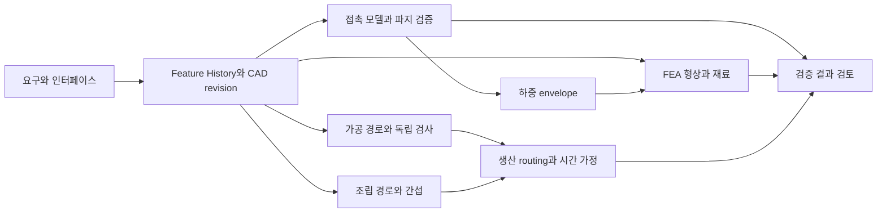

# Taskforce 프로젝트 세션 구조와 연구 결과 시각화 계획

2026-10-23 KST · 읽기 전용 조사와 적용 제안 · 기준 HEAD `8861368d290747a5813b0b3d0a36abf54cc04b88`

> 이 문서는 조사 당시 그대로 둔다. 실제 이벤트로 확인한 결과와 정정(5장 2번 `forkedFromId`, 6장 동시 질문 처리)은 [실측 문서](taskforce-0.2.0-agent-tree-observation-2026-10-23.md)가, 확정 범위와 PR 순서는 [구현 계획](taskforce-0.2.0-agent-tree-implementation-plan-2026-10-23.md)이 이긴다. 본문의 절대 경로 링크는 조사한 Mac의 체크아웃 기준이다.

**추천은 프로젝트 상세 안의 접을 수 있는 세션·서브에이전트 트리다.** 프로젝트 목표, 지금 필요한 결정, 최신 검증 결과를 먼저 보여주고, 트리는 누가 무엇을 맡았고 어디서 막혔는지를 설명한다. 작업 의존성은 별도의 작은 흐름도로 제공한다. 에이전트 호출 네트워크는 필요할 때 여는 진단 화면으로 남긴다.

두 참고 자료는 affectUI의 **Agent Tree와 Agent Graph 컴포넌트 데모**다. 공개 문서상 앱이 상태와 관계 데이터를 공급하는 표시 컴포넌트이며, 영상만으로 Claude·Codex의 실제 실행을 수집하는 제품이라고 볼 수 없다. Taskforce에서는 화면보다 **관계·상태·결과의 정확한 수집과 귀속**이 먼저 해결할 문제다.

## 1. 조사 범위와 증거

| 증거 | 확인한 범위 | 한계 |
|---|---|---|
| [영상 A](https://x.com/flohoeller/status/2112150373565612534/video/1) | 게시문 `Agent tree component, see who started whom`, 22초 영상 재생 및 약 7초 장면 관찰 | 영상 속 버튼의 실제 provider 효과는 확인 불가 |
| [영상 B](https://x.com/flohoeller/status/2113196195631820807/video/1) | 게시문 `Agent graph component, every call in real time`, 19초 영상 재생 및 약 12초 장면 관찰 | 호출 애니메이션이 실제 모델 호출이라는 증거는 아님 |
| [Agent Tree 공개 데모·문서](https://www.affectui.com/components/agent-tree) | Researcher 분기를 직접 접고 `Show 2 sub-agents`로 바뀌는 것 확인. API·상태·접근성 설명 읽음 | 유료 소스·실행 백엔드는 읽지 않음 |
| [Agent Graph 공개 데모·문서](https://www.affectui.com/components/agent-graph) | Orchestrator 노드를 직접 선택해 최근 호출 목록·상태·비용 카드 확인 | 실제 외부 도구 실행이나 데이터 전달은 확인하지 않음 |
| [공개 GitHub](https://github.com/flohoeller/affectui/tree/65e05fb718427a0ca16fee78106a0f77e428fc24) | commit `65e05fb…` 파일 목록과 README. React 19·TSX 단일 파일 배포 안내, Pro 소스는 공개 저장소 밖이라는 설명 | 공개 트리에 Agent Tree/Graph 구현 파일 없음. 사이트 내부 엔진·서버 스택은 미확인 |
| Taskforce 로컬 코드 | 계약·서버 모델·Swift bridge·파서·화면·테스트 파일 정적 확인 | 운영 flag, DB 적용, 설치 앱, 실제 provider E2E 미확인 |
| provider 공식 문서·설치 CLI | Claude 최신 SDK 문서, Codex 0.162.1 기본/experimental 타입 생성 | schema 존재는 실제 event 수신·권한·제어 성공과 별개 |

REA 스킬을 읽고 `capture_browser_scenario`를 실제 사용했다. X의 첫 영상 URL은 REA가 초기 navigation에 실패했으며 웹 fetch도 두 URL 모두 403이었다. in-app browser에서는 두 영상을 재생·관찰할 수 있었다. 이후 REA로 공개 affectUI 페이지를 정상 수집했다. REA가 영상을 분석했다고 표현하지 않는다.

REA Evidence:

- 홈페이지: `ev_04c2e386dd86214c87571b550128bb77735dd922936d3c2b7c96fa1db218c4c5`
- Agent Tree: `ev_b4c996cc200b50d137591fcbc8db3e504e769d35cb367c87d06e501cda1220c0`
- Agent Graph: `ev_c5b1005ea151df0181f3d36fbae6ca27f91b86fcff4af88cf722abbd5a1425e0`

세 수집은 선언한 URL 열기·대기·accessibility/URL capture 범위에서 complete이며, owned Chromium 종료도 확인됐다. 네트워크 본문·WebSocket·백엔드·스크립트 실행 인과관계는 수집하지 않았다. REA doctor는 별도의 Ghidra helper 준비 과정에서 sandbox cache 쓰기 제한으로 끝났지만, 브라우저 capture는 정상 동작했다. 설정 변경이나 엔진 설치는 하지 않았다.

## 2. 두 영상에서 가져올 것

| 비교 | Agent Tree | Agent Graph |
|---|---|---|
| 답하는 질문 | 누가 누구를 시작했고 어느 분기가 끝나거나 막혔나 | 누가 어떤 에이전트·도구와 통신하고 있나 |
| 관찰한 구조 | Orchestrator 아래 Researcher·Writer·Coder, 그 아래 Scraper·Analyst·Tester | 중앙 Orchestrator, 주위 에이전트, 외곽 사용자·Notion·GitHub 등 도구 |
| 정보 | 역할·모델·할 일·상태·비용·시간, 실패 원인과 Retry/Dismiss 팝오버 | 노드 상태, 움직이는 호출/응답 선, 최근 호출·시간·비용, 사용자 필요 표시 |
| 좋은 점 | 위임 책임과 실패 분기를 바로 찾고 끝난 분기를 접을 수 있음 | 도구 사용과 호출 병목을 설명하고 특정 노드 주변을 볼 수 있음 |
| Taskforce에서의 위험 | 부모 완료를 자식 검증 합격으로 오해하거나 분기 비용을 중복 합산할 수 있음 | 활동량을 연구 진척으로 오해하기 쉽고, 호출 선을 선행 작업 관계로 착각할 수 있음 |
| 채택 | 역할·맡은 일·막힘 이유·접기·원문/결과 열기 | 선택 노드 상세와 관계 강조. 항상 움직이는 전체 네트워크는 후순위 |

**공개 API에서 확인한 구현 단서:** Tree는 `root: TreeAgent`의 `id/status/children/ask/error/cost` 등을 받고, `onSelect`, `onCollapsedChange`, `onResolve` 콜백을 제공한다. Graph는 `nodes`, `calls {id,from,to,at,status}`, `edges`를 받는다. 안정적인 ID와 갱신된 데이터 배열이 시각화의 입력이다. Graph 문서는 ResizeObserver와 requestAnimationFrame 기반 표시를 설명한다. 이는 공개 문서의 설명이며 유료 소스 분석 결과는 아니다.

Tree의 `onResolve`는 앱이 실제 상태를 갱신해야 하는 통로다. Retry가 실제 에이전트를 다시 실행하는 책임까지 컴포넌트에 있다고 해석하면 안 된다. Graph의 call 성공은 통신/도구 호출의 성공이지 산출물의 품질 합격이 아니다. 두 컴포넌트는 Pro로 표시되고 공개 소스에 없으므로, 무료 저장소의 MIT 표기를 이 둘의 복제 권한으로 확장하지 않는다. Taskforce에는 인터랙션 원리를 SwiftUI로 적용하는 편이 현재 플랫폼 계약과 맞는다.

## 3. 가장 단순한 화면 구조

프로젝트를 열면 상단에 **목표 한 줄 / 현재 설계 revision / 지금 필요한 결정 / 마지막 관찰 시각**을 놓는다. 본문 기본값은 세션 구조, 행 선택 시 기존 세션 패널을 연다. 별도의 전역 관리 시스템을 추가하지 않고 프로젝트 내부에 충분한 폭의 구조 화면을 제공한다.

아래는 구현 결과가 아닌 개념 예시다. 숫자와 상태는 CAD 실측값이 아니다.

```text
Hand-E 맞춤 손끝  ·  목표: 편집 가능한 CAD와 검증 근거 확보
설계 r3  ·  결정 필요: 요구 마찰 범위 확인  ·  8초 전 관찰

[세션 구조]  [작업 의존성]

▾ 복원·검증 구현  ·  Codex                 파지 결과 확인 대기
  ├ Feature History 복원                  실행 종료 · 형상/편집 근거 있음
  ├ 파지 조건 sweep                       실패 조건 검토 필요
  └ 강도 screening                        선행 하중 결과 대기
▾ 독립 검토  ·  Claude                    검토 중
  └ 메시 수렴·구속 조건 점검              보고서 준비 중

결과: 형상/편집 · 파지 · 강도 · 가공 · 조립 · 생산
각 결과에 r3 또는 이전 revision, 판정 근거, 미검증 항목 표시

선택한 행 → 맡은 일 / 막힌 이유 / 결과·근거 / 세션 열기
            질문하기 / 지원되는 범위의 중단
```

위 예시의 자식 관계는 실제 provider 증거가 있을 때만 그린다. Claude와 Codex 두 세션이 같은 프로젝트에 있다는 이유만으로 하나를 다른 하나의 native 자식으로 만들지 않는다. 프로젝트는 탐색 범위이고, 세션 간 협업·작업 의존성·native spawn은 각각 다른 관계다.

| 방식 | 가장 적합한 판단 | 권장 위치 |
|---|---|---|
| 목록 | 여러 프로젝트에서 지금 개입할 곳, 최근 세션 복귀 | 전역 요약·좁은 화면 |
| 접는 트리 | 프로젝트 안의 세션과 native 위임 구조, 책임·막힘·결과 | 프로젝트 기본 화면 |
| 작업 DAG | 무엇이 무엇을 기다리는지, 변경 후 어떤 검증이 낡았는지 | `작업 의존성` 보기 |
| 호출 네트워크 | 어떤 도구 호출이 실패·지연·비용을 유발했는지 | 선택 세션의 진단 상세 |

트리는 기본 두 단계까지만 펴고 실패·질문 분기는 발견 가능하게 남긴다. 완료 분기는 접되 재시도 전 실패와 이전 결과는 기록에 보존한다. 정보가 없는 프로젝트는 가짜 에이전트·샘플 활동을 채우지 않는다. 알 수 없는 역할은 `서브에이전트`, 끊긴 관찰은 `마지막 확인 … · 현재 상태 미확인`으로 보인다.

행에는 역할보다 **맡은 일**을 먼저 읽히게 하고 provider·모델·비용은 보조 정보로 둔다. 총 몇 명보다 `결정 1 · 선행 결과 대기 1 · 검토할 결과 2`가 유용하다. 실제 분모가 있는 solver sweep은 `검사 90개 중 63개 처리`를 표시할 수 있지만, 모델의 작업 진행률을 임의의 %로 만들지 않는다. 처리 개수와 합격 개수도 분리한다.

일상 화면의 움직임은 상태 변경과 새 분기 등장 정도로 제한한다. 선택 중 행 순서·키보드 초점·스크롤 위치를 보존하고, 색 외에 상태 글자를 제공하며 reduced motion과 VoiceOver로 동일한 정보를 읽을 수 있어야 한다.

현재 계약에서 입력·승인 질문은 세션 패널/에이전트 대화에서 답한다. 프로젝트의 결정 표시를 누르면 그 질문으로 이동하게 하고 새 답변 큐를 만들지 않는다. 결과 검토는 기존 Taskforce 대화의 `result_ready` 의미와 연결한다. 근거: [Assistant 계약 5.4](</Users/daniel/Documents/Life Design/Taskforce-new/docs/design/taskforce-0.2.0-assistant-contract-2026-10-12.md:363>).

## 4. 현재 코드의 재사용과 부족한 부분

아래는 현재 checkout의 정적 사실이다. 구현 존재를 배포·실행 성공으로 대신하지 않는다.

| 현재 근거 | 재사용할 것 | 부족한 것 |
|---|---|---|
| [agent_sessions](</Users/daniel/Documents/Life Design/Taskforce-new/supabase/migrations/20261113000000_agent_gateway_core.sql:77>) | connection, external session ID, workspace, turn/sequence | parent/role 없음. `bound_action_id`는 최초 이슈 기록이며 프로젝트 소유 관계가 아님 |
| [agent_tasks](</Users/daniel/Documents/Life Design/Taskforce-new/supabase/migrations/20261113000000_agent_gateway_core.sql:141>) | run·step·session·message·turn 귀속과 열린 turn 제약 | native 자식마다 만드는 모델로 설계되어 있지 않음 |
| [AgentSessionModels](</Users/daniel/Documents/Life Design/Taskforce-new/apple/Packages/TaskforceKit/Sources/TaskforceKit/AgentSessionModels.swift:271>) | issueIDs, currentIssueID, conversationID, 상태·Stop 표시 | 다중 이슈 세션을 프로젝트 단일 소유로 고정하면 잘못된 집계 발생 |
| [SessionRow](</Users/daniel/Documents/Life Design/Taskforce-new/apple/Packages/TaskforceKit/Sources/TaskforceUI/ProjectRow.swift:67>), [이슈 화면](</Users/daniel/Documents/Life Design/Taskforce-new/apple/Taskforce/Mac/Edge/EdgeIssueScreens.swift:246>) | 기존 세션 행·패널·선택 동작 | 프로젝트 단위 계층·의존성 projection 필요 |
| [registry](</Users/daniel/Documents/Life Design/Taskforce-new/src/lib/agents/registry.ts:5>) | provider 버전·능력·flag 계약 | 두 provider의 list/attach_existing=false. 기존 외부 세션 자동 부착을 지원한다고 볼 수 없음 |
| [BridgeHost](</Users/daniel/Documents/Life Design/Taskforce-new/apple/Taskforce/Mac/Bridge/BridgeHost.swift:528>) | ClaudeCodeProcess와 bridge 생명주기 | 실제 등록은 Claude 또는 Fake. concrete Codex 실행 adapter 등록은 없음 |
| [ClaudeCodeLaunch](</Users/daniel/Documents/Life Design/Taskforce-new/apple/Packages/TaskforceKit/Sources/TaskforceKit/Bridge/ClaudeCode/ClaudeCodeLaunch.swift:32>) | 엄격한 도구 집합 | 현재 `--tools`에는 Agent/Task 없음. native subagent를 허용하는 변경은 실행 권한 범위까지 검증해야 함 |
| [ClaudeStreamParser](</Users/daniel/Documents/Life Design/Taskforce-new/apple/Packages/TaskforceKit/Sources/TaskforceKit/Bridge/ClaudeCode/ClaudeStreamParser.swift:117>), [Mapper](</Users/daniel/Documents/Life Design/Taskforce-new/apple/Packages/TaskforceKit/Sources/TaskforceKit/Bridge/ClaudeCode/ClaudeEventMapper.swift:213>) | stream parsing과 상태 전달 | task_started/task_notification의 내용을 `.task` → 상위 progress로 축약. child/parent/role 귀속 보존 필요 |
| [agent_events](</Users/daniel/Documents/Life Design/Taskforce-new/supabase/migrations/20261116000000_agent_events.sql:126>) | strict event schema, 소유·turn·sequence 재검증 | child identity 필드 추가는 parser만으로 끝나지 않으며 서버 계약·DB 검증도 필요 |
| [turn 완료 처리](</Users/daniel/Documents/Life Design/Taskforce-new/supabase/migrations/20261116000000_agent_events.sql:288>) | `turn_completed` → idle 원칙 | 연구 합격·프로젝트 완료로 변환하지 말 것 |
| [agent_artifacts](</Users/daniel/Documents/Life Design/Taskforce-new/supabase/migrations/20261116000000_agent_events.sql:12>) | path/hash/summary 및 run/task/turn 귀속, 이전 산출물 supersede | child·CAD revision·검증 기준·가정·판정·review 귀속 필요 |
| [Outbox](</Users/daniel/Documents/Life Design/Taskforce-new/apple/Packages/TaskforceKit/Sources/TaskforceKit/Bridge/Outbox.swift:4>), [Reconcile](</Users/daniel/Documents/Life Design/Taskforce-new/apple/Packages/TaskforceKit/Sources/TaskforceKit/Bridge/Reconcile.swift:4>) | durable replay, live/ended/orphan/unknown 구분 | child별 checkpoint/snapshot/종료 누락 처리 확장 |
| [AgentSessionStore](</Users/daniel/Documents/Life Design/Taskforce-new/apple/Packages/TaskforceKit/Sources/TaskforceKit/AgentSessionStore.swift:115>) | 열린 task 5초 polling, 복귀 refresh, 계정·늦은 응답 방어 | 하위 관찰 freshness와 큰 트리 부분 갱신 |
| [context bundle](</Users/daniel/Documents/Life Design/Taskforce-new/src/lib/context/bundle.ts:6>) | 범위·버전·기억·자료·manifest/hash | 이 함수는 dispatch하지 않음. 자식이 실제로 받은 맥락은 별도 receipt 필요 |
| [coordinator](</Users/daniel/Documents/Life Design/Taskforce-new/src/lib/coordinator/coordinate.ts:9>) | 변경 영향 후보와 근거 기록 | 자동 다음 단계·재실행·Action 완료는 현재 경계 밖 |

`Running now`라는 정확한 문자열은 조사한 src/Apple Swift/design 검색에서 찾지 못했다. 현재 확인한 실제 입구는 이슈 상세의 Sessions와 세션 패널이다. 따라서 이 계획은 특정 Running now 구현을 교체한다고 가정하지 않는다.

작업 의존성도 완성된 저장 모델을 전제로 하면 안 된다. [coordinator inbox](</Users/daniel/Documents/Life Design/Taskforce-new/src/lib/coordinator/inbox.ts:20>)는 `dependency_changed`를 envelope_only로 두고 `action_dependencies`가 아직 없다고 명시한다. 메시지의 dependency 참조 필드 존재와 실제 의존성 저장·변경 전파 구현은 구분한다. P4에서 기존 계획과 맞춰 최소 관계 저장·검증을 구현해야 한다.

## 5. provider별 관찰 가능성

| 항목 | Claude 공식 지원 | Codex 공식 지원·설치 스키마 |
|---|---|---|
| root와 자식 ID | hooks의 session_id/agent_id/agent_type, SDK task_id | Thread.id/sessionId, SubAgentSource.thread_spawn |
| 부모 관계 | 최신 SDK task_started.parent_task_id | parentThreadId, thread_spawn.parent_thread_id |
| 실행 시도 | 최신 SDK run_id; 재개 task_id 유지 가능 | thread·turn·item, collabAgentToolCall의 sender/receiver |
| 역할·메시지 | agent_type, agent_id, parent_tool_use_id | agentRole/agentNickname, source, agentsStates |
| 진행·종료 | task_progress, task_updated, task_notification | ThreadStatus, activeFlags, CollabAgentStatus, turn/item events |
| 누락 복구 | SDK background_tasks_changed 전체 live set와 reinitialize snapshot | 저장 history 조회와 live load/subscription을 구분; 마지막 cursor부터 reconcile 필요 |
| 개입 | Query.stopTask는 running background task 범위; 부모 streaming input/interrupt | turn/steer(expectedTurnId), turn/interrupt, canAcceptDirectInput capability |

Claude 근거: [TypeScript reference](https://code.claude.com/docs/en/agent-sdk/typescript), [subagents](https://code.claude.com/docs/en/agent-sdk/subagents), [hooks](https://code.claude.com/docs/en/hooks), [입력 모드](https://code.claude.com/docs/en/agent-sdk/streaming-vs-single-mode), [sessions](https://code.claude.com/docs/en/agent-sdk/sessions).

Codex 근거: [App Server 공식 문서](https://developers.openai.com/codex/app-server), 설치 CLI의 [Thread.ts](</private/tmp/taskforce-provider-stable-schema-20261023/v2/Thread.ts>), [ThreadItem.ts](</private/tmp/taskforce-provider-stable-schema-20261023/v2/ThreadItem.ts>), [SubAgentSource.ts](</private/tmp/taskforce-provider-stable-schema-20261023/SubAgentSource.ts>). 임시 파일은 조사 당시 생성한 스키마이며 영구 산출물은 아니다.

**버전 경계:** 설치 Claude Code는 2.1.306, Codex CLI는 0.162.1로 확인했다. Taskforce registry 계약은 Claude `>=2.1.241 <2.2`, Codex `>=0.162.1 <0.163`이다. Claude SDK의 parent_task_id/run_id/agent_id 세부 계약은 v0.3.292+ 문서이며, SDK package 버전과 CLI 버전은 별개다. 현재 Swift의 턴별 `claude -p --output-format stream-json`에서 동일 필드를 받을 수 있는지는 실제 stream으로 먼저 검증한다. SDK 기능을 쓰기 위해 곧바로 전체 adapter를 SDK로 교체할 근거는 아직 없다.

Codex 0.162.1 기본·experimental 타입을 둘 다 생성했다. parentThreadId/agentRole/collabAgentToolCall은 기본 타입에도 있다. thread/list의 parentThreadId·ancestorThreadId 필터와 canAcceptDirectInput은 experimental 출력에만 있어 버전·capability 가드가 필요하다. 현재 Taskforce의 [예정된 Codex 계약](</Users/daniel/Documents/Life Design/Taskforce-new/docs/design/taskforce-0.2.0-assistant-contract-2026-10-12.md:621>)은 `--disable multi_agent`도 지정한다. 실제 Codex adapter 연결과 native multi-agent 사용 범위 변경을 함께 검토해야 한다.

구현 시 지킬 구분:

1. Claude `parent_tool_use_id`는 Agent **도구 호출 ID**다. 부모 agent ID로 저장하지 않는다. parent_task_id 부재도 무조건 root라는 뜻은 아니다.
2. Codex `forkedFromId`는 분기 이력, `parentThreadId`는 spawn 계층이다. sessionId가 같다고 모든 thread가 부모·자식인 것은 아니다.
3. Claude 진행 summary와 agentRole은 provider가 보고한 메타데이터다. 실제 전문성·검증 합격의 근거가 아니다.
4. Claude SubagentHandback 사용 시 SubagentStop 마지막 문장이 최종 보고서 본문과 다를 수 있다. handback 보고서와 종료 신호를 별도 수집한다. 내부 보조 작업도 subagent hook에 나타날 수 있어 사용자에게 맡긴 작업과 구분한다.
5. `notLoaded`, telemetry 공백, task 목록 누락을 완료나 실패로 바꾸지 않는다. snapshot의 범위와 event 순서를 함께 해석한다.
6. listSessions/thread/read는 과거 기록 조회다. 사용자의 다른 터미널·앱에서 이미 실행 중인 모든 세션을 자동 관찰·제어할 수 있다는 뜻이 아니다. 첫 지원 범위는 **Taskforce가 실행·연결을 소유하는 세션**으로 정한다. 외부 세션은 연결 확인 전 `기록만 보기`로 둔다.
7. child 단독 중단·직접 질문은 검증한 capability가 있을 때만 제공한다. 지원하지 않으면 부모에게 요청을 보내는 동작임을 명시한다. 기존 세션 Stop을 자식 Stop처럼 보이게 하지 않는다.

## 6. 필요한 최소 데이터와 이벤트 계약

기존 `agent_tasks`는 상위 turn 전달·승인·취소 계약으로 유지한다. 그 아래 native 작업을 관찰하는 작은 projection을 추가한다. 모든 child를 별도 Action·execution_run·대화로 자동 생성하지 않는다.

| 개념 | 최소 보존 정보 | 원칙 |
|---|---|---|
| 프로젝트 표시 범위 | project/context ↔ action/run/task 참조 | 기존 이슈 연결로 먼저 계산. 세션이 여러 프로젝트를 다루면 관련 turn만 포함하고 공유 세션으로 표시 |
| native 작업 identity | provider/connection/root session/native agent ID | 이름이나 도구 종류로 dedupe하지 않음. cross-provider ID 충돌 방지 |
| 실행 시도 | native run ID 또는 관찰 가능한 turn/item 기반 attempt key | resume와 retry를 구분. 실패 이력 덮어쓰기 금지 |
| 관계 | child, parent 또는 unresolved parent ref, relation kind, evidence event | spawn/fork/call/dependency를 분리. 자기 참조·cycle·다른 소유자 연결 거절 |
| 업무 설명 | provider role, 맡긴 문장 요약, 원문 event ref | 모델 추정 제목은 `요약`, 사용자 지정은 `사용자 지정`으로 출처 구분 |
| 상태 | native_status, normalized lifecycle, wait reason, last_seen, observation freshness | 마지막 실행 상태와 연결 상태를 별도 저장 |
| 결과 | 기존 artifact ID + producer attempt + revision/input hash + report ref | 경로 같아도 revision/producer 다르면 다른 결과 |
| 개입 능력 | observe/read history/direct input/stop background/interrupt turn, scope, 확인 버전 | 모든 노드에 동일한 버튼을 붙이지 않음 |

기본 증거 등급은 `provider가 관찰한 관계`, `사용자가 정한 작업 연결`, `제안된 관계`, `미확인`으로 충분하다. provider가 증명한 spawn만 트리의 실선으로 그린다. 사용자가 정한 의존성은 작업 보기에 표시하고, 추론된 의존성은 제안 목록으로 둔다. timestamp·같은 폴더·유사 제목만으로 부모를 연결하지 않는다. 증거가 늦게 오면 같은 ID에 관계만 보완한다.

상태는 세 축으로 분리한다.

- **실행:** queued/running/waiting/ended/failed/interrupted/unknown. waiting은 입력·승인·선행 결과·도구 대기처럼 이유가 있을 때만 세분한다.
- **관찰:** live/reconnecting/stale/unsupported. heartbeat가 끊겨도 마지막 실행 상태는 보존하되 현재처럼 강조하지 않는다.
- **연구 결과:** 미검증 / 가정하 통과 / 실패 / 입력 필요 / 미지원 / 이전 revision. 사람의 검토·제작 승인 여부는 별도다.

수집 순서는 provider raw event → 최소 필드 검증·정규화 → durable outbox → 서버 소유·귀속·sequence 검증 → projection → SwiftUI다. 원본 transcript 전체를 서버에 복제할 필요는 없다. 허용된 구조 필드와 민감정보가 제거된 요약·근거 ref만 보내며 secret 질문은 기존 로컬 답 경계를 유지한다.

중복 전송은 안정적인 event key로 수렴하고, 원본 event ID가 없으면 durable ledger가 부여한 key를 재전송에서도 유지한다. root와 child의 sequence를 혼용하지 않고 connection epoch와 provider cursor를 보존한다. out-of-order child 종료는 임시 미확인 노드에 보관하고 시작/부모가 도착하면 결합한다. 끊긴 구간은 gap으로 표시하며 root 종료만으로 모든 child의 종료를 합성하지 않는다.

재접속 시 이미 제출한 명령을 자동 재전송하지 않는다. snapshot과 남은 outbox, 저장된 history를 대조하고 제어 채널·현재 turn ID를 확인한 뒤 입력을 연다. 취소 요청도 requested/confirmed/unknown으로 나눈다. Codex turn interrupt 뒤 외부 solver 프로세스가 남을 수 있다는 기존 계약을 유지한다. 살아 있는 프로세스를 끝냈다는 증거 없이 `모두 중단됨`을 표시하지 않는다.

동시 자식 질문은 별도 관문이다. 현재 [질문 저장 계약](</Users/daniel/Documents/Life Design/Taskforce-new/supabase/migrations/20261116000000_agent_events.sql:296>)은 pending_question이 있으면 다른 질문을 question_conflict로 거절하며, Claude 프롬프트도 한 번에 한 ask_user만 요구한다. native child를 허용하면 이 가정이 깨질 수 있다. P2에서 자식 질문을 ID와 함께 보존해 차례로 처리할지, provider 측에서 직렬화할지 결정하고 검증한다. 마지막 질문으로 덮어쓰거나 거절된 질문을 조용히 버리는 방식은 허용하지 않는다.

## 7. CAD 연구 한 건에서의 사용 흐름

기준은 [Hand-E MVP 계획](</Users/daniel/Documents/ChatGPT/CAD research/reports/gripper-fingers-mvp-plan-2026-10-23.md>)이다. 아래는 Taskforce 사용 시나리오이며 CAD 연구·solver 실행을 이번에 수행한 것은 아니다.

**보기:** 프로젝트 상단은 “편집 가능한 Feature History와 r3 검증 근거 확보”를 보여준다. 사용자는 파지 sweep이 특정 요구 조건에서 실패했고 강도 검토가 하중 envelope를 기다린다는 것을 본다. Codex 구현 세션과 Claude 독립 검토 세션은 동급 root로 놓고, 각 세션이 실제로 시작한 자식만 아래에 놓는다.

**질문:** 파지 행을 열면 실패 조건·input hash·solver 버전·원래 요구 범위를 확인한다. “왜 실패했는가?”는 해당 보고서를 참조해 소유 세션에 질문한다. “마찰을 올려 통과시켜”처럼 합격 기준을 사후 변경하지 않고, 미확정 물성을 확인하거나 형상을 바꾸는 선택지를 비교한다. 자식 직접 입력이 불가능하면 부모 세션으로 보낸다는 사실을 표시한다.

**중단:** 잘못된 재료값으로 FEA가 돌아가면 사용자는 해당 실행을 선택한다. 지원되는 개별 task 중단인지 전체 turn 중단인지 버튼 옆에 범위를 보여준다. 요청 직후는 `중단 요청됨`, provider 확인 후 `턴 중단됨`, 외부 solver 생존을 모르면 `명령 종료 미확인`으로 둔다. 기존 파일과 이미 나온 결과는 자동 삭제·되돌림하지 않는다.

**결과 검토:** Feature History 결과에는 FCStd/STEP, revision/input hash, 재열기·재계산·지정 편집 검사와 형상 비교 근거를 연결한다. 파지·강도·가공·조립·생산은 각각 별도 판정이다. 에이전트가 “완료”라고 말하거나 exit code가 0이어도 이를 모두 통과 처리하지 않는다. r2 보고서가 r3 옆에 보이면 `이전 설계 결과`로 명확히 표시한다.

**다음 작업:** 손끝 길이를 변경하면 영향을 받는 contact mesh, FEA mesh, CAM, 조립 간섭, 도면/BOM과 생산 routing 결과를 stale로 표시한다. 사용자는 영향 목록을 보고 필요한 실행을 맡긴다. 기존 coordinator는 영향 기록까지만 하므로 이 단계에서 조용히 다음 연구를 자동 실행하지 않는다. 검증된 receipt를 받아 다음 작업을 제안하는 소비자는 후속 구현 범위다.



이 화살표는 **산출물·조건 의존성**이다. 어떤 에이전트가 누구를 spawn했는지는 위 도식으로 나타내지 않는다. 실제 계산은 CAD 도구의 책임이고 Taskforce는 같은 revision과 판정 근거를 연결한다.

## 8. 개발 순서와 단계별 통과 조건

| 우선순위 | 변경 범위 | 해당 단계의 증거 |
|---|---|---|
| P0 관찰 계약 spike | 지원 CLI/SDK 버전 고정, 실제 native child event 표본과 control capability 확인, 상태/ID 매핑 명세 | Claude와 Codex 각각 root+child 2개, 종료·실패·질문·재개 표본. 실제 stream에서 못 얻은 필드는 unsupported로 확정 |
| P1 기존 세션으로 화면 가치 확인 | 프로젝트 범위의 세션 목록·접는 구조·선택 패널 연결. provider 관계 없는 child는 생성하지 않음 | 같은 시나리오를 목록과 구조 화면으로 비교해 담당·막힘·결과·다음 개입을 찾는 시간과 오답 측정 |
| P2 Claude 수집을 끝까지 연결 | parser/mapper → event 계약 → child projection → 트리. Agent 도구 허용·자식 권한 상속·질문/stop 범위를 별도 검증 | 실제 Claude native child가 올바른 부모·역할·결과로 표시. stream-json만으로 부족하면 제한된 helper/SDK 경로를 비교한 뒤 선택 |
| P3 Codex concrete adapter | app-server 연결·버전/schema gate·재연결·승인/질문/stop, multi_agent 계약 갱신, child event projection | Fake 대신 실제 Codex에서 동일 E2E. 다른 실행 중 app-server를 탈취하거나 저장 기록을 live로 오인하지 않음 |
| P4 검증 결과와 의존성 | artifact와 producer/revision/criteria 연결, stale 전파·근거 상세·작은 작업 DAG | CAD revision 변경 시 구 결과가 최신 합격으로 남지 않음. 사용자가 다음 작업을 올바르게 선택 |
| P5 필요할 때만 호출 그래프 | 선택 세션의 도구 호출·오류·지연 진단 | 목록/트리보다 원인 찾기가 실제로 빨라지는 경우에만 채택 |

P2/P3는 공통 event 계약을 합의한 뒤 독립 구현할 수 있다. 다만 첫 완주 증거를 빨리 얻기 위해 현재 concrete adapter가 있는 Claude부터 연결하는 것이 합리적이다. **Claude만 통과하면 전체 목표 완료가 아니며, Claude·Codex 각 provider별 합격을 따로 기록한다.**

첫 UI에 새 그래프 라이브러리·자유 배치 캔버스·자동 역할 배정·무한 재시도·별도 CAD 실행 엔진을 넣지 않는다. 프로젝트 화면에서 실제 판단이 줄어드는지 확인한 후 필요 범위를 늘린다. 현재 native 플랫폼 계약을 유지하며 사용자용 Next.js 화면을 추가하지 않는다.

## 9. 실제 E2E 합격 기준

아래 수치는 제안하는 제품 시험 기준이며 현재 달성한 결과가 아니다. 고정된 테스트 workspace·비밀값 없는 fixture·지원 버전과 서명 앱 빌드·서버 SHA를 기록하고, local replay와 실제 provider 실행 결과를 분리한다.

| 시험 | 합격 기준 |
|---|---|
| native 계층 | 실제 Claude와 Codex 각각 root+동시 child 2개를 실행. provider transcript의 ID·부모 관계와 UI 일치. 지원되지 않는 깊이는 가짜 노드 없이 표시 |
| 잘못된 관계 | 같은 이름·같은 폴더·비슷한 시작 시각, fork, 별도 root, 모르는 parent 사례에서 오귀속 0. user/project 범위가 다른 event는 쓰기 0 |
| 상태 구분 | 진행, 입력/승인 대기, 실패, interrupted, idle, 연결 끊김을 구별. turn 종료를 연구 합격으로 표시하는 사례 0 |
| 갱신 지연 | 연결 정상 상태의 event→화면 반영 p95 10초 이내를 초기 목표로 측정. 5초 polling 기반이면 이를 실시간 스트리밍이라 부르지 않음 |
| 누락·중복·역순 | outbox 재전송·연결 단절·child 종료 선도착·시작 누락을 주입. 중복 노드/비용/결과 0, 복원 불가능한 구간은 미확인 표시 |
| 재시작 | Mac 앱/bridge 재시작 후 동일 session·child·attempt 귀속 유지. 실행 명령 자동 중복 제출 0. history-only는 live로 승격하지 않음 |
| 질문 | 동시 child 2개가 입력/승인 질문을 내도 유실·덮어쓰기·오전달 0. 정확한 provider request에 한 번만 답 전달. 오래된 질문 답은 거절. secret은 서버 기록 0 |
| 중단 | UI가 표시한 범위와 실제 멈춘 범위가 일치. 자식만 중단 불가 시 버튼을 숨기거나 상위 중단임을 명시. 외부 명령 미확인 상태를 보존 |
| 권한 | 새 child도 승인·workspace·경로 충돌 규칙을 벗어나지 않음. Agent 허용으로 자동 권한 확대가 일어나지 않음을 실제 부정 사례로 확인 |
| 결과 귀속 | 같은 path를 여러 attempt가 쓰거나 retry하는 경우 이전 실패·산출물 보존. child/turn/revision/input hash가 보고서와 일치 |
| CAD 변경 | 예시 r2→r3 길이/소재 변경 후 영향받은 구 검증은 모두 stale. source hash 불일치·timeout·NaN·미지원 결과를 pass로 변환하는 사례 0 |
| 맥락 전달 | root에 보낸 bundle manifest/hash를 기록. child 전달을 확인할 수 있는 canary/receipt가 있을 때만 확인 표시. parent 수신을 child 수신으로 대체하지 않음 |
| UI 판단 | 2개 세션·8개 관찰 노드·실패 1개·질문 1개 시나리오에서 30초 안에 목표/막힘/담당/필요 결정/검토할 결과를 설명. 원문 로그를 찾아 헤매지 않고 2회 이내 선택으로 관련 세션 도달 |
| 접근성·규모 | 키보드·VoiceOver·reduced motion에서 같은 판단 가능. 50개 관찰 노드는 접기/필터로 접근 가능하며 선택·스크롤이 event 갱신에 튀지 않음 |

기존 테스트 재사용 지점: `tests/db/agent-events.test.ts`, `agent-events.scenarios.ts`, `agent-artifacts-rls.test.ts`, `agent-turn-start.test.ts`, `tests/pg/agent-turn-start.test.ts`, Swift `ClaudeEventMapperTests`, `ClaudeCodeGoldenTests`, `OutboxTests`, `ReconcileTests`. 구현 시 focused 회귀 → Swift/TS 검사 → DB/RLS·경합 → 실제 provider·서명 앱 E2E 순으로 증거를 쌓는다. 이 조사에서는 테스트 파일 존재만 확인했고 시험을 실행하지 않았다.

## 10. 판단과 남은 확인

현재 코드에는 세션·턴·산출물·질문·중단·재연결의 기반이 있다. 하지만 **native child identity를 보존하는 계층과 concrete Codex adapter가 빠져 있어 UI만 추가해서 요청한 경험을 만들 수는 없다.** 가장 작은 유효한 첫 구현은 프로젝트 세션 보기와 provider 하나의 실제 native 위임을 끝까지 연결하는 것이다. 그다음 Codex와 결과 revision 연결을 완주한다.

남은 핵심 확인은 Claude 실제 stream의 최신 필드 가용성, Agent 허용 후 권한·질문·중단 전파, Codex concrete adapter와 multi_agent 설정 변경, 각 provider의 재접속 시 관찰 범위, CAD 결과 report schema다. 유료 컴포넌트 소스·비공개 backend·운영 flag·설치 앱 상태는 이번에 확인한 것으로 주장하지 않는다.

저장소 제품 코드·기존 문서·설정·git index/branch·DB·배포는 변경하지 않았다. 저장소에 새로 저장한 것은 이 계획 문서다. 임시 폴더에는 provider 타입 확인용 스키마와 공개 문서 사본을 생성했다. CAD 연구 구현이나 과거 release 작업은 재개하지 않았다.
