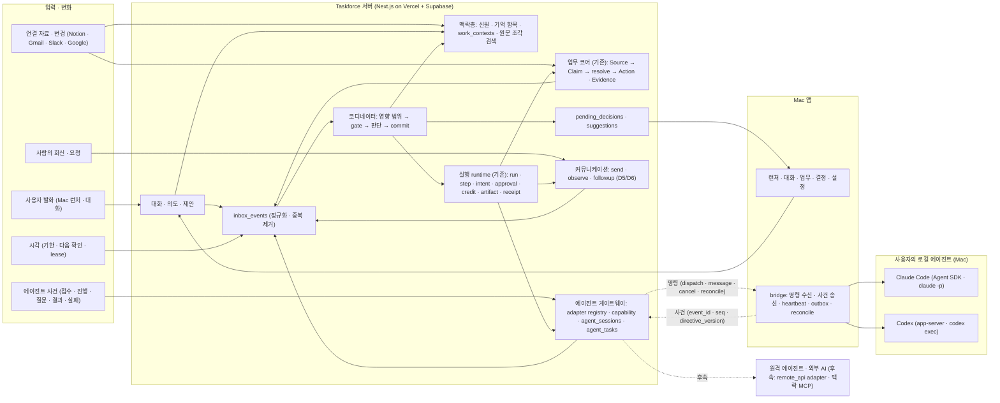
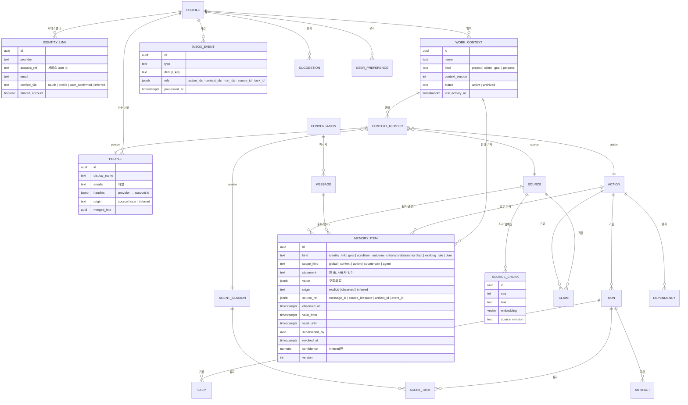
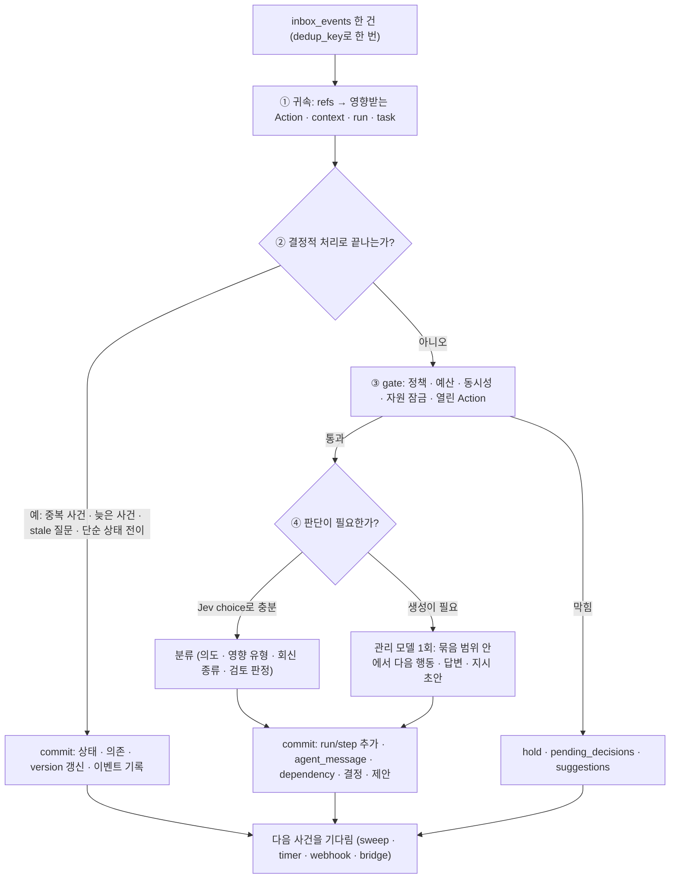
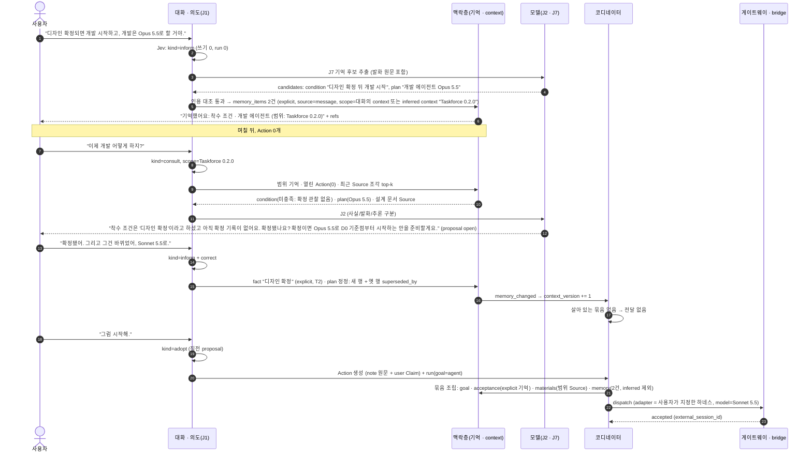
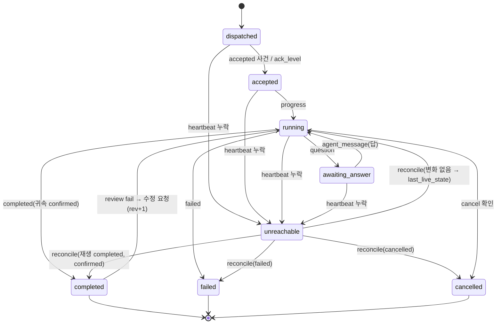

# Taskforce 0.2.0 추천 아키텍처 — 맥락층 · 코디네이터 · 에이전트 게이트웨이 · Mac bridge

2026-10-09 · Claude Fable 5.1 (노력 엑스트라) 독립 재설계 · 설계 문서만 · 코드 · 마이그레이션 · 운영 · 외부 연락 · 커밋 없음 · 요청서 [BRIEF](../../.omx/artifacts/taskforce-020-fable-architecture-20261009/BRIEF.md)

함께 읽는 문서: [이행 · 개발 인계 계획](../../.omx/plans/taskforce-0.2.0-architecture-migration-fable-2026-10-09.md) · [대안 · 결정 기록](../research/taskforce-0.2.0-architecture-decisions-fable-2026-10-09.md). 기존 문서는 읽기 전용이며 필요한 수정은 결정 기록 7장의 변경표로 제안한다.

표기: `기존` = root 또는 worktree 코드에 이미 있다(파일 · HEAD를 적는다). `유지` = 앞선 [런타임 계약](taskforce-0.2.0-runtime-contract.md) · [개발 계획](../../.omx/plans/taskforce-0.2.0-development-plan.md)의 제안을 그대로 쓴다. `제안` = 이 문서의 새 설계. `확정` = 사용자 결정 또는 CLAUDE.md 원칙. 이름 · 기본값은 모두 D0에서 바꿀 수 있다. 운영 DB · 설치 앱 · 실제 provider와의 일치는 확인하지 않았다.

## 1. 결론

**추천: 기존 코어(Source → Claim → resolve → Action, B2 Postgres 실행 상태 머신)를 그대로 두고, 그 위에 네 경계를 새로 긋는다.** 전면 재작성도, 기존 Codex/Fable안의 단순 보완도 아니다.

| # | 결정 | 한 줄 이유 |
|---|---|---|
| 1 | **맥락층을 Action과 분리한 파생 인덱스 + 기억 항목(`memory_items`)으로 둔다.** 세 층(신원 · 업무 이해 · 방식과 진행)은 책임이지 DB 세 개가 아니다 | 0.1.0 Ask는 Action이 없으면 unknown으로 끝났다(`pipeline/ask.ts:201`). 사용자가 말한 목표 · 조건 · 선호는 Claim도 Action도 아니지만 다음 작업과 다른 에이전트에게 다시 설명하지 않아도 되는 재료다 |
| 2 | **`work_contexts`를 비운영 범위 객체로 추가한다.** 검색 범위 · 맥락 묶음 · 화면 묶음의 기준이며 상태 머신 · 권한 · 진실 판정에는 닿지 않는다 | "목표 3건"을 Action 3개로만 두면 Action이 없는 목표(CTX02)와 프로젝트 단위 맥락 전달을 담을 곳이 없다. 운영 객체로 키우면 두 번째 상태 머신이 된다 |
| 3 | **액티브 하네스는 루프가 아니라 사건 반응 코디네이터다.** 사건 하나 → 영향 범위 → 정책 · 예산 gate → (필요할 때만) 모델 판단 → run · 의존 · 결정 commit | 매 주기 LLM 호출은 비용과 노이즈다. 기존 1분 sweep · lease · intent key가 이미 사건 반응 구조다(`EXECUTION.md` 2–4장) |
| 4 | **에이전트 게이트웨이는 adapter × transport × capability로 두고, 첫 에이전트는 Claude Code(Agent SDK · `claude -p`)다(사용자 결정 2026-10-09). Codex app-server는 같은 계약의 두 번째 adapter 후보다. Claude Code는 사용자 본인의 구독 로그인으로 돈다(확인 R1, 8.2 · I16).** 쓰기는 경계별 강제가 실측된 모드에서만 켠다(유지) | 두 하네스는 공식 문서상 승인 콜백 · 세션 재개 · 중단 · 사건 스트림을 모두 제공한다(8장 근거표). 실측(ARCH16)은 아직이다 |
| 5 | **Mac bridge는 앱 안의 전송 계층이며 상태를 갖지 않는다.** heartbeat · outbox · reconcile만 맡고, 서버는 bridge가 끊긴 동안 로컬 에이전트를 제어할 수 있다고 가정하지 않는다 | 로컬 하네스 두 개가 모두 Mac 프로세스라 bridge 없이는 왕복이 없다. 상태를 Mac에 두면 iPhone · 다른 기기 · 서버 cron이 다른 진실을 본다 |
| 6 | **변경 전파는 `context_version` + `directive_version` 두 숫자로 한다.** 기억 · 자료 · 사람 회신이 바뀌면 영향받은 범위의 version만 올리고, 살아 있는 작업에는 변경분만 보낸다 | 전체 재계획 · 전체 재전송은 비용과 중복 실행의 원인이다. 옛 결과를 현재 결과로 쓰지 않는 규칙은 유지 |
| 7 | **선호 · 추정 기억 · 제안은 어떤 경우에도 실행 권한을 만들지 않는다.** 권한은 `execution_policies` · 연결별 정책 · 승인 hash뿐이다 | 사용자 추가 맥락의 요구. "앞으로 이 고객에게는 요약부터"는 작성 기준이지 발송 권한이 아니다 |
| 8 | **0.2.0 통합 기반은 root dirty 체크아웃이 아니라 `origin/main` 최신이다.** root는 origin/main보다 184 커밋 뒤에 있고 실행 모듈이 없다 | `git status`(2026-10-09) · `REUSE_BASE.md`(2026-10-05, 148 커밋 차이 기록) · worktree 둘 다 `src/lib/execution/` 보유 |
| 9 | **과금은 Pro 구독(무제한 사용 · Taskforce가 모델 비용 부담 · 프리미엄 라우팅)과 Lifetime(1회 결제 · BYOK) 두 플랜이다(사용자 결정 2026-10-09, 10.1). 결제 제공자는 Lemon Squeezy, 자격은 그 webhook으로만 바뀐다(확인 R2).** 무료 플랜 · 구매 크레딧은 없다. 체험 · 구독이 끝나면 읽기만 남고, 사용자의 Claude Code 비용은 Pro에 들어 있지 않다(확인 R3) | 2026-10-01 "월 구독 + 추가 크레딧"과 기능 계약 C09의 무료 발견 경계를 대체한다. 내부 원가 원장은 사용자용 크레딧이 아니라 공정 사용 안전장치로 남는다 |

## 2. 제품 목표에서 나온 설계 원칙

| ID | 원칙 | 출처 |
|---|---|---|
| P1 | 사용자가 한 번 말한 맥락은 저장되고, 다음 질문 · 다음 작업 · 다른 에이전트에게 Taskforce가 대신 전달한다. 재설명 횟수가 지표다 | 사용자 정정(BRIEF 7–9), 추가 맥락 |
| P2 | 등록된 Action이 없어도 상담한다. 확인 사실 · 사용자 발화 · 추론을 섞지 않고, 모르는 것은 꾸미지 않는다 | BRIEF 3, 기획안 3.1 |
| P3 | 업무 출처 · 종류를 한정하지 않는다. 회의 · 메일 · 메시지 · 문서 · 대화 · 에이전트 결과가 같은 맥락층에 들어온다 | BRIEF 4, 10 |
| P4 | 사람 · 도구 · 에이전트 사이의 일을 잇는 것이 제품이다. 에이전트 대시보드도, 메일 봇도 아니다 | BRIEF 7 |
| P5 | 사람은 라우터 · 승인자가 아니다. 위임 범위 안의 판단 · 검토 · 수정 · 후속 연락은 코디네이터가 한다. 범위 밖 · 비가역 · 새 약속만 사람에게 간다 | BRIEF 11, 기능 계약 C03 |
| P6 | LLM은 Claim과 판단 후보를 만들고, 사실 · 상태 · 권한 · 비용 · 중복은 코드가 정한다 | CLAUDE.md 원칙 5, `EXECUTION.md` 머리말 |
| P7 | 모든 기억 · 관계 · 요약은 출처 · 관찰 시각 · 유효 시각 · 명시/관찰/추정을 들고 다닌다. 출처가 지워지면 파생도 지워진다 | 추가 맥락, CTX05, Slack D3 |
| P8 | 접수 ≠ 진행 ≠ 완료 보고 ≠ 검증된 결과 ≠ 목적 달성. 결과 불명은 실패가 아니고, 연결 끊김은 중단이 아니다 | 기능 계약 C04, 런타임 계약 5장 |
| P9 | Mac이 중심이고 iPhone 신규 구현은 핵심 경로가 아니다. 다중 서비스 확장성은 유지한다 | BRIEF 12 |
| P10 | 측정할 수 없으면 출시하지 않는다. 재설명 · 수동 전달 · 관리 시간 · 수정 없이 받아들인 결과를 센다 | CLAUDE.md 원칙 6, 기획안 7장 |

## 3. 현재 → 제안 비교

"현재"는 root HEAD `72cbe394`(dirty) 또는 worktree `handoff` `0a6f9d2f` · `mvp` `0c5775b7`의 코드 기준이다. 운영 적용 상태는 별도다.

| 층 | 현재 | 제안 | 바뀌는 계약 |
|---|---|---|---|
| 상담 · 대화 | `POST /api/v1/ask`: Action top-8 → 그 Action의 Evidence/Claim 원문만 → 없으면 unknown. 대화 저장 없음 (`ask-store.ts:42`, `ask.ts:201`, B01–B05) | `conversations` · 메시지 · 의도 분류(`유지`) + **맥락층 검색**(Action 독립) + **기억 항목** 생성 · 정정. v1은 그대로, v2 대화 API 추가 | Ask 응답 스키마에 `segments[].tier`(유지), `memory_refs` · `context_refs`(제안). 처리방침 "질문 · 답 저장 안 함" 변경(V08) |
| 신원 | `profiles(display_name, aliases, emails)` + 계정 이메일 + google/gmail 연결 `settings.email` + Notion `notionUserId`(`store.ts` `loadIdentity`, `notion/tasks.ts` `isNotionUserMe`) `기존` | 그대로 쓰되 **`identity_links`로 서비스별 "나"를 명시 · 감사 가능하게**, **`people`로 상대를 서비스 계정 id 기준으로** 등록. 이름만으로 합치지 않는다 | 수신자 출처 `user` 판정이 `people` 확인 여부를 본다(D5). `isUser`는 그대로 |
| 업무 사실 | Source → Claim → `resolve()` → Action, Evidence, `action_events` `기존` | **바꾸지 않는다.** 기억 항목 · 에이전트 사건은 Claim이 아니다. 채택 · 검증을 거친 것만 기존 경로로 Claim이 된다(유지) | 없음. `sources.kind`에 `note` · `execution`은 이미 쓰인다 |
| 업무 범위 | 없음. Action이 유일한 묶음. 프로토타입은 "UI 투영"으로만 프로젝트 묶음 | **`work_contexts`**: 이름 · 멤버(Action · Source · people · 세션 · 기억) · `context_version`. 운영 객체 아님 | Ask 범위, bundle 조립, 제안 dedup subject, 화면 묶음이 이 객체를 본다. `begin_call` · 정책 · 진실 판정은 보지 않는다 |
| 검색 | Action 임베딩(pgvector)만. 원문 본문 검색 없음 | **`source_chunks`**(원문 조각 임베딩 + Postgres 전문 검색) + 관계형 조건 조회 + 범위 필터. 그래프 DB 없음(6.1 질의 비교) | 새 표 · RPC. 기존 `match_open_actions` · `match_actions_for_ask`는 그대로 |
| 실행 | run · step · intent · approval · credit · artifact · receipt (worktree `src/lib/execution/`, 마이그레이션 `20261021`–`20261028`) `기존`. goal `draft`만, 외부 단계 미실행, 단계 상한 4 | **재사용.** additive 확장(goal · kind · outcome · hold_reason · 열, 유지) + `conversation_id` · `context_id` · `bundle_context_version` 열(제안) | CHECK 교체 마이그레이션(V02). `begin_call` 서명은 바꾸지 않는다 |
| 코디네이터 | 없음. cron 4개(sync · reminders · retention · retry-sources) + worktree의 `execution-sweep` 1분 | **`inbox_events` + `coordinate(event)`**: 사건 하나에 한 번, 사용자별 직렬화, 모델 호출 상한 | 새 cron 1개(`coordinator`) 또는 sweep에 합류. 기존 cron은 그대로 |
| 에이전트 | 없음(`Hand off to AI` = 클립보드 Markdown, `handoff.ts`) | **adapter registry**(connectors registry와 같은 모양) + capability 서술자(유지) + `agent_sessions` · `agent_tasks`(유지) + **bridge 프로토콜**(제안) | `contract.ts` provider enum 확장 방식(V10), 새 bridge API |
| 사람과의 연락 | Gmail readonly 수집만 | D5/D6 유지(`gmail.send` + 표식 + readback). 수신자는 `people` 확인 또는 사용자 입력만 `user` 출처 | 기존 7–9장 계약 그대로 |
| Mac | ⌥Space 런처, Ask 단일 응답 화면, Realtime은 신호로만 | 런처 + 대화 복원 + **bridge**(앱 안 actor) + 설정의 연결 · 에이전트 · 권한 | 새 API 호출, 새 enum 디코딩(V11) |

## 4. 시스템 구조



### 책임 분담

| 책임 | 서버 | Mac 앱 (UI) | Mac bridge | 로컬 에이전트 |
|---|---|---|---|---|
| 사실 · 상태 · 기억 · 권한 · 예산 · 중복 · 결정 목록 | ○ 소유 | × (읽기) | × | × |
| 코디네이터 판단 · 모델 호출 | ○ | × | × | 자기 내부 루프만 |
| 로컬 에이전트와의 전송 · 프로세스 수명 | × | × | ○ | ○ |
| 승인 콜백 · 질문의 **정책 적용** | ○ | 결정이 필요할 때만 표시 | 전달만 | 요청만 |
| 산출물 참조 · 로컬 파일 | 참조 · 해시 · 요약 저장 | 열기 | 참조 전달 · 필요 시 업로드 | 생성 |
| 사람과의 연락(발송 · 관찰) | ○ | 승인 · 보기 | × | × |

서버는 bridge가 끊긴 동안 로컬 에이전트가 멈췄다고도, 계속 간다고도 가정하지 않는다(9장).

## 5. 핵심 객체와 수명

### 5.1 세 층과 저장 위치

사용자 추가 맥락의 세 층을 책임으로 두고, 저장은 기존 객체 + 새 객체 두 개(`memory_items` · `work_contexts`)와 보조 두 개(`identity_links` · `people`)로 한다.

| 층 | 묻는 질문 | 저장 객체 | 수명 · 갱신 | 실행 권한과의 관계 |
|---|---|---|---|---|
| ① 계정과 정체성 | 어느 이메일 · Slack 사용자 · Notion 사용자 · 로컬 에이전트 계정이 나인가. 상대는 누구인가 | `profiles` · `connections.settings`(기존) + **`identity_links`** · **`people`**(제안) | 연결 · 프로필 변경 · 사용자 확인으로만 바뀐다. 추정 후보는 `verified=false` | 없음. 신원은 자료의 "나/상대" 판정에만 쓴다 |
| ② 하는 일과 원하는 결과 | 맡은 범위 · 현재 목표 · 관련 사람 · 약속한 결과 · 마감 · 착수 조건 | `actions` · `action_dependencies`(유지) + **`work_contexts`** + **`memory_items`**(kind `goal` · `condition` · `outcome_criteria` · `relationship` · `fact`) | 대화 · 자료 · 결과 사건으로 갱신. 정정은 supersede, 삭제 아님 | 없음. 채택(adopt)해야 Action이 되고, Action 값은 Claim으로만 바뀐다 |
| ③ 일하는 방식과 지금의 진행 | 어떤 에이전트 · 어떤 결과 선호 · 무엇이 실행 중 · 어떤 판단 대기 | `user_preferences`(유지, 명시/추론) + `memory_items`(kind `working_rule` · `plan`) / **진행 상태는 기억이 아니다**: `execution_runs` · `agent_tasks` · `action_dependencies` · `pending_decisions` | 선호는 오래 산다(수정 · 철회 전까지). 진행 상태는 실행 객체의 수명을 따른다 | **없음.** 선호 · 규칙 · 계획은 `acceptance` 기본값과 dispatch 묶음에만 들어간다. 권한은 정책 · 승인 hash뿐 |

### 5.2 객체 관계



### 5.3 `memory_items` 계약 `제안`

- 한 행은 "사용자 또는 자료가 말한 한 가지"다. 예: `kind=condition`, `statement="디자인 확정 뒤 개발 시작"`, `value={"start_after":{"kind":"design_approved"}}`, `origin=explicit`, `source_ref={message_id}`.
- **origin 세 값과 우선순위:** `explicit`(사용자가 대화 · 설정 · 정정에서 직접 말함) > `observed`(연결 자료 · 검증된 결과에서 읽음, 반드시 `source_ref`에 원문 id + 인용) > `inferred`(모델 추정, 후보. 사용자가 확인하면 `explicit`로 새 행). 충돌하면 더 좁은 범위 · 더 높은 origin · 더 최근 `observed_at` 순으로 이긴다. 진 항목은 `superseded_by`로 남는다.
- **정정:** "그건 이제 바뀌었어"는 새 행(explicit) + 옛 행 `superseded_by`. 옛 행은 지우지 않는다. 정정의 적용 범위는 발화의 범위(`scope_kind`)를 따르고, 범위가 불명하면 현재 대화의 범위(context 또는 action)에만 적용한 뒤 응답에 그 범위를 적는다.
- **시간:** `observed_at`은 말한 · 읽은 시각, `valid_from/until`은 사실의 유효 구간(알 때만). 기한 · 약속처럼 Action 필드로 가야 할 값은 기억에 머물지 않고 채택 시 Claim이 된다(`due` Claim은 AI가 쓰지 않는다, 런타임 계약 3장 유지).
- **권한 불변식:** 어떤 `memory_items` · `user_preferences` · `suggestions` 행도 `execution_policies` · 연결별 정책 · `execution_tools` · 승인 hash를 읽거나 바꾸지 못한다. 코드 경계(`src/lib/context/`는 `src/lib/execution/policy*`를 import하지 않음)와 테스트로 고정한다(ARCH06).
- **Claim과의 경계:** 기억 항목은 Action 필드를 바꾸지 않는다. `goal`이 채택되면 기존 경로(Action + `sources` kind `note` + origin `user` Claim)로 Action이 생기고, 기억 항목은 `value.action_id`를 가리킨다.
- **보관 · 삭제:** `explicit` 항목은 사용자가 지우거나 정정할 때까지 산다(기획안 3.2). `observed` 항목은 출처 원문의 글이 지워지면(`raw_text_purged_at`, Slack 끊기) `statement`를 비우고 `source_purged=true`를 남긴다. `inferred` 항목은 확인되지 않으면 보관 기한(기본값표) 뒤 지운다. 계정 삭제는 cascade.
- **대화 글 보관과의 관계:** 대화 메시지 `text`가 보관 기간 뒤 비워져도 `explicit` 기억 항목의 `statement`는 남는다(사용자가 저장한 최소 정보). `source_ref.message_id`는 유지되지만 원문은 "보관 기간이 지남"으로 보인다.

### 5.4 `work_contexts` 계약 `제안`

- **무엇:** 사용자가 이루려는 결과의 **범위**. 프로젝트 · 고객 · 목표 · 개인. Action 0개여도 존재한다(CTX02: "Shape 출시 준비"라고 말하면 context가 먼저 생긴다).
- **무엇이 아닌가:** 상태 머신이 없다. `begin_call` · 정책 · 진실 판정 · 완료 판정은 context를 보지 않는다. 완료는 Action 단위다.
- **쓰이는 곳:** ① Ask 검색 범위(대화 헤더의 scope), ② dispatch 묶음의 `materials` 선택 범위, ③ 제안 dedup의 subject, ④ 화면 묶음(프로토타입의 Ungrouped · Auto-linked · Set by you는 이 객체의 멤버십 `origin`으로 표현한다), ⑤ `context_version`으로 변경 전파.
- **멤버십:** `context_members(context_id, member_kind, member_id, origin in ('user','auto','inferred'), confidence, created_at)`. `auto`는 코드 규칙(같은 Notion DB · 같은 메일 스레드 · 같은 세션 · 채택한 제안), `inferred`는 모델 후보. 사용자가 바꾼 멤버십은 `user`가 되고 자동 규칙이 덮지 않는다(프로토타입의 Set by you · Undo).
- **version:** 멤버 추가/삭제, 범위 기억 항목의 추가/정정, 멤버 Source의 revision 변경, 멤버 Action의 Claim 변경 때 `context_version += 1`. 묶음(bundle)은 만들 때의 `context_version`을 기록한다(6.3).
- **분할 · 병합:** 사용자만. 자동 병합 없음(동명 context 둘은 둘로 둔다, CTX03).

### 5.5 `identity_links` · `people` 계약 `제안`

- `identity_links`: 서비스별 "나". OAuth 결과(`google`/`gmail` `settings.email` · `googleUserId`, Notion `notionUserId`, Slack user id)는 `verified_via=oauth`로 코드가 쓴다. 프로필 별칭 · 이메일은 `profile`. 자료에서 추정한 후보("이 Slack 사용자가 당신인가요?")는 `inferred`로 두고 확인 전에는 `isUser`에 넣지 않는다. `shared_account=true`(팀 공용 메일함 등)는 "나"의 발언으로 치지 않고 `audience` 판정에서 `shared`로만 본다.
- `people`: 상대. `(provider, account_ref)`가 1차 키, 이메일이 2차, 이름 · 별칭은 보조 단서. 이름만 같은 두 사람은 두 행이다. 병합은 사용자 또는 이메일 일치 같은 코드 규칙으로만(`merged_into`). 발송 수신자 출처 `user`(`EXECUTION.md` 7장)는 사용자가 고른 `people` 행 또는 직접 입력한 주소에만 붙는다. 회의 참석자 · 에이전트 출력의 주소는 `source` · `tool_output`이다(유지).
- 기존 `pipeline/identity.ts`(`isUser` · `quoteSpeaker` · `speakerRole`)는 바꾸지 않는다. `loadIdentity`가 `identity_links`도 합친다.

### 5.6 대화 객체 `유지` + 추가

런타임 계약 2장(`conversations` · `conversation_messages` · `refs` · 의도 분류 · 지시 대상 규칙 · proposal 채택 멱등)을 그대로 쓴다. 추가 `제안`:

- 의도 kind에 **`inform`**(기억할 사실 · 조건 · 계획을 알림)과 **`correct`**(기존 기억 · 해석 정정)를 더한다. 둘 다 쓰기 의도이지만 쓰는 곳은 `memory_items`뿐이며 run · Action을 만들지 않는다. `preference`는 `user_preferences`로 가는 기존 뜻을 유지한다.
- `conversations.context_id`(nullable): 대화의 기본 범위. 헤더에 보이고 바꿀 수 있다. `null`은 "All work".
- 응답 `refs`에 `memory_item_ids[]` · `context_ids[]`를 더해 "무엇을 기억했는지 · 어느 범위에 적용했는지"를 앱이 보여 줄 수 있게 한다(ARCH01).

### 5.7 수명 요약

| 객체 | 생성 | 끝 | 재사용/신규 |
|---|---|---|---|
| `work_contexts` | 사용자 발화 · 채택 · 설정 · 자동 묶음 규칙 | 사용자 보관(archive). 자동 삭제 없음 | 신규 |
| `memory_items` | 대화(`inform` · `correct` · `preference` 채택), 자료 관찰, 검증된 결과 | supersede · 철회 · 출처 삭제 · 추정 기한 | 신규 |
| `identity_links` · `people` | 연결 · 프로필 · 자료 관찰 · 사용자 확인 | 연결 해제(링크만) · 사용자 삭제 · 병합 | 신규 |
| `conversations` · 메시지 · proposal | 런처 입력 | 글 보관 기한 뒤 `text` 비움, 행 유지 | 유지 |
| `actions` · Claim · Evidence · `action_dependencies` | 기존 경로 · 채택 | 기존 | 기존 · 유지 |
| `execution_runs` · steps · intents · approvals · artifacts · credits | 위임 · 코디네이터 | 기존(`done` · `failed` · `stopped`, 글 90일 정리) | 기존 |
| `agent_sessions` · `agent_tasks` | dispatch · 세션 binding | 세션 `closed`, 작업 끝 상태 | 유지 |
| `inbox_events` | 모든 변화 | `processed_at` 뒤 보관 기한 지나면 정리 | 신규 |
| `pending_decisions` | 계산값 | 처리되면 사라짐 | 유지 |

## 6. 맥락층 — 수집 · 검색 · 관계 · 시간 · 모순 · 출처 · 정정 · 보관 · 전달

### 6.1 저장 선택: 실제 질의로 비교

| 실제 질의 | 관계형 (Postgres) | 전문 검색 (tsvector/trigram) | 벡터 (pgvector) | 그래프 DB |
|---|---|---|---|---|
| "오늘 남은 일이 뭐야" | `actions where status=open and due_at…` 전부. 유사도로 "전체"를 말하지 않음(A04) | 불필요 | 불필요 | 불필요 |
| "오늘 Shape 디자인 하면 어떨까" | `work_contexts` 이름 매칭 → 범위 기억 항목 · 열린 Action · 최근 Source 멤버 | context 이름 · Source 제목 | 범위 안 `source_chunks` top-k 보완 | 불필요 |
| "아까 그 자료 가격은 빼줘" | 메시지 `refs` → 산출물 · run | 불필요 | 불필요 | 불필요 |
| "지훈이 보낸 기획서 v2" | `people` → Source `participants` · 제목 · `external_version` | 제목 · 본문 조각 | 보완 | 불필요 |
| 에이전트에게 줄 자료 | Action의 Evidence/Claim 원문(기존 `material.ts`) + context 멤버 Source | 불필요 | 범위 안 조각 top-k | 불필요 |
| "이 건 결정권자가 누구야" | `memory_items(kind=relationship)` + Claim `speaker_role` · 규칙 0 | 불필요 | 불필요 | 2-hop 이하 — 관계형 join으로 충분 |
| "이 사람과 관련된 모든 일" | `people` → `context_members` · Source participants · Action counterpart | 불필요 | 불필요 | 불필요 |
| 접근 철회 후 재검색(CTX05) | `source_chunks` · `memory_items` 삭제/비움을 Source와 같은 트랜잭션에서 | 인덱스 행 삭제 | 조각 삭제 | 삭제 전파가 가장 어렵다 |

**결론:** Postgres 하나로 간다. 관계형 조건 조회가 1차, 전문 검색과 범위 안 벡터가 보완이다. 그래프 DB는 2-hop을 넘는 탐색 질의가 실제로 나타날 때 다시 본다(결정 기록 DR03). Agently의 "temporal knowledge graph"는 개념이지 그래프 DB 채택 증거가 아니다(공식 Brain 문서는 저장 기술 · 동일 개체 판별을 적지 않는다, 2026-10-09 확인).

### 6.2 Source identity · revision · 조각

- `sources.external_id` · `external_version`(기존 `IngestItem`)을 **같은 자료의 다른 접근 경로(API/MCP)가 수렴하는 키**로 쓴다. 키 = `(provider, account_ref, external_id)`; `connection_id`가 달라도 같은 키면 같은 자료다(CTX06). 기존 `ingestedIds`는 연결별이라 D0에서 "다른 연결의 같은 자료"를 어떻게 셀지 정한다(이행 계획 ARCH-V04).
- 수정 추적: 지금은 한 항목을 한 번만 넣는다(`ingest.ts` 주석, W5). 0.2.0은 **같은 external_id의 새 `external_version`을 새 revision으로 받아** 조각 · 기억 · 영향 범위를 다시 계산한다. Action 중복 생성은 기존 매칭(duplicate/update)이 막는다. 이 변경은 Plugin 계획 2단계와 같은 뜻이다.
- `source_chunks`: 원문을 1–2k자 조각으로 나눠 임베딩(기존 `embed.ts` · 모델 `openai/text-embedding-3-small` 1536차원). 보관 기간은 원문과 같고, 원문 글이 지워지면 조각도 지운다. Slack 원문은 Slack D3를 그대로 따른다. 처리방침에 "원문 조각 임베딩"을 적어야 한다(V08 확장).
- 임베딩은 동의한 사용자만, 외부 AI 처리 범위 안에서(기존 `withConsentGate`).

### 6.3 맥락 묶음(context bundle)과 변경 전파

런타임 계약 5장의 묶음(`goal` · `acceptance` · `constraints` · `materials[tier]` · `permissions`)을 유지하고 다음을 더한다 `제안`:

```
bundle = {
  taskforce_task_id, marker, directive_version, expected_result_revision,
  context_id, context_version,                 -- 만들 때의 범위 version
  identity: { me: {display_name, emails[]} },  -- 수신자 · 작성자 서명용 최소 정보
  memory: [{id, kind, statement, origin, observed_at}],   -- explicit · observed만. inferred 제외
  people: [{id, display_name, role}],          -- 범위 안 관련자, 이메일은 필요한 단계만
  goal, acceptance, constraints, materials, open_questions, permissions
}
```

- **포함 규칙:** `inferred` 기억 · 미확인 신원 · 다른 범위의 기억은 넣지 않는다. 묶음 hash를 단계 `args.bundle_hash`에 남긴다(유지).
- **stale 판정:** 살아 있는 `agent_tasks`의 묶음 `context_version` < 현재 `work_contexts.context_version`이면 stale 후보다. 코디네이터는 바뀐 항목이 **묶음에 들어 있던 항목이거나 같은 범위의 `explicit` 기억 · 멤버 Source revision**일 때만 `agent_message`(변경분)를 붙인다. 다른 변화(무관한 Action의 Claim 등)로는 보내지 않는다(CTX12).
- **지시 버전:** 사용자의 `modify` · `correct`가 묶음 내용을 바꾸면 `directive_version += 1`(유지). 자료만 바뀐 경우는 `context_version`만 올리고 `directive_version`은 그대로 둔다 — 에이전트에게는 "참고 자료 갱신"으로, 결과 귀속에는 영향이 없다.

### 6.4 모순 · 시간 · 정정 규칙

| 상황 | 처리 |
|---|---|
| 같은 범위에 같은 kind의 explicit 항목 둘 | 더 최근 `observed_at`이 이기고 옛 것은 `superseded_by`. 응답은 "이전엔 X였고 지금은 Y"로 둘 다 보인다(CTX04) |
| explicit vs observed 충돌 | explicit이 이긴다. 단 Action 필드(기한 · 담당 · 상태)는 기억이 아니라 Claim · 규칙 0–6이 정한다 |
| observed vs inferred | observed. inferred는 후보로만 표시 |
| 기억과 현재 관찰이 다름(예: "디자인 확정됨" 기억, Figma 상태는 모름) | 기억은 사용자 발화(T2)로 표시하고 외부 사실로 승격하지 않는다. 확인 가능한 출처가 있을 때만 observed 추가 |
| 사용자 정정의 범위가 불명 | 현재 대화 범위에만 적용하고 응답에 범위를 적는다. 다른 범위로의 일반화는 하지 않는다(A06 · A63) |
| 정정 뒤 살아 있는 작업 | 6.3 stale 규칙으로 변경분만 전달. 재dispatch 없음(A24) |
| 반복 행동에서 추론한 선호 | `user_preferences(origin=inferred)` 후보. 확인 전엔 `acceptance` 기본값에 넣지 않는다(유지) |

### 6.5 보관 · 삭제 전파 (CTX05)

| 사건 | 지우는 것 | 남기는 것 |
|---|---|---|
| 원문 보관 기간(90일) | `raw_text` · `judge_logs` · **`source_chunks`** · `observed` 기억 `statement` | 제목 · 링크 · Claim · Evidence 인용 · 기억 행(비움 표시) |
| Slack 연결 해제 · 앱 제거 | 위 + 제목 · 관련자 · 인용 글자(기존 `purge_slack_sources`) + 그 Source에서 온 `people.handles.slack` · 기억 항목 글 | 행 · 판정 칸 |
| 연결 해제(그 밖) | 새 수집 중단. 기존 원문은 보관 정책대로. `identity_links`의 그 provider 링크 | 원문 · 기억 |
| 접근 상실(403 · 삭제 감지) | 재검색에서 제외(`unobservable`), 묶음에서 제외 | 과거 완료 · 검증 시각(C07) |
| 사용자 기억 삭제 | 행 삭제 또는 `revoked_at`. 이미 보낸 묶음에는 영향 없음(통제 불가 범위를 기록) | 실행 기록 |
| 계정 삭제 | cascade | 없음 |

이미 외부 에이전트에게 전달한 묶음은 Taskforce가 회수할 수 없다. 묶음에 어떤 Source · 기억이 들어갔는지 `execution_steps.args.bundle_manifest`(id 목록, 글 없음)로 남겨 사용자가 "어디까지 나갔는지" 볼 수 있게 한다(ARCH08).

## 7. 코디네이터 — 액티브 하네스의 실제 모양

### 7.1 사건 → 반응



- **입구:** 대화 메시지(`user_message`), Source 처리 완료(`source_processed` · `source_revised`), 회신 관찰(`reply_observed`), 에이전트 사건(`agent_event`), 의존 변화(`dependency_changed`), 기억 변화(`memory_changed`), 시각(`timer_due`: `next_check_at` · 기한 창 · lease 만료), 사용자 결정(`decision_made`), 연결 상태(`connection_changed` · `bridge_unreachable`).
- **실행 위치:** 함수 호출 한 번 = 사건 하나(또는 작은 묶음). 사용자별 직렬화는 메모리가 아니라 Postgres(`for update skip locked` on `inbox_events` + 사용자 advisory lock)로 한다. 기존 `withUserLock`(인스턴스 안)과 다르다. 깨우기는 commit 뒤 `after()` 자기 호출 + 1분 sweep(기존 `execution-sweep`에 합류 또는 `coordinator-sweep` 분리는 D0 결정).
- **모델 호출 상한:** 사건 하나에 관리 모델 호출 최대 1회, Jev 호출은 분류 수만큼. 사건이 없으면 호출 0(CTX12). 일일 AI 원가 한도(기존 `ai_spend_budget`)에 포함한다.

### 7.2 코드의 불변 계약 (관리 모델이 바꿀 수 없는 것)

| ID | 불변식 | 어디서 강제 |
|---|---|---|
| I01 | Action 필드 값은 Claim → `resolve()`로만. 기억 · 제안 · 에이전트 사건 · 코디네이터 판단은 Claim을 쓰지 못한다(채택 · 검증 receipt 제외) | `write_action` · DB 제약(기존) |
| I02 | 외부 효과는 `begin_call` 하나를 지나고 intent key로 한 번만. 결과 불명에서 재호출 없음 | `EXECUTION.md` 3–4장(기존) |
| I03 | 승인은 hash에 묶이고, hash에는 bundle hash · `directive_version` · 정책 version이 들어간다 | 승인 hash 확장(유지) |
| I04 | 기억 · 선호 · 제안 · 묶음은 `execution_tools` · 정책 · 승인 범위를 읽거나 바꾸지 않는다 | import 경계 테스트 + DB 권한(ARCH06) |
| I05 | 쓰기 도구는 동작 × 모드의 경계(`approval_gate` · `target_scope` · `revocation`)가 모두 `verified`인 adapter에만 있다. 예산은 조건이 아니다 | capability registry(유지, A44) |
| I06 | 에이전트 결과는 귀속(`directive_version` · bundle hash 표식 · readback) 확인 전 `unconfirmed`이며 검토 · 전달되지 않는다 | `agent_tasks` · artifacts 열(유지, A35) |
| I07 | 사건은 `(session, event_id)`로 한 번만 적용된다. 도착 순서는 최신성의 증거가 아니다 | `execution_events` unique(유지) |
| I08 | 한 run의 실패 · 대기 · 결과 불명은 그 Action과 그것을 기다리는 Action에만 영향을 준다 | 영향 범위(유지, A30) |
| I09 | 모델 호출은 사건당 1회, 묶음 범위 안의 자료만. 전체 이력 · 전체 원문은 보내지 않는다 | 코디네이터 상한 · 묶음 조립기 |
| I10 | 수신자 출처 `user`는 사용자가 고른 `people` 또는 직접 입력만. 자료 · 도구 · 모델 출력 주소는 승인 대상 | `EXECUTION.md` 7장(기존) + `people` |
| I11 | 선호 · 기억에서 온 값은 `acceptance` · `constraints`에만 들어간다. 모드 · 대상 · 예산은 들어가지 않는다 | 묶음 조립기 테스트 |
| I12 | 서버는 bridge가 끊긴 동안 로컬 작업의 상태를 바꾸지 않는다(`unreachable` 표시만). 재접속 뒤 재생 사건으로만 바뀐다 | 9장 |
| I13 | 비긴급 제안은 하루 1묶음 · 3개(실험값), 같은 계기 revision은 다시 제안하지 않는다 | `suggestions` dedup(유지) |
| I14 | `work_contexts`는 어떤 gate · 전이 · 판정에도 입력이 아니다 | 코드 경계(ARCH07) |
| I15 | 사용자 API 키는 그 사용자의 호출에만 쓰이고 관리형 키는 BYOK 사용자에게 쓰이지 않는다. 자격(entitlement)은 결제 제공자 webhook으로만 바뀐다 | `llmConfigForUser` · `entitlements` 쓰기 권한(ARCH27 · 28) |
| I16 | Taskforce는 사용자의 Claude 자격증명 · 세션 토큰을 읽지도 저장하지도 대신 발급하지도 않고, 설치된 Claude Code 바이너리를 고치지 않고 그대로 띄운다. 로그인은 사용자가 Anthropic의 자체 흐름으로만 하고, Claude Code 사용량은 사용자 자신의 플랜에 청구된다 | bridge spawn 계약(8.2) · `agent_sessions.auth_method`에는 `claude auth status`의 방식 이름만 · ARCH29 |

### 7.3 판단 지점 — 어디서 모델을 부르나

| 지점 | 입력 | 출력 | 모델 |
|---|---|---|---|
| J1 의도 · 대상 분류 | 발화 + `refs` + 직전 proposal | kind · referent · 확신 | Jev `choice`(유지) |
| J2 상담 · 답변 생성 | 범위 안 기억 · Action 조건 조회 · 조각 top-k · 사용자 발화 | `{text, segments[tier], citations, proposal?, memory_candidates[]}` | 생성형(기존 `completeJson` 구조화 출력). 인용은 원문 대조(기존 `verifyCitations`) |
| J3 묶음 · 지시 초안 | Action · 범위 기억 · 선호 · capability | `acceptance` · brief · 필요한 자료 목록 | 생성형 1회. `materials`는 코드가 고른다 |
| J4 변경 영향 | Source revision diff 또는 회신 분류 + 영향 후보(코드) | "영향 있음/없음 · 이유" per Action | Jev `noul` per 후보. 후보가 0이면 호출 없음 |
| J5 검토 | 산출물 + `acceptance` | 판정 스키마(유지) | `tool` 먼저, `model`은 생산자와 다른 설정(유지) |
| J6 회신 분류 | 회신 본문 | OOO · 반송 · 거절 · 요구 변경 · 수락 | Jev `choice`(유지) |
| J7 기억 후보 추출 | `inform` · `correct` 발화 | `memory_candidates[]`(kind · statement · scope · value) | J2와 같은 호출에서. explicit 저장은 **발화 원문 인용이 있을 때만**(기계 검증) |

### 7.4 병렬 · 자원 · 자리 · 우선순위 `유지` + 변경

- 실행 동시성 3 · 살아 있는 외부 작업 5 · 대기 보관 무제한(30일 정리 제안) · Action당 열린 run 2(intent 다를 때)는 유지한다(런타임 계약 4 · 7장).
- 공유 자원 잠금 `execution_resource_locks`는 유지하되 자원 키에 **`context_id + 산출물 종류`**를 더한다(같은 문서를 두 run이 고치는 경우, A37).
- **변경:** 우선순위에 "사용자가 지금 보고 있는 범위(대화 `context_id`)"를 넣지 않는다. 사람의 주의가 실행 순서를 바꾸면 라우터가 된다(P5). 순서는 긴급 창 → 의존 해소 → 오래 기다린 순(유지).

### 7.5 AI 검토 · 수정 `유지` + 추가

- 검토 기준(`acceptance`)은 dispatch 전에 코드가 조립한다: 사용자 지시(T2) + 범위의 `explicit` 기억(`outcome_criteria` · `working_rule`) + 명시 선호 + Action 현재 값. `inferred`는 넣지 않는다(ARCH05).
- 검사기 독립: `tool` 검사(빌드 · 테스트 · 링크 · 규격)는 bridge 또는 서버가 실행하고 결과를 `check` 단계 receipt에 둔다. `model` 검사는 생산자와 다른 프롬프트 버전 · 가능하면 다른 모델로. 생산자의 추론 글은 넣지 않는다(유지).
- 왕복 상한 2, `unverifiable ≠ pass`, 상한 뒤 `review_failed` → 두 판정을 결정으로(유지).
- **추가:** 검토 통과 산출물만 `agent_done` → receipt → 다음 단계(발송 · 공유 · 의존 충족)의 입력이 된다. 통과 전 산출물은 "초안"으로만 보인다(F05).

### 7.6 변경 전파 매트릭스 `제안`

| 변화 | 영향 계산(코드) | 살아 있는 작업에 | 사람에게 |
|---|---|---|---|
| Source 새 revision | Claim 재병합(기존) → 바뀐 Action; `context_version` 올림; J4로 "영향 있음" 후보만 | 묶음에 든 Source면 `agent_message`(자료 갱신) | 바뀐 Action이 긴급 창이면 결정, 아니면 일일 묶음 |
| 사람의 회신(요구 변경) | J6 분류 → 의존 조건 상태 · Action Claim(요청자 발언, 규칙 0) | 영향받은 run의 `acceptance` 재평가 → 범위 안이면 `agent_message`, 밖이면 결정 | 새 약속 · 금액 · 범위는 사용자 결정(라우팅 표) |
| 사용자 `correct` | 기억 supersede → `context_version` | 묶음에 든 기억이면 `directive_version += 1` + 변경분 | 응답에 적용 범위 표시 |
| 에이전트 결과 검증 통과 | receipt → `needs_artifact` 의존 충족 → 기다리던 run 깨움 | 없음 | 결과 보고(일일 또는 즉시) |
| 사용자 수동 완료 | `begin_call` gate `action_closed`(기존) | `agent_cancel` 시도 | "진행 중 효과 확인" |
| 연결 철회 · Slack 해제 | 6.5 삭제 전파; 묶음 manifest에 든 run은 `hold_reason=needs_connection` | 새 쓰기 0 | 복구 경로 |
| 납기 변경 요청(상대) | 제안 상태로만(수락 전 합의 불변, A58) | 영향 분석만 | 수락 여부는 사용자 |
| 기한 접근(timer) | 남은 의존 · run 상태 집계 | 없음 | 긴급 창 결정 또는 제안 |

### 7.7 결정 라우팅 `유지` + 추가 행

런타임 계약 6장 표를 그대로 쓰고 다음 행을 더한다.

| 사용자만 결정 | 코디네이터가 위임 범위 안에서 결정 |
|---|---|
| `inferred` 기억 · 선호를 `explicit`로 확정 | explicit 기억 · 선호를 `acceptance` · 묶음에 적용 |
| 두 work_context 병합 · 멤버십 변경(`user`) | 자동 멤버십(`auto`) · 후보(`inferred`) 추가 |
| 에이전트 질문 중 기억에 없는 취향 · 방향 | 기억(explicit · observed)에 답이 있는 질문 |
| 첫 에이전트 · 세션 선택(미지정이고 후보가 둘 이상, 비용 차이가 큼) | 사용자가 지정했거나 후보가 하나인 경우 |

## 8. 연결 경계 — 자료 연결 · 도구 실행 · 에이전트 게이트웨이 · 맥락 제공

### 8.1 선택 기준

| 기준 | 직접 API(기존 connector) | 원격 MCP(host) | 관리형 인증(Nango) | 로컬 CLI 하네스(adapter) |
|---|---|---|---|---|
| 자료 연결(검색 · 읽기 · 변경 감지 · 삭제 전파) | Notion · Gmail · Slack · Google 이미 있음. 유지 | 변경 감지 · 삭제 관찰은 보장 없음(MCP Resources 알림 선택 사항). 검색 전용 등급으로 시작 | 인증 · 토큰 갱신 · 일부 sync. Free는 연결 10개 · 월 10시간 컴퓨트 한도(2026-10-09 가격 페이지). 사용자 한 명이 계정 여러 개면 곧 한도. 새 수탁자(처리방침) | 해당 없음 |
| 도구 실행(쓰기 · receipt · readback) | D5 Gmail send 설계 있음(표식 · readback 확인) | 쓰기는 연결별 검증 뒤에만(Plugin 계획 5장) | 쓰기 검증은 제품 책임 그대로 | 에이전트의 자기 도구(파일 · 쉘 · MCP)는 adapter 경계 밖 |
| 에이전트 세션 능력(지시 · 질문 · 결과 · 변경 · 중단 · 재개) | 해당 없음 | 맥락 제공은 가능, 세션 제어는 아님 | 해당 없음 | **Claude Code · Codex가 공식 통로 제공(8.2)** |
| 0.2.0 결정 | **유지 · 재사용** | 후속(검색 전용 adapter 틀만 둠) | **채택 안 함**(D0에서 5번째 provider 때 재비교, DR04) | **첫 에이전트 통로** |

### 8.2 첫 에이전트 Claude Code(결정)와 두 번째 후보 Codex — 공식 문서 근거표 (2026-10-09 조회, 실측 아님)

capability 서술자(런타임 계약 5장)의 각 항목을 어떤 공식 통로로 채울 수 있는지다. `verified`는 D0 V06 실측 뒤에만 true가 된다.

| 서술자 항목 | Claude Code (Agent SDK · `claude -p`) | Codex (app-server · `codex exec`) | 증거 수준 |
|---|---|---|---|
| `transport` | `local_bridge`: Mac에서 프로세스 실행. `--cloud`로 클라우드 세션에 메시지를 넣는 경로도 문서화됨 | `local_bridge`: app-server(stdio JSONL, JSON-RPC 2.0) 또는 `codex exec` | 문서 |
| `session.attach_existing / create` | `--resume <session_id>` · `--continue`; 출력 `json`에 `session_id` | `thread/start` · `thread/resume` · `thread/fork` · `thread/list`; `codex exec resume <id>` | 문서 |
| `dispatch.ack_level` | 프로세스 시작 + `system/init` 사건 = `transport` 접수; 첫 `assistant` 사건 = `agent` | `thread/started` + `turn/started` | 문서 |
| `events` | `push`: `--output-format stream-json`(`--verbose`) 줄 단위 사건, `result` 마지막 줄, `system/api_retry`, `permission_denied` | `push`: `turn/started` · `item/started` · `item/completed` · `turn/completed`(status `completed`/`interrupted`/`failed`); `--json` JSONL(`thread.started` · `turn.completed` · `item.*`) | 문서 |
| `question.receive / answer` | Agent SDK `canUseTool` 콜백(승인 질문) · `AskUserQuestion` 도구 · MCP elicitation; `--permission-prompt-tool <mcp tool>`로 외부 응답 | 서버 발신 `item/commandExecution/requestApproval` · `item/fileChange/requestApproval` · `item/tool/requestUserInput`; 응답 `accept` / `acceptForSession` / `decline` / `cancel` | 문서 |
| `cancel` | SIGINT 또는 SDK `interrupt()`(턴 종료), SIGTERM(exit 143, 턴 미완료) → `requested_only`; 확인은 종료 사건으로 | `turn/interrupt` → `turn/completed` status `interrupted` → `confirmed` 후보 | 문서 |
| `resume` | `--resume` 또는 transcript `.jsonl` 경로로 재개; `CLAUDE_CODE_RESUME_INTERRUPTED_TURN=1` | `thread/resume`; `--ephemeral`는 재개 불가 | 문서 |
| `enforcement.approval_gate` | `canUseTool` 콜백 또는 `--permission-prompt-tool`; `PreToolUse` 훅 `hookSpecificOutput.permissionDecision` `allow/deny/ask`(exit 2 = 차단) | approval 요청에 `decline`; execpolicy `.rules` | 문서. **실측 필요** |
| `enforcement.target_scope` | `--permission-mode`(`dontAsk` · `acceptEdits` · `auto`), `--allowedTools` 규칙(`Bash(git diff *)`), 빈 cwd + `--add-dir <프로젝트>`(추가 디렉터리의 `.claude/` 설정은 대부분 읽지 않음), `--setting-sources user`, `--strict-mcp-config` | `--sandbox read-only / workspace-write / danger-full-access`, execpolicy | 문서. **실측 필요** |
| `enforcement.revocation` | 프로세스 종료 + `--permission-prompts none` + 훅 deny; 재개 시 설정 재적용 | `turn/interrupt` + 새 턴 시작 안 함 + sandbox 유지 | 문서. **실측 필요** |
| `enforcement.budget` | `--max-budget-usd`(초과 시 배경 작업 중단) · `--max-turns`; 출력 `total_cost_usd`는 클라이언트 추정이고 구독 로그인에서는 청구액이 아니라 참고값 | 문서에서 비용 상한 플래그 미확인 → `cost: unknown` 후보 | 문서/미확인 |
| `cost` | `observable`(추정치) | `unknown`(D0 확인) | 문서 |
| `artifacts` | `files` · `diff` · `text`; `--json-schema`로 구조화 결과 | `files` · `diff` · `text`; `--output-schema` | 문서 |
| 주의 | `-p`는 cwd의 `.claude/settings.json` 훅 · `.mcp.json`을 **신뢰 대화상자 없이** 로딩한다. `--bare`는 OAuth 자격증명 · Keychain · `CLAUDE_CODE_OAUTH_TOKEN`을 읽지 않아 **구독 로그인과 양립하지 않는다** → bridge는 비-bare `-p`를 Taskforce가 만든 빈 cwd에서 띄우고 사용자 프로젝트는 `--add-dir`로 붙인다(아래 spawn 계약). `-p`에서는 환경의 `ANTHROPIC_API_KEY`가 있으면 **항상** 그 키를 쓰므로 자식 환경변수를 비운다 | app-server WebSocket은 실험 · 미지원, 비loopback은 기본 무인증 → stdio만 | 문서 |

- **첫 에이전트는 Claude Code다(사용자 결정 2026-10-09).** 둘 다 로컬 프로세스라 bridge 없이는 서버가 왕복할 수 없다(9장). D0 실측(ARCH16)은 Claude Code로 하고, Codex는 같은 adapter 계약의 두 번째 구현으로 둔다.
- **Claude Code는 사용자 본인의 구독 로그인으로 돈다(사용자 결정 2026-10-09, R1).** Taskforce Pro가 부담하는 모델 비용은 Taskforce 자체 호출(상담 · 코디네이터 · 추출 · 검토)뿐이고, Claude Code 사용량은 사용자의 Claude 플랜 한도에서 나간다(확인 R3). 공식 문서 근거(2026-10-09 조회): ① 법률 · 준수 페이지는 사용자가 **수정하지 않은 Claude Code 바이너리에 자기 구독으로 로그인해 쓰는 것**을 허용하고(플랫폼이 Claude Code를 띄우는 경우 포함), 제품이 사용자 대신 비용을 내거나 중개하는 것과 Claude.ai 자격증명 · 세션 토큰을 수집 · 저장 · 중개하는 것을 금지한다 → Taskforce는 사용자가 설치한 `claude`를 그대로 띄우고 로그인은 사용자가 Anthropic 흐름으로 직접 한다(I16). 제품 안에서 Claude Code를 띄우는 것은 Commercial Terms 동의를 조건으로 하므로 출시 전 동의 · 필요시 Anthropic 영업 문의를 ARCH-V07에 넣는다. ② 도움말 "Use the Claude Agent SDK with your Claude plan"(2026-10-07 갱신)은 Agent SDK · `claude -p` · 서드파티 앱이 구독 한도 안에서 쓰인다고 적는다. ③ 인증 우선순위: `-p`에서는 `ANTHROPIC_API_KEY`가 있으면 항상 그 키를 쓰고 구독 OAuth는 마지막 순위다. 사용자 Anthropic API 키 경로는 만들지 않는다(후속 선택지). "Claude Code" 이름은 평문으로만 쓰고 로고 · 제품명에 쓰지 않는다(12.2). Codex는 저장된 CLI 로그인 재사용 또는 `CODEX_API_KEY`.
- **spawn 계약(bridge → Claude Code):** (a) 사전 점검 `claude auth status`(JSON, 로그인 없으면 exit 1) → `authMethod`(`claude.ai` · `oauth_token` · `api_key` …)만 `agent_sessions.auth_method`에 적고 토큰 · 이메일은 적지 않는다. 로그인 없음 · 만료는 `needs-you` "Claude Code에 로그인하세요(터미널에서 `claude auth login`)"로 보이고 Taskforce가 로그인을 대행하지 않는다. (b) 자식 환경변수는 PATH · HOME · 로케일만 넘기고 `ANTHROPIC_API_KEY` · `ANTHROPIC_AUTH_TOKEN` · `CLAUDE_CODE_OAUTH_TOKEN` · `ANTHROPIC_PROFILE` · `CLAUDE_CODE_USE_*`를 비운다(사용자의 구독 로그인만 남게). (c) cwd는 Taskforce가 만든 빈 디렉터리, 사용자 프로젝트는 `--add-dir`(추가 디렉터리의 훅 · `.mcp.json`은 로딩되지 않음), `--setting-sources user`(사용자 전역 설정은 사용자의 선택이므로 로딩, 프로젝트 · 로컬 설정은 제외), `--strict-mcp-config --mcp-config <Taskforce가 승인한 서버>`. `--safe-mode`가 `-p`와 함께 동작하면 (c)를 한 플래그로 대체할 수 있다(ARCH-V07에서 실측). (d) `--session-id <agent_session.id>`로 세션 id를 미리 정해 transcript readback · reconcile에 쓴다. `--output-format stream-json --verbose`, `--max-turns`, `--max-budget-usd`(참고용 추정). 승인 질문은 Agent SDK 호스트의 `canUseTool` 또는 `--permission-prompt-tool`(bridge가 띄우는 로컬 MCP 도구)로 Taskforce 정책에 보낸다(8.3). (e) 사건 매핑: `system/api_retry.error` 또는 실패 `result`의 사유가 `authentication_failed` · `oauth_org_not_allowed` · `account_on_hold` · `billing_error`면 `needs-you`(로그인 · 계정), `rate_limit`이면 `waiting`("Claude 사용량 한도 — 재시도 예정", 초기화 시각은 알 수 없음), `overloaded` · `server_error`는 자동 재시도, `result.permission_denials`는 정책 거절 기록으로 남긴다.
- 외부 에이전트가 Taskforce 맥락을 읽는 **MCP 서버**(Agently의 Brain MCP와 같은 방향)는 같은 맥락 서비스 · 같은 권한을 재사용하는 후속 adapter다. 0.2.0 핵심 경로에 넣지 않는다.

### 8.3 왕복 계약 `유지` + 승인 콜백 매핑

런타임 계약 5장(세션 binding · 묶음 · `agent_tasks` 전이 · 사건 봉투 · 귀속 · 질문 라우팅 · directive · 중단 · bridge 책임 · 미지원)을 구현 기준으로 한다. 추가 `제안`:

| 에이전트 쪽 요구 | 사건 봉투 `type` | 코디네이터 처리 |
|---|---|---|
| 도구 승인(`canUseTool` · `requestApproval`) | `question` with `payload.kind='approval'`, `tool`, `target`(경로 · 명령 · 수신자) | 정책 평가기: Auto/Full 규칙 안 → `agent_message` `allow`(intent key = question id). Manual · 규칙 밖 · 비가역 → `pending_decisions`(긴급). 콜백 밖 우회 금지 |
| 사용자 질문(`AskUserQuestion` · `requestUserInput`) | `question` with `payload.kind='input'` | 기억 · Action 값으로 답할 수 있으면 답하고 근거 id를 붙인다. 아니면 결정 |
| 진행(`item/started` · assistant 메시지) | `progress` | `running`. 대화 `event` 메시지에 넣지 않는다(heartbeat 아님) |
| 산출물(`file_change` · 파일 쓰기) | `artifact` with refs(경로 · diff hash) | `execution_artifacts(kind='agent_result', attribution=…)` |
| 끝(`result` · `turn/completed`) | `completed` / `failed` / `cancelled` with `directive_version` · `result_revision`(bridge가 묶음 표식에서 읽어 채움) | 귀속 확인 → `review` 단계 |
| 세션 소멸(프로세스 종료 · transcript 없음) | `unreachable` → reconcile | 9.3 |

## 9. Mac bridge와 cloud

### 9.1 bridge 프로토콜 `제안`

Vercel 함수는 상주 소켓을 못 두므로 bridge가 **끌어오는** 모양이다.

| 채널 | 방향 | 모양 |
|---|---|---|
| 명령 | 서버 → bridge | `bridge_commands(id, user_id, bridge_id, step_id, agent_task_id, cursor, kind in ('message','answer','cancel'), lease_owner, leased_at, outcome, outcome_at, created_at)`(OA D2a). 상태의 원천은 `execution_steps`이며 명령 행에는 글 · payload 사본을 두지 않는다. `GET /api/v1/bridge/commands?after=`(long-poll ≤ 25초, 2초 재확인)는 메타데이터와 readbacks만 돌려주고, `ack` lease 응답에서 보관 기한 내 원문을 읽는다. 단계 prepared와 같은 트랜잭션의 INSERT를 Realtime으로 알린다 |
| 사건 | bridge → 서버 | `POST /api/v1/bridge/events` 배열. 원장 중복 범위는 `(run_id, external_event_id) where type='agent'`, `seq`는 작업의 순서 판단에 쓴다. 사용자 · 세션의 bridge 귀속을 확인한 뒤 `execution_events(type='agent')`에 bridge_id를 남긴다. 코디네이터 생산자 연결은 E1c |
| heartbeat | bridge → 서버 | 30초. 살아 있는 `agent_tasks`의 `(task_id, process_alive, last_seq)`를 함께 보낸다. 3회 누락 → 세션 · 작업 `unreachable`(유지) |
| outbox | bridge 로컬 | SQLite 또는 파일. 보내지 못한 사건을 TTL 24시간(기본값표) 보관. 재접속 시 순서대로 재생 |
| 비밀값 | 로컬 | 에이전트 API 키 · 로그인은 Mac Keychain. 서버에 올리지 않는다. `connection_secrets`에는 remote adapter 토큰만 |
| 등록 | bridge → 서버 | `bridges(id, user_id, device_id, status, last_heartbeat_at, capabilities jsonb)`. 기기당 하나. 다른 Mac에서 로그인하면 bridge가 둘일 수 있고, 세션은 만든 bridge에 묶인다(다른 bridge가 이어받지 않는다) |

### 9.2 bridge가 하는 일 · 하지 않는 일

| 한다 | 하지 않는다 |
|---|---|
| 명령 payload의 묶음을 그대로 에이전트에 넣는다(묶음 hash 검증) | 묶음을 고치거나 자료를 더한다 |
| 에이전트 프로세스 수명(spawn · resume · interrupt · 종료 감지) | 승인 · 정책 판단(질문으로 올린다) |
| 승인 콜백 · 질문을 사건으로 올리고 응답 명령을 기다린다 | 자동 허용 · 거절 |
| 산출물 참조(경로 · hash · 요약 ≤ 2k자)를 올린다. 사용자가 허용한 산출물만 업로드 | 작업 디렉터리 전체 전송 |
| `tool` 검사(빌드 · 테스트)를 `check` 명령으로 실행하고 결과만 올린다 | 검사 결과 해석 |
| 절전 · 종료 · 재시작 뒤 reconcile | 끊긴 동안 받은 명령을 추측 실행 |

### 9.3 절전 · 종료 · 오프라인 · 재접속

| 상황 | bridge | 서버 | 사용자에게 |
|---|---|---|---|
| Mac 절전 | 프로세스 정지. 깨면 heartbeat 재개, 에이전트 프로세스 생존 확인 | heartbeat 3회 누락 → `unreachable`, `last_live_state` 기록. 다른 Action · 원격 작업 · 발송 · 관찰은 계속 | "Mac 연결 끊김 · 진행 알 수 없음", 다른 작업 계속 |
| 네트워크 단절(에이전트는 진행) | 사건을 outbox에 쌓는다 | 위와 같음 | 같음 |
| 재접속 | outbox 재생(순서 · event_id) → `reconcile` 사건(살아 있는 task마다 `alive/finished/unknown`) | 재생 사건을 한 번씩 적용 → 끝 사건이 있으면 귀속 확인 → 없으면 `last_live_state` 복원 | 재생 결과 |
| Mac 종료 · 앱 종료 | 에이전트 프로세스 사망. 재시작 시 저장된 `external_session_id`로 `resume` 가능 여부 확인 | `unreachable` 유지. 재dispatch 금지(I02). 재개는 capability `resume=supported`일 때만 `message`(이어서) 명령 | "재개 가능 / 불가" 구분 |
| outbox 유실(앱 크래시) | bridge 원장으로 먼저 확인한다. Claude Code transcript는 파싱하지 않는다(Assistant 계약 13.2 우선). Codex는 13.3의 공식 turn 조회에서 marker와 clientUserMessageId를 대조한다 | ack readback의 received/not_received/unknown으로 기존 단계만 정산한다. not_received는 앞 프로세스 종료 확인이 필수이며 자동 재dispatch하지 않는다 | "전달 결과 확인 중" |
| 다른 Mac에서 로그인 | 새 bridge 등록. 기존 세션은 이어받지 않음 | 세션은 bridge_id에 묶임 | "이 작업은 다른 Mac에서 실행 중" |
| 사용자가 Stop | `cancel` 명령 수신 → interrupt → 종료 사건 | `cancel_requested_at`, 확인 전 상태 유지(유지) | "중단 요청됨" |
| bridge 버전이 서버 enum을 모름 | 모르는 명령 kind는 `unsupported` 사건 | `needs_capability` | 앱 업데이트 안내 |

## 10. 상태 · 권한 · 비용 · 실패 복구

- **상태:** 업무(Action) · 실행(run/step) · 원격 작업(`agent_tasks`) · 의존(`action_dependencies`) · 결정(`pending_decisions`) · 연결(bridge · connection)은 서로 다른 축이다(기능 계약 C02). 화면은 다섯 축을 한 점으로 합치지 않는다.
- **권한:** 사용자 정책(기존 1행) + **연결별 정책**(agent adapter는 Gmail과 다른 경계를 가지므로 0.2.0에 최소형으로 넣기를 권한다, DR07) + 승인 hash + capability `verified`. 추론 · 선호 · 제안은 어디에도 닿지 않는다(I04).
- **비용:** 사용자에게는 플랜(Pro · Lifetime BYOK)만 보이고 크레딧은 보이지 않는다(10.1). 내부적으로는 run `budget_credits` + 일일 AI 원가(`ai_spend_budget`, worktree `20261027/28`, 운영 적용됨 — mvp HANDOFF 2026-10-05) + 코디네이터 사건당 상한을 **공정 사용 안전장치**로 유지하고, 에이전트 외부 비용은 `observable/estimated/unknown`으로 표시한다. 비용을 모르면 숫자를 만들지 않는다.
- **실패:** 런타임 계약 11장 실패표를 그대로 쓴다. 추가:

| 상황 | 처리 |
|---|---|
| 코디네이터가 사건 처리 중 죽음 | 사건은 `processed_at` null로 남고 다음 sweep이 다시 집는다. 처리의 모든 쓰기는 한 트랜잭션 또는 멱등 RPC(intent key · dedup key) |
| 같은 사건이 두 함수에 집힘 | `skip locked`로 한쪽만. 그래도 겹치면 commit 쪽 unique가 막는다 |
| 기억 후보 추출 모델이 없는 사실을 만듦 | 발화 원문 인용 대조 실패 → 저장 안 함(J7). `inferred`로도 남기지 않는다 |
| 묶음 조립에 지워진 Source | manifest에서 제외하고 `materials_missing[]`로 에이전트에게 알린다 |
| bridge가 모르는 adapter 명령 | `unsupported` → `needs_capability`(유지) |
| 외부 에이전트 비용이 run 예산을 넘는지 알 수 없음 | `cost: unknown` 표시, 예산은 Taskforce 모델 호출에만 적용. 무제한 약속 금지 |

### 10.1 플랜 · 자격 · BYOK `제안` (사용자 결정 2026-10-09 반영)

사용자가 첨부한 One의 가격 화면 구조를 Taskforce에 적용한다. 결제 제공자는 **Lemon Squeezy**다(사용자 결정 2026-10-09, R2; 스토어 `Task Force labs`는 Live 모드 · 신원 인증 완료 — 2026-10-08 판매 준비 문서). 금액은 사용자가 고른 기준값이며 세금 표시 · 약관 · Lifetime 수량 사다리의 실제 수치는 출시 전에 확정한다(ARCH-V08).

| 플랜 | 사용자에게 | Taskforce 모델 비용 | 에이전트(Claude Code) 비용 |
|---|---|---|---|
| Pro 월간 | $12.99/월, 첫 달 $6.99, 카드 등록 뒤 3일 무료 체험(Lemon Squeezy free trial ON) | Taskforce 부담(관리형 키). 무제한 사용. 프리미엄 라우팅 | 사용자 본인의 Claude 구독 로그인(Pro에 포함되지 않음, 확인 R3) |
| Pro 연간 | $9.99/월 상당, 연 $119.88 청구(23% 절약), 3일 체험 | 같음 | 같음 |
| Lifetime | $229 1회(정가 $299, 한정 수량 사다리 $129 → $179 → $229 → $299), 무제한 업데이트, 3일 안 전액 환불(Mac 설정에서) | **BYOK**: 사용자의 OpenRouter 키로 Taskforce 호출. Taskforce가 모델 비용을 내지 않는다 | 같음 |
| 플랜 없음(`none`) | 로그인만 한 계정. 수동 목록 · 기존 결과 · 근거 열람과 체험 시작(카드 등록 checkout)만 | 0 | — |
| 기존 베타(`beta_legacy`) | 유료 출시 전 계정. 공개 약관(2026-10-07 시행)의 "유료 전환 최소 30일 전 고지 · 별도 동의"를 지켜 그 전까지 지금처럼 쓴다. 3일 카운트다운 · 자동 청구 없음 | Taskforce 부담(관리형 키) · 현행 안전장치 | 같음 |

- 무료 플랜은 없다. 체험 · 구독이 끝나면 **AI 기능과 실행은 멈추고 수동 목록 · 기존 결과 · 근거 열람은 남는다**(데이터 잠금 · 삭제 없음, 기능 계약 C09의 보존 규칙은 유지). 재구독하면 보류된 run이 같은 자리에서 재개한다. 체험 종료 뒤 "읽기만 남김"은 2026-10-09 사용자가 확인했다(R3).
- "프리미엄 라우팅" = 기존 `providers.ts`의 공급자 정책(ZDR · `data_collection: deny` · 허용 목록 · 목록 밖 fallback 금지)과 작업별 모델 선택. **BYOK에도 같은 정책을 적용한다**(사용자 키로 보내도 조건 밖 공급자로 가지 않는다, ARCH-V09).
- "One pays for the models"의 Taskforce 해석: Taskforce 자체 호출(상담 · 코디네이터 · 추출 · 판정 · 검토 · 임베딩)만 Pro가 부담한다. 사용자의 Claude Code는 사용자가 이미 쓰는 구독 로그인으로 돈다(BRIEF 6 "이미 구독한 에이전트 활용", R1). 이 해석도 2026-10-09 사용자가 확인했다(R3): Pro에 Claude Code 사용량은 들어 있지 않고 사용자의 Claude 플랜 한도에서 나간다(8.2).
- 객체: `entitlements(user_id, plan in ('none','trial','pro_monthly','pro_yearly','lifetime','beta_legacy'), status in ('active','past_due','lapsed','refunded'), period_start, period_end, trial_ends_at, cancel_at, provider = 'lemonsqueezy', provider_customer_id, provider_subscription_id, provider_order_id, provider_status(LS 원값), refund_until, source in ('webhook','manual'), version)` — Lemon Squeezy webhook으로만 바뀐다(클라이언트 자기 신고 금지, 중복 webhook 멱등, 검증 계획 A48 규칙; `manual`은 운영자 수동 조정으로 `billing_events`에 사유를 남긴다). `billing_events(provider_event_id unique, event_name, object_type, object_id, object_updated_at, test_mode, received_at, processed_at, payload_hash)`. `unclaimed_entitlements(provider_customer_email, provider_order_id | provider_subscription_id, plan, created_at, claimed_by)`(아래 웹사이트 결제). `user_ai_keys(user_id, provider='openrouter', ciphertext, last_ok_at, revoked_at)` — `connection_secrets`와 같은 암호화 · 로그 금지. `llmConfigForUser(userId)`가 플랜에 따라 관리형 키 또는 사용자 키를 고르고 `llm.ts` · `embed.ts` · `jev.ts`에 같은 모양으로 넘긴다.
- 불변식 I15: 사용자 키는 그 사용자의 호출에만, 관리형 키는 BYOK 사용자의 호출에 쓰지 않는다. 키가 폐기되면 호출은 닫힌 쪽으로 실패하고 `Notice`로 이유를 보인다(ARCH27).
- 공정 사용: "무제한"은 사용자 약속이다. 내부 안전장치(일일 AI 원가 상한 · 사건당 모델 호출 · 동시성 자리)에 닿으면 새 유료 단계만 미루고 이유를 보인다. 상한을 숨긴 과금으로 쓰지 않는다. 현재 코드의 사용자당 누적 $10 한도(`ai_spend_budget`)는 Pro 약속과 맞지 않으므로 플랜별 운영값으로 바꾼다(ARCH-V08).
- 웹사이트 결제: 웹사이트에서도 먼저 로그인한 뒤 서버가 checkout을 만들어 `checkout_data.custom.user_id`를 넣는다(webhook `meta.custom_data`로 돌아온다). user_id 없이 들어온 결제(직접 링크)는 `unclaimed_entitlements`에 LS 고객 이메일로 보관하고, 같은 이메일로 **인증된** 계정이 로그인하면 붙인다(One의 "같은 이메일로 로그인" 경험). 성공 페이지 · 이메일 일치는 자격 근거가 아니다. 이메일 불일치 · 계정 병합은 수동 지원 경로다.
- 설정 › Execution의 `BudgetSummary`(가용 · 예약 · 사용 · 정산)는 **플랜 · 사용량** 행으로 바뀐다: Pro는 플랜 · 체험/갱신일 · 이번 달 사용량(참고), Lifetime은 키 상태 · "비용은 OpenRouter 계정에 청구". 외부 서비스 지출은 그대로 분리(D-11 수정). Account 탭에 "Manage subscription"(Lemon Squeezy 고객 포털 — 24시간 사전 서명 링크를 열 때마다 서버가 새로 받음)과 "Request refund"(결제 3일 안, 서버가 LS 환불 API를 부르고 webhook으로 확정)를 둔다. One의 "Cancel any time from your Mac" · "Full refund within 3 days, from Settings"에 해당한다.

**Lemon Squeezy 사건 → 자격 매핑.** webhook route는 `X-Signature`를 서명 비밀의 HMAC-SHA256 hex digest로 상수 시간 비교해 검증하고, 사건을 `billing_events`에 멱등 저장한 뒤 바로 200을 돌려준다(LS는 비-200이면 최대 3번 더 보내고 멈추므로 저장 먼저, 처리는 뒤에). 순서는 보장되지 않으므로 같은 구독 · 주문에 대해 `data.attributes.updated_at`이 적용된 것보다 오래된 사건은 무시한다. `data.attributes.test_mode`가 true인 사건은 테스트 자격 표에만 쓴다(테스트 · Live 서명 비밀 · 상품 id 분리). 체험은 LS의 구독 free trial(3일, 카드 등록 · 첫 청구는 체험 끝)로 한다.

| LS 사건 · 상태 | `entitlements` | 사용자에게 |
|---|---|---|
| `subscription_created` / `subscription_updated`, status `on_trial` | `plan` = 변형(월간 · 연간), `status active`, `trial_ends_at` | 체험 중 · 첫 청구일 |
| status `active` | `status active`, `period_end = renews_at`, `cancel_at null` | 플랜 · 갱신일 |
| `subscription_payment_failed` / status `past_due` | `status past_due`(LS가 약 2주 동안 4회 재시도). AI · 실행은 유지 | 결제 수단 갱신 링크(`urls.update_payment_method`) |
| `subscription_payment_recovered` · `subscription_payment_success` | `status active` | — |
| `subscription_cancelled`(status `cancelled`, `ends_at`) | `status active`, `cancel_at = ends_at`. 기간 끝까지 사용 | "N일까지 사용 가능 · 다시 시작" |
| `subscription_resumed` · `subscription_unpaused` | `status active`, `cancel_at null` | — |
| `subscription_paused` | 제공하지 않는 상태. 받으면 `lapsed` + 운영 알림 | — |
| `subscription_expired` / status `expired` · `unpaid` | `status lapsed`. 새 AI 호출 · 새 실행 0, 읽기 유지, 보류된 run은 자리 유지 | "구독이 끝났어요 · 다시 시작" |
| `order_created`(Lifetime 변형, status `paid`) | `plan lifetime`, `status active`, `refund_until = +3일` | OpenRouter 키 입력 안내 |
| `order_refunded` / status `refunded` | `status refunded`(효과는 `lapsed`와 같음) | — |
| 환불 요청(앱) | 서버가 `POST /v1/orders/:id/refund`(Lifetime) 또는 구독 인보이스 환불을 부르고, 자격은 webhook이 와야 바뀐다 | "환불을 요청했어요" → 확정 Notice |

## 11. 시나리오

### ① 등록된 Task 없는 상담 — 맥락 형성 → 갱신 → 정정 → 전달



- 꾸밈 금지: "디자인 확정"은 사용자 발화(T2)로 저장되고 Figma 관찰(T1)로 승격되지 않는다.
- 범위 불명: 첫 발화에 프로젝트 이름이 없으면 대화 헤더의 scope 또는 최근 활동 context를 `inferred` 멤버십으로 붙이고 응답에 "범위: …"를 적는다. 사용자가 고치면 `user`가 된다.
- "Opus 5.5"가 실제 adapter · 모델로 존재하지 않으면 묶음 조립에서 `needs_capability`를 내고 사용자에게 가능한 대안을 보인다. 프롬프트 복사로 대체하지 않는다(A22).

### ② 여러 에이전트 + AI 검토 + 사람의 변경 요청

목표 3건: A 화면 개선안(로컬 코딩 하네스), B 영상 시안(지원 adapter 없음 → 내장 초안 또는 `needs_capability`), C 파트너 자료 요청(Gmail send + followup). 모두 Auto, 검토 위임.

```mermaid
sequenceDiagram
    autonumber
    actor U as 사용자
    participant K as 코디네이터
    participant X as 실행 runtime (run/step)
    participant A as A: 코딩 하네스 (bridge)
    participant R as 검토(J5)
    participant CM as 커뮤니케이션(Gmail)
    actor P as 파트너

    U->>K: "이 세 건 진행해줘. 화면·영상은 기준대로 검토·수정하고, 파트너 연락도 챙겨줘."
    K->>X: run A(goal=agent) · run B(goal=draft 또는 needs_capability) · run C(goal=send, followup)
    par 병렬 (서로 다른 Action, 자리 ≤3, 외부 작업 ≤5)
        X->>A: dispatch(bundle v1, acceptance)
        A-->>X: accepted → running
    and
        X->>CM: send (Auto 규칙 안: 수신자 user 출처, 표식, readback)
        CM-->>X: called (message id) → dependency needs_external open, next_check_at
    and
        X-->>U: B: "영상 제작 adapter가 없어요. 내장 초안으로 시안 설명서를 만들까요?" (needs_capability → 결정, 비긴급)
    end
    A-->>X: completed(rev 1, directive v1, marker 일치) → attribution confirmed
    X->>R: review 단계 (tool 검사 + model 검사, 생산자와 다른 설정)
    R-->>X: fail (기준 2: 모바일 레이아웃 깨짐)
    X->>A: agent_message(수정 요청, expected_result_revision=2)
    P-->>CM: 회신: "영상 납기를 내일 오전으로 당길 수 있나요?"
    CM->>K: reply_observed → J6: 요구 변경
    K->>K: 영향: B의 due_at은 Claim(상대 요청, 규칙 0: 당기기는 내 결정) → 새 약속은 사용자 결정 (긴급 창)
    K-->>U: pending_decisions(urgent): "납기 당기기 요청 · 영향: B 미착수, A 검토 중 · 선택지 2개"
    A-->>X: completed(rev 2)
    X->>R: review → pass
    X->>X: agent_done → receipt (origin execution) → A 결과 보고
    U->>K: "화면은 두 번째 방향으로. 영상은 내일 오전 OK, 설명서로 가자."
    K->>X: A: directive v2 (방향 선택) → agent_message; B: Action due Claim(user) + run draft 시작; C: 회신 발송(Auto 규칙 안) 
    K->>K: 각 피드백은 refs의 정확한 run · 산출물 버전에 묶임 (제목 유사도 아님)
```

- 사용자는 두 번 호출됐다: capability 부재(비긴급)와 새 약속(긴급). 검토 왕복 · 수정 요청 · 회신 발송에는 호출되지 않았다(P5, A31).
- B가 `needs_capability`로 끝나는 것은 실패가 아니라 명시된 미지원이다(A22).

### ③ 원격 성공 직후 연결 상실과 재개

```mermaid
sequenceDiagram
    autonumber
    participant AG as 로컬 에이전트
    participant BR as Mac bridge
    participant S as 서버 (게이트웨이 · 코디네이터)
    actor U as 사용자

    AG-->>BR: result (완료, 산출물 경로, 묶음 marker 포함)
    BR->>BR: outbox에 completed(event_id=e9, seq=9, directive v1, rev 1) 저장
    BR--xS: POST events 실패 (네트워크 단절)
    Note over BR,S: heartbeat 3회 누락 (90초)
    S->>S: agent_task unreachable, last_live_state=running, 다른 작업 계속
    S-->>U: "Mac 연결 끊김 · 이 작업 진행 알 수 없음" (다른 2개 작업은 진행 중)
    Note over BR: Mac 절전
    BR->>S: heartbeat + outbox 재생 [e9]
    S->>S: (bridge_id, e9) unique → 한 번 적용. completed → marker · directive 대조 → confirmed
    S->>S: unreachable → completed; review 단계 append; 재dispatch 0
    S-->>U: "결과 도착 · 검토 중"
    Note over BR,S: 변형: outbox 유실
    BR->>S: reconcile(task: process finished, outbox empty, transcript readback: 마지막 결과 + marker)
    S->>S: marker 있음 → confirmed로 completed 적용 / 없음 → unconfirmed → readback 단계 · 사용자 확인
```



## 12. 디자인이 반드시 표현해야 할 상태 · 상호작용 계약

디자인 파일은 수정하지 않는다. 아래는 개발 전 확정 디자인이 담아야 할 것과, 현재 문서 · 프로토타입과 맞지 않는 부분이다.

### 12.1 필수 계약

| # | 화면 계약 | 왜 |
|---|---|---|
| D-1 | 대화 헤더에 **범위(work_context)** 가 보이고 바꿀 수 있다. "All work"도 하나의 범위다 | 범위가 기억 · 검색 · 묶음의 기준이다 |
| D-2 | 응답의 "기억했어요 / 정정했어요"는 항목 · 범위 · 출처(명시/관찰/추정)와 함께 보이고 바로 고칠 수 있다 | P1 · P7, ARCH01 |
| D-3 | 기억 검사기(F07): 항목마다 출처 · 시각 · origin · 적용 범위 · 사용 중인 작업. "권한이 아님"이 보인다 | I04 |
| D-4 | 결과 상태 6종: 초안 · 귀속 미확인 · 검토 중 · 수정 요청됨 · 검토 통과 · 받아들임(사용자). 완료 보고 ≠ 검증 | P8, F05 |
| D-5 | 원격 작업 상태에 **unreachable**(Mac 끊김)과 **중단 요청됨**(확인 전)이 있고, "다른 N개 작업은 진행 중"을 함께 말한다 | I12, ③ |
| D-6 | 에이전트 목적지: 어느 adapter · 세션 · 모델 · 등급(관찰 전용 / 지시 전달 / 쓰기 가능)인지 보인다. 미지원은 "미지원"으로 | A22 · A44 |
| D-7 | 결정 항목에 "왜 당신이 필요한가"(범위 밖 · 비가역 · 새 약속 · 취향)와 영향 범위가 있다. 읽음 ≠ 결정 | 라우팅 표 |
| D-8 | 피드백 한 번이 여러 작업에 가면 **개별 receipt**가 보인다(부분 실패 포함) | F03 |
| D-9 | 묶음 manifest: "이 작업에 무엇을 보냈나"(Source · 기억 id, 글 없음)를 열 수 있다 | ARCH08 |
| D-10 | 연결 화면이 자료 연결 · 도구 실행 · 에이전트를 나누고, 기능별 준비(검색 / 발견 / 실행 / 검증)와 에이전트별 등급을 따로 보인다 | 8장, F08 |
| D-11 | 비용: Taskforce 크레딧과 외부 에이전트 비용(관찰 가능 / 추정 / 모름)을 분리. 모름은 0이 아니다 | 10장 |
| D-12 | 복귀 요약(F01)은 `user_seen` 이후 변화만. 전체 대화 재독 없이 다음 행동 | A40 |
| D-13 | 범위 · 멤버십 변경(Auto-linked / Set by you / Ungrouped)과 Undo는 실행 범위를 바꾸지 않는다는 문구 | I14 |
| D-14 | 오프라인 · 읽기 실패 · 업무 없음 · 결정 없음은 다른 화면이다 | 기능 계약 C11 |

### 12.2 디자인 시스템 아티팩트와의 대조 (2026-10-09)

사용자 지시로 [Taskforce 디자인 시스템 아티팩트](https://claude.ai/artifact/Vt7xUFnjFrLvXmkkKZ5gFx)(README · tokens · `design-system.json` lastChange 2026-10-09 04:02Z · 컴포넌트 README 28개 읽음, 미리보기 렌더링은 안 봄)를 현재 디자인 기준으로 판단한다.

**결론: DESIGN.md 상단 · 블루프린트 · 프로토타입 · figma-native-redesign 사이의 충돌은 이 디자인 시스템이 해소한다.** 채택된 방향은 bezel에서 자라는 `EdgeRail`(44px, 작업 4개 + All work · Chats · More) + 380px 유리 `EdgePanel`(라이트 · 잉크 중심, 두 테마), 상태는 형태(`StatusMark` ○ ◉ ✓)와 움직임(`ActivityRing`: running · needs you · waiting · done), 결정함은 **Review**(Inbox 아님), 대화는 **Chats**(Talk 아님), 설정은 네이티브 창 560px 5탭(Account · Connections · Execution · Reports · Shortcuts)이다. 760×480 런처 · Codex식 설정 사이드바 · One 충실도 차콜 패널 · 색 점은 과거안이다. 이 설계의 객체는 어느 화면에도 의존하지 않으므로 구조 변경은 없다.

| 아키텍처 계약 | 디자인 시스템의 대응 | 판단 |
|---|---|---|
| D-1 범위 헤더 | `PanelHeader context`는 "프로젝트에 연결된 작업과 대화에만", `ProjectLink`(Auto-linked / Set by you / No clear link · 이유 · select · Undo) | 일치. `context_members.origin`과 1:1. 대화의 범위 전환은 `ProjectLink`를 대화 헤더에도 쓴다 |
| D-2 · D-3 기억 표시 · 검사기 | 없음 | **추가 필요.** `Disclosure` + `Card` + `SourceQuote`로 "Remembered" 행(statement · 출처 · 시각 · explicit/observed/inferred · 범위 · Forget). "설명 문구 금지"와 충돌하지 않는다(내용이지 설명이 아님) |
| D-4 결과 상태 6종 | `CheckList`("N of M required checks passed", passed / pending / unverified), `WorkDetailPage` Result › Versions · What changed | 대부분 일치. 추가 필요: 귀속 미확인(unconfirmed) · 수정 요청됨(revision requested)을 Result 카드의 상태 줄로 |
| D-5 unreachable · 중단 요청됨 | 문구 "Connection lost · progress unknown", "Stop new steps"; `ActivityRing waiting`는 사람 대기 전용 | 일치. unreachable은 활동 글로 표시하고 레일 링은 running 정지(half ring) 또는 없음으로 정한다(디자인 결정 1건) |
| D-6 에이전트 목적지 · 등급 | Connections 탭 "Your agents (empty)", `CapabilityRow`(Search · Discover work · Execute · Verify results) | **추가 필요.** Your agents에 Claude Code 행: 로그인 상태(`claude auth status` 결과만, 로그인 버튼 없음 · 안내는 터미널로) · 세션 · 등급(관찰 전용 / 지시 전달 / 쓰기) · 에이전트용 `CapabilityRow` 네 항목(Dispatch · Questions · Results · Stop) |
| D-7 결정의 "왜 당신이 필요한가" | `DecisionBlock`: 바뀐 사실을 질문으로, 답 2–3개, 원문 인용, 답하면 outcome + Undo, meta "Needs your answer · Shape launch" | 일치. 이유는 질문 문장과 meta에 담고 별도 설명 줄은 두지 않는다 |
| D-8 개별 receipt | `DecisionBlock outcome` 행, `Message` | 부분. 피드백 하나가 두 작업에 갈 때의 두 outcome은 Chat의 Taskforce 메시지 안 목록으로(디자인 결정) |
| D-9 묶음 manifest | 없음 | **추가 필요.** WorkDetail의 Result 아래 "Sent to agent" `Disclosure`(id 목록, 글 없음) |
| D-10 연결 3분할 | Sources · More services · Your agents, `CapabilityRow`, Behavior(discovery · execution override) | 일치 |
| D-11 비용 분리 | `BudgetSummary`(Available · Reserved · Used · Settling, Unavailable), "Spending inside other services stays there", "units and pricing not decided" | 10.1로 **수정 필요**: 플랜 · 사용량 행(Pro / Lifetime)으로 교체, 크레딧 숫자 제거 |
| D-12 복귀 요약 | `PanelHeader steps`, 레일 순서(needs you → running → done → rest) | 부분. "떠나 있던 동안 바뀐 것" 목록은 없다 → All work 상단 또는 Chats의 Taskforce 메시지(디자인 결정) |
| D-13 범위 변경 ≠ 권한 | "changes organization only, never agent access" | 일치 |
| D-14 빈 화면 구분 | `EmptyState`("Nothing on your plate yet.", "Couldn't load tasks" + retry, never "All caught up") | 일치. 오프라인 · 읽기 실패 변형은 `Notice` |
| 모드 · 정책 | `PolicyDefault`(Manual · Auto · Full Access) + `PolicyOverrides`(연결별, 연결 상세 Behavior에서 생성) | DR07(연결별 정책 최소형)과 일치. "per-connection overrides in the runtime"은 이 설계가 채택 |
| 동의 | `ConsentPrompt`: AI 기능 진입 때, Settings › Connections › AI processing에서 철회 | 기존 `consent` 경로와 일치 |
| 상표 · 로그인 | 연결 행의 "실제 로고" 관행, Your agents 행 | **추가 필요(제약).** "Claude Code"는 평문 이름만 쓰고 로고 · 제품명 · 아이콘에 쓰지 않는다(Anthropic 법률 · 준수 페이지 · 상표 지침, 2026-10-09 조회). 로그인 · 토큰은 Taskforce 화면에 두지 않는다(I16). 실제 로고는 자료 서비스(Gmail · Notion · Slack)에만 |

디자인 시스템이 "Not decided yet"으로 둔 다섯 가지 중 정해진 것: 가격 · 단위(10.1, Lemon Squeezy), 첫 에이전트(Claude Code, 구독 로그인), 연결별 정책(채택). 남은 것: 보고 기본값(D06), Add from URL(DR09: 0.2.0 밖). "추가 필요"는 5건(Remembered · Result 상태 줄 · Your agents · Sent to agent · 상표 제약), 디자인 결정은 3건이다. `BudgetSummary`의 `sample` 표시는 10.1 반영 때 제거한다.

## 13. 검증 기준 ARCH01–ARCH29

번호는 기존 A01–A45 · CTX01–CTX12 · UI01–UI12와 독립이다. "증거"는 fixture / 실제 provider / Mac 통합을 구분한다.

| ID | 사례 | 통과 조건 | 증거 | 관련 |
|---|---|---|---|---|
| ARCH01 | "디자인 확정되면 개발 시작, 개발은 Opus 5.5" 발화 → 며칠 뒤 "이제 개발 어떻게 하지?" | 기억 2건(condition · plan, explicit, source=message, 범위 표시). 두 번째 질문에 조건 미충족을 사용자 발화로 말하고 **확정 여부만** 묻는다. Action 0 · run 0 · 꾸민 사실 0 | 대화 fixture + DB | CTX02, A02 |
| ARCH02 | 위에서 "확정됐어, 그리고 Sonnet 5.5로 바뀌었어" | fact 1건 추가, plan은 새 행 + 옛 행 `superseded_by`. 응답에 적용 범위. 옛 행 삭제 0 | fixture | CTX04 |
| ARCH03 | 정정 뒤 같은 범위에 살아 있는 agent_task 있음 | 묶음에 든 기억이면 `directive_version +1` + 변경분 `agent_message` 1회, 재dispatch 0. 묶음에 없던 기억이면 전달 0 | adapter fixture | A24 · A35 |
| ARCH04 | 모델이 발화에 없는 기억 후보를 만듦 | 인용 대조 실패 → 저장 0(`inferred`로도 0) | adversarial fixture | A05 |
| ARCH05 | `inferred` 선호 · 기억이 있는 상태에서 dispatch | 묶음 `memory`와 `acceptance`에 inferred 0건. 사용자가 확인하면 다음 묶음부터 포함 | fixture | A06 |
| ARCH06 | 기억 · 선호 · 제안 코드가 정책 · 승인 · tools를 import 또는 갱신 시도 | 빌드 · 테스트 실패(경계 테스트). DB 권한으로 `execution_policies` 쓰기 거절 | 단위 · DB | A44 |
| ARCH07 | `work_contexts` 멤버십 변경 · 병합 · 보관 | `begin_call` 결과 · 정책 평가 · `resolve()` 출력 변화 0. Ask 범위 · 묶음 · 제안 subject만 변함 | 단위 · DB | — |
| ARCH08 | 묶음을 보낸 뒤 Source 하나 접근 철회 | 재검색 · 새 묶음에서 제외, 기존 run은 `needs_connection` hold. manifest에 그 Source id가 "이미 전달됨"으로 남음 | fixture | CTX05 |
| ARCH09 | 같은 자료가 다른 연결(API · MCP)로 두 번 | `(provider, account_ref, external_id)` 수렴, 조각 · 기억 · Action 중복 0 | fixture | CTX06 |
| ARCH10 | 동명이인 두 사람, 같은 제목 문서 둘 | `people` 2행, context 2개. 발송 수신자 `user` 출처는 사용자가 고른 행만 | fixture | CTX03 |
| ARCH11 | 변화 없는 24시간 | 코디네이터 모델 호출 0, 전송 0, 제안 0. sync · 검색 · LLM 호출량 분리 기록 | 시계 고정 | CTX12 |
| ARCH12 | 사건 100건이 두 함수에 동시에 집힘 | 각 사건 처리 1회, commit unique 위반 0, 사용자별 순서 보존 | DB 경합 | — |
| ARCH13 | 목표 3건 · 독립 run 2개 · 하나는 외부 대기(시나리오 ②) | 실행 시간 중첩 확인, 대기가 다른 run을 막지 않음, 검토 왕복에 사용자 호출 0, 사용자 호출은 capability 부재 · 새 약속 2회만 | 내장 초안 + 실제 에이전트 1개 | CTX09, A30 · A31 |
| ARCH14 | 사람의 요구 변경과 에이전트 결과가 동시 도착 | 요구 변경이 run `acceptance` 재평가 · 결정으로, 옛 결과는 현재 결과로 전달 0 | fixture | CTX10 |
| ARCH15 | 승인 콜백(`canUseTool` · `requestApproval`)이 Auto 규칙 안 / 밖 / Manual로 옴 | 안: `allow` 응답 1회(intent key = question id). 밖 · Manual: 결정 생성, 에이전트는 대기, 콜백 밖 우회 0 | adapter fixture + **실제 에이전트** | A23 · A44 |
| ARCH16 | 쓰기 경계 실측: Manual 승인 전 쓰기, Auto 범위 밖 쓰기, 철회 뒤 쓰기 | 각각 실제로 막힘을 본 경우만 `verified=true`. 하나라도 아니면 쓰기 도구 0 | **실제 에이전트, 통제 환경** | V06 |
| ARCH17 | 시나리오 ③: 완료 직후 단절, 90초 뒤 unreachable, 재접속 재생 | 사건 1회 적용, 재dispatch 0, 재생 전 상태 변경 0, 다른 작업 계속 | 장애 주입 + Mac 실측 | CTX11, A36 |
| ARCH18 | outbox 유실 뒤 reconcile | marker 있음 → confirmed, 없음 → unconfirmed + readback 단계. 현재 결과로 검토 0 | Mac 실측 | A35 |
| ARCH19 | Mac 종료 후 재시작, `resume` 지원/미지원 adapter | 지원: 이어서 명령 1회. 미지원: `needs_capability`, 새 dispatch는 사용자 지시에서만 | Mac 실측 | A25 |
| ARCH20 | 다른 Mac에서 로그인 | 세션은 원래 bridge에 묶임, 두 번째 bridge가 이어받지 않음 | 두 기기 | — |
| ARCH21 | 회신 분류(OOO · 반송 · 거절 · 요구 변경 · 수락)와 의존 상태 | 자동 응답은 수락 아님, 수락만 `satisfied`, 요구 변경은 재평가 사건 | thread fixture + 실제 수신함 | A14 |
| ARCH22 | 발송 수신자가 회의 참석자 명단 · 에이전트 출력에서 옴 | 출처 `source` · `tool_output` → 승인 대상. `people` 사용자 선택만 `user` | fixture | A11 |
| ARCH23 | 외부 에이전트 비용을 알 수 없음 | `cost: unknown` 표시, 숫자 0 표시 0, 무제한 약속 문구 0 | fixture + 실측 | A17 |
| ARCH24 | 대화 글 보관 만료 뒤 explicit 기억 | `statement` 유지, 출처 메시지는 "보관 기간이 지남". observed 기억은 원문 삭제 시 비움 | retention fixture | A16 |
| ARCH25 | 복귀 요약 | `user_seen` 이후 변화 · 결과 · 결정 · 다음 행동만, 기존 이벤트로 계산 | fixture + Mac | A40 |
| ARCH26 | 재설명 측정 | `context_reused`(묶음에 기억 포함) · `memory_corrected` · `user_restated`(같은 내용 재입력) 이벤트가 쌓이고, 10건 실사용에서 재설명 횟수를 보고 | 지표 단위 + 실사용 | A43 |
| ARCH27 | BYOK 사용자와 관리형 사용자가 섞인 상태에서 호출 | 사용자 키는 그 사용자 호출에만, 관리형 키는 BYOK 사용자에게 0회. 키 폐기 뒤 호출은 닫힌 쪽 실패 + Notice. 공급자 정책(ZDR · 허용 목록)은 두 경로 모두 적용. 키 · 응답이 로그에 0회 | 단위 · DB · 실제 OpenRouter 키 1개 | I15 · ARCH-V09 |
| ARCH28 | 체험 만료 · 결제 실패 · 환불 · 재구독 | 자격은 webhook으로만 바뀜(중복 멱등, 클라이언트 신고 무시). lapsed면 새 AI 호출 · 새 실행 0, 수동 목록 · 기존 결과 · 근거 열람 유지, 데이터 삭제 0. 재구독 시 보류된 run이 같은 자리에서 재개 | 결제 fixture + Lemon Squeezy 테스트 모드 | A48 · C09 · ARCH-V08 |
| ARCH29 | Claude Code 로그인 없음 · 만료 · 사용량 한도 · 부모 환경의 API 키 | spawn 전 `claude auth status`로 없음 · 만료를 잡아 `needs-you`와 로그인 안내(Taskforce의 로그인 대행 · 토큰 처리 0), `rate_limit`은 `waiting` 뒤 자동 재시도, 부모 환경의 `ANTHROPIC_API_KEY`는 자식에 0회 전달(구독 로그인 사용 확인), 자격증명 · 토큰 · 이메일이 DB · 로그에 0회 | Mac 실측(실제 Claude Code, 통제 환경) | I16 · ARCH-V07 |

## 14. 0.2.0 최소 완결 경로

이행 계획의 순서를 요약한다. 상세 · PR 단위 · gate는 [이행 계획](../../.omx/plans/taskforce-0.2.0-architecture-migration-fable-2026-10-09.md).

1. **기준점(D0 확장):** `origin/main` 최신에서 실행 모듈 · 마이그레이션 상태 확인, 마이그레이션 번호 충돌 정리, 첫 에이전트 실측(ARCH16).
2. **맥락층 1단계 + 지속 대화:** `work_contexts` · `memory_items` · `source_chunks` · 대화 v2 · `inform/correct`. ARCH01–05 · 24.
3. **코디네이터 1단계:** `inbox_events` · 사건 처리 · 변경 전파 · 제안 · 결정 목록. ARCH11–12 · 14.
4. **에이전트 게이트웨이 + Mac bridge:** Claude Code adapter(구독 로그인 spawn 계약, 8.2) · 승인 콜백 · reconcile. ARCH15–20 · 29.
5. **커뮤니케이션(D5/D6 유지)** 와 `people`. ARCH21–22.
6. **병렬 · 검토 · 측정:** 시나리오 ② 실사용 10건. ARCH13 · 23 · 25–26.
7. **플랜 · 자격 · BYOK**(2–6과 병행 가능): `entitlements` · Lemon Squeezy webhook(서명 · 멱등 · 순서) · checkout · 포털 · 환불 API · `user_ai_keys` · `llmConfigForUser` · 설정 Account · Execution 탭 교체. ARCH27–28.

후속(0.2.0 밖): 원격 adapter(cloud 세션), 맥락 제공 MCP 서버, 사용자 Plugin/MCP 설치 UI, Nango 재비교, 그래프 탐색 질의가 생길 때의 저장 재검토, iPhone.

## 15. 미해결 결정 요약

상세와 선택 기준은 [결정 기록](../research/taskforce-0.2.0-architecture-decisions-fable-2026-10-09.md) 8장.

2026-10-09 사용자 결정으로 닫힌 것: 첫 에이전트 = Claude Code, 과금 = Pro / Lifetime BYOK(10.1), 나머지는 이 문서의 추천대로(`work_contexts` 채택, 연결별 정책 최소형, 보관 기본값, Plugin/MCP 추가 UI는 0.2.0 밖, bridge는 앱 안, 기본값표). 같은 날 확인으로 닫힌 것(R1–R3): Claude Code는 사용자 본인의 **구독 로그인**(8.2 spawn 계약 · I16 · ARCH29), 결제 제공자는 **Lemon Squeezy**(10.1 매핑표), 체험 · 구독 종료 뒤 "읽기만 남김"과 "Pro에 Claude Code 비용 미포함" 두 해석. 남은 것:

- 보고 기본값(D06). 디자인 추가 항목(12.2의 "추가 필요" 5건과 디자인 결정 3건) — R4, 디자인 인계에서.
- 출시 전 운영 · 법률 확인(결정이 아니라 확인, 체크리스트는 이행 계획 11장): Commercial Terms 동의 · 필요시 Anthropic 영업 문의와 spawn 계약 실측(ARCH-V07); Lemon Squeezy 상품 · 변형 재생성(첫 달 $6.99의 구현 — 변형 가격 vs 자동 할인, Lifetime 수량 사다리, 3일 체험 ON), 세금 표시, 환불 API 동작, 기존 베타 계정 고지(ARCH-V08); BYOK 공급자 정책(ARCH-V09).
